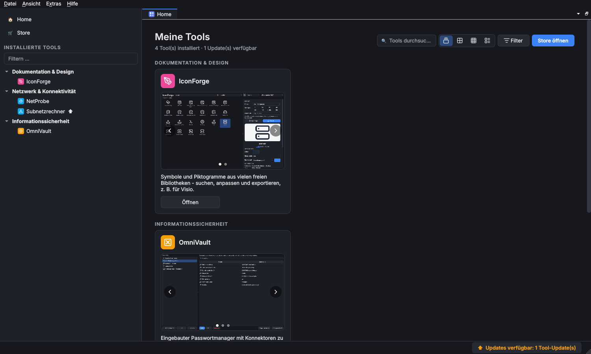
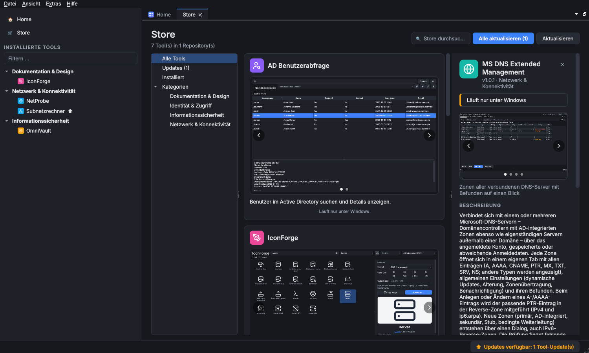
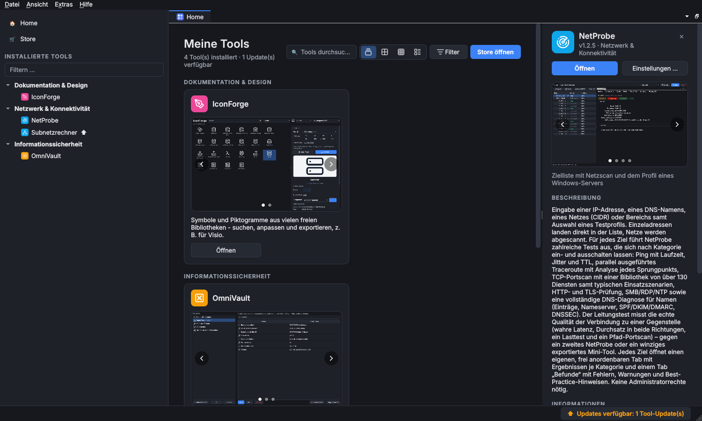
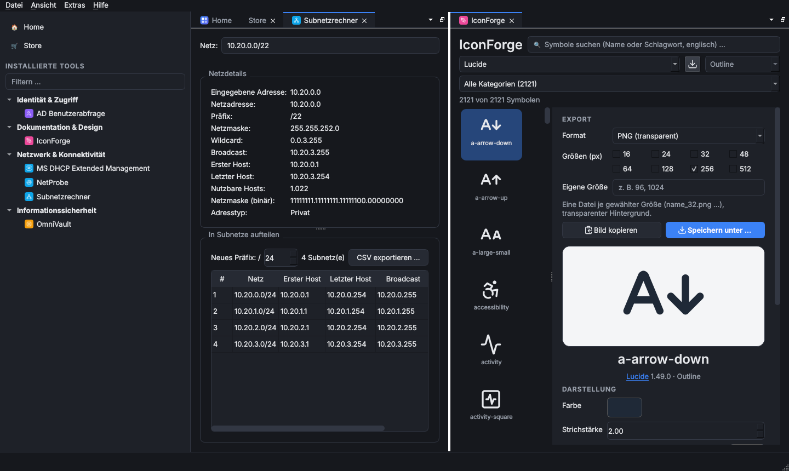
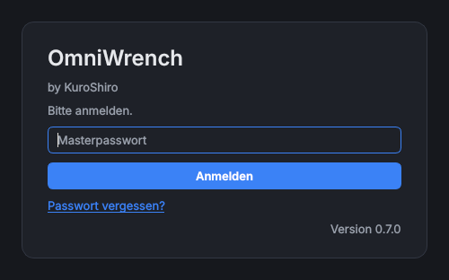

<h1 align="center">OmniWrench</h1>

<p align="center">
  <em>Das Universalwerkzeug für Administratoren – von <strong>KuroShiro</strong>.</em>
</p>

<p align="center">
  <a href="https://github.com/KuroShiroMe/OmniWrench/releases/latest"></a>
  
  <a href="LICENSE"></a>
  <a href="https://github.com/KuroShiroMe/OmniWrench/wiki"></a>
</p>

<p align="center">
  
</p>

Jeder Admin kennt das: ein Ordner voller Skripte, fünf Konsolen, drei Passwortlisten und für jede Aufgabe ein
anderes Werkzeug. **OmniWrench** bringt das alles in ein Programm. Es ist ein Werkzeugkasten, der genau die Tools
enthält, die gebraucht werden: aus einem Store installiert, in Tabs nebeneinander geöffnet und mit einem gemeinsamen,
verschlüsselten Tresor für alle Zugangsdaten.

## Was OmniWrench ausmacht

### Tools wie aus dem App-Store

Im **Store** stellt sich jedes Tool auf einer schlanken Karte vor: Symbol, Name, durchblätterbare Screenshots seiner
Funktionen und eine kurze Beschreibung. Ein Klick auf die Karte zeigt rechts alle Angaben. Ein Klick installiert ein
Tool **samt seiner Voraussetzungen**: RSAT-Funktionen, PowerShell-Module, winget- und Python-Pakete richtet
OmniWrench selbst ein, bei Bedarf mit einer einzigen Abfrage der Benutzerkontensteuerung. Neue Versionen erkennt der
Store von allein und spielt sie auf Wunsch gleich beim Start ein. Neben dem offiziellen Store lassen sich weitere
Repositories einbinden, etwa mit eigenen Tools für das eigene Team.

<p align="center">
  
</p>

### Alles im Blick auf der Startseite

Die **Startseite** zeigt die installierten Tools nach Service-Bereichen geordnet (Netzwerk, Identität,
Sicherheit …), mit Suche und Filter, wahlweise als Karten mit Screenshots wie im Store, als große oder kleine Symbole
oder als Liste mit Details. Ein Klick öffnet die Detailleiste mit Screenshots, Beschreibung, Version und Link zur
Anleitung, ein Doppelklick startet das Tool. Die Seitenleiste (`Strg+B`) führt alle Tools im Kategoriebaum, ein
Rechtsklick bietet Einstellungen, Aktualisieren, Voraussetzungen prüfen, Reparieren und Deinstallieren.

<p align="center">
  
</p>

### Eine Arbeitsfläche nach Maß

Jedes Tool öffnet sich in einem eigenen **Tab**. Tabs lassen sich per Drag & Drop nebeneinander oder übereinander
anordnen, auf einen zweiten Bildschirm ausklinken und mehrfach öffnen, etwa zwei Netzwerktests gleichzeitig.
Beim Beenden merkt sich OmniWrench das Layout und stellt es beim nächsten Start wieder her.

<p align="center">
  
</p>

### Ein Tresor für alle Zugangsdaten

Passwörter liegen nie im Klartext auf der Platte. Der **Tresor** ist mit einem Masterpasswort (Argon2id und
AES-256-GCM) und/oder unter Windows mit einem Benutzerzertifikat bzw. einer Smartcard geschützt. Der eingebaute
**Passwortmanager** hält Zugangsdaten bereit, die jedes Tool über die Schlüssel-Schaltfläche übernimmt; gespeichert
wird nur ein Verweis, das Passwort wird erst beim Gebrauch abgerufen. Mit dem Tool OmniVault kommen bei Bedarf
externe Passwortmanager wie KeePass, Bitwarden oder 1Password dazu. `Strg+L` sperrt OmniWrench sofort, auf Wunsch
auch automatisch nach einer Weile ohne Eingabe.

<p align="center">
  
  &nbsp;
  
</p>

### Und außerdem

* **Immer aktuell:** Das Programm meldet neue Versionen und aktualisiert sich selbst, passend zur Installationsart.
  Einstellungen, Tresor und Tools bleiben dabei erhalten.
* **In 23 Sprachen:** Deutsch, Englisch, Französisch, Spanisch, Italienisch, Niederländisch, Polnisch,
  Portugiesisch, Tschechisch, Schwedisch, Türkisch, Ukrainisch und, für den Feierabend, Dialekte von Badisch bis
  Wienerisch. Tools übernehmen die Sprache des Programms.
* **Durchdachte Einstellungen:** Jedes Tool bringt seinen eigenen Einstellungsdialog mit, inklusive Zugangsdaten
  aus dem Tresor. Oberfläche hell oder dunkel und frei skalierbar, auch auf 4K-Bildschirmen.
* **Zurückhaltend im Netz:** OmniWrench fragt nur den Tool-Store und die Release-Liste auf GitHub ab, und die
  Update-Prüfung lässt sich abschalten. Verbindungen zu Active Directory, DHCP-Servern oder Passwortmanagern
  stellen nur die Tools her, die installiert und eingerichtet wurden.

> Welche Tools es gibt und was sie im Einzelnen können, steht im [Wiki](https://github.com/KuroShiroMe/OmniWrench/wiki).

## Installation

Alle Pakete gibt es unter [Releases](https://github.com/KuroShiroMe/OmniWrench/releases/latest). Python muss nicht
installiert sein, alles Nötige ist enthalten. Systemvoraussetzung: Windows 10/11 (64 Bit, Clients; Windows Server
wird nicht unterstützt) oder Linux x86_64 mit glibc 2.35 oder neuer (z. B. Ubuntu 22.04, Debian 12).

| System | Installationsprogramm (empfohlen) | Portable Version (ohne Installation) |
|---|---|---|
| Windows 10/11 | `OmniWrench-X.Y.Z-win64-setup.exe` | `OmniWrench-X.Y.Z-win64.zip` |
| Linux | `omniwrench_X.Y.Z_amd64.deb` (Debian, Ubuntu, Mint …) | `OmniWrench-X.Y.Z-linux-x86_64.tar.gz` |

### Windows

1. `OmniWrench-X.Y.Z-win64-setup.exe` herunterladen und ausführen, die Abfrage der Benutzerkontensteuerung
   bestätigen. OmniWrench landet in `C:\Program Files\KuroShiro\OmniWrench`, mit Startmenü-Eintrag, optionaler
   Desktop-Verknüpfung und Deinstallation unter *Einstellungen › Apps*.
2. Beim ersten Start den Tresor einrichten: Masterpasswort festlegen und/oder ein Zertifikat bzw. eine Smartcard
   wählen.
3. Im Store die gewünschten Tools installieren.

Die Programmdateien sind noch nicht signiert. Windows SmartScreen kann deshalb beim ersten Start warnen;
*Weitere Informationen › Trotzdem ausführen* startet das Setup.

**Softwareverteilung** (Intune, SCCM …), stille Installation und Deinstallation:

```bat
OmniWrench-X.Y.Z-win64-setup.exe /VERYSILENT /SUPPRESSMSGBOXES /NORESTART
"C:\Program Files\KuroShiro\OmniWrench\unins000.exe" /VERYSILENT /SUPPRESSMSGBOXES /NORESTART
```

Eine Desktop-Verknüpfung legt die Installation mit dem zusätzlichen Schalter `/TASKS="desktopicon"` an.

**Portabel:** ZIP entpacken (z. B. nach `C:\Tools`) und `OmniWrench\OmniWrench.exe` starten.

### Linux

```bash
sudo apt install ./omniwrench_X.Y.Z_amd64.deb
```

Das Paket installiert OmniWrench nach `/opt/omniwrench` mit allen nötigen Systembibliotheken, dem Befehl
`omniwrench` und einem Eintrag im Anwendungsmenü. Entfernen mit `sudo apt remove omniwrench`.

**Portabel:** `tar -xzf OmniWrench-X.Y.Z-linux-x86_64.tar.gz` und `OmniWrench/OmniWrench` starten. Dafür werden die
Qt-Systembibliotheken gebraucht, unter Debian/Ubuntu `sudo apt install libegl1 libxkbcommon-x11-0 libxcb-cursor0`.

Unter Linux laufen die Tools, die Linux unterstützen; der Store kennzeichnet die übrigen mit „Läuft nur unter
Windows“. Die Anmeldung per Zertifikat oder Smartcard gibt es nur unter Windows.

### Updates und Daten

OmniWrench meldet neue Versionen beim Start und unter *Extras › Nach Updates suchen* und installiert sie mit einem
Klick. Einstellungen, Tresor und installierte Tools liegen getrennt vom Programm im Benutzerprofil und bleiben bei
Updates und bei der Deinstallation erhalten:

| System | Einstellungen und Tresor | Tools, Tool-Daten, Logs |
|---|---|---|
| Windows | `%APPDATA%\KuroShiro\OmniWrench` | `%LOCALAPPDATA%\KuroShiro\OmniWrench` |
| Linux | `~/.config/KuroShiro/OmniWrench` | `~/.local/share/KuroShiro/OmniWrench` |

Für einen USB-Stick neben dem Programm einen Ordner `portable-data` anlegen: Dann bleiben alle Daten dort.
Die ausführliche Anleitung steht im Wiki unter [Installation](https://github.com/KuroShiroMe/OmniWrench/wiki/Installation).

## Dokumentation

Bedienung, Einstellungen, Tresor, alle Tools im Detail und die Anleitung für eigene Tools:
**[OmniWrench-Wiki](https://github.com/KuroShiroMe/OmniWrench/wiki)**.
Fehler und Wünsche bitte als [Issue](https://github.com/KuroShiroMe/OmniWrench/issues) melden.

## Lizenz

OmniWrench steht unter der [MIT-Lizenz](LICENSE). Mitgelieferte Bibliotheken behalten ihre eigenen Lizenzen
(u. a. PySide6/Qt: LGPL, Lucide-Symbole: ISC).
