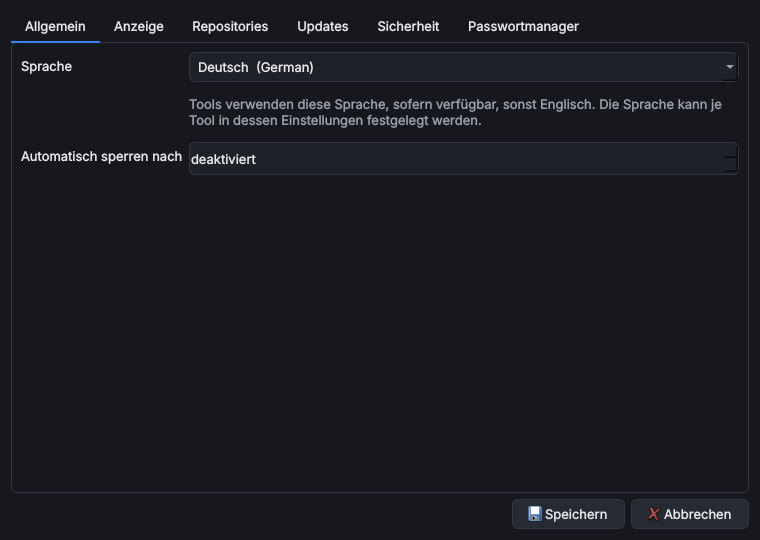

# Einstellungen

> **Kurz:** *Extras › Einstellungen …* (`Strg+,`) enthält alle Programmeinstellungen in neun Reitern.
> Jedes Tool hat zusätzlich eigene Einstellungen (Rechtsklick › *Einstellungen …*).

**Gilt für:** Hauptprogramm ab Version 0.7.0 (KI-Reiter ab 0.9.0) · Windows und Linux

## Inhalt
- [Allgemein](#allgemein)
- [Anzeige](#anzeige)
- [Repositories](#repositories)
- [Updates](#updates)
- [Sicherheit](#sicherheit)
- [Passwortmanager](#passwortmanager)
- [KI-Assistenten](#ki-assistenten)
- [KI-Datenablage](#ki-datenablage)
- [KI-Zugriff](#ki-zugriff)
- [Einstellungen eines Tools](#einstellungen-eines-tools)

## Allgemein

| Einstellung | Standard | Bedeutung |
|---|---|---|
| Sprache | Systemsprache, sonst Englisch | Sprache des Hauptprogramms. Dialekte stehen eingerückt unter ihrer Hauptsprache. Wirkt sofort, ohne neue Anmeldung. Siehe [Sprachen](Sprachen). |
| Automatisch sperren nach | deaktiviert (0) | Sperrt OmniWrench nach so vielen Minuten ohne Bedienung (1–600 min). Danach ist eine neue Anmeldung nötig. |

## Anzeige

| Einstellung | Standard | Bedeutung |
|---|---|---|
| Farbschema | Dunkel | Dunkel oder Hell |
| Skalierung | Windows-Einstellung (100 %) | Vergrößert oder verkleinert Schrift, Symbole und Abstände zusätzlich zur Anzeigeskalierung des Systems (75–300 %). Wird nach einem Neustart wirksam; OmniWrench bietet den Neustart sofort an. |
| Geöffnete Tabs und Anordnung beim Start wiederherstellen | an | Speichert beim Beenden die offenen Tabs und ihr Layout |

Die Skalierung hilft z. B. auf 4K-/8K-Monitoren oder bei Präsentationen am Beamer.

## Repositories

Liste der Tool-Quellen für den Store, mit den Spalten **Aktiv**, **Name** und **URL**.
**Hinzufügen** legt eine Zeile an, **Entfernen** löscht die markierte. Erlaubt sind `https://`-Adressen und
lokale Pfade. Mehr dazu unter [Store und Tools › Repositories](Store-und-Tools#repositories).

## Updates

| Einstellung | Standard | Bedeutung |
|---|---|---|
| GitHub-Repository (Hauptprogramm) | `KuroShiroMe/OmniWrench` | Woher Programm-Updates kommen. Nur ändern, wenn eine eigene Ausgabe (Fork) verteilt wird. |
| Beim Start nach Updates suchen (Programm und Tools) | an | Prüft beim Start Releases und Store-Kataloge |
| Vorabversionen berücksichtigen | aus | Bietet auch Beta-Versionen des Hauptprogramms an |
| Tools automatisch im Hintergrund aktualisieren | aus | Installiert Tool-Updates beim Start ohne Rückfrage (geöffnete Tools und Updates mit neuen Voraussetzungen ausgenommen) |
| Update-Fenster nach Abschluss automatisch schließen | aus | Derselbe Haken wie im Fortschrittsfenster |
| Tool-Updates: Alle aktualisieren (n) | – | Installiert sofort alle verfügbaren Tool-Updates |
| GitHub-Token | leer | Optional, für private Repositories und ein höheres API-Limit. Verschlüsselt im Tresor. |

## Sicherheit

Anmeldemethoden für den Tresor:

- **Masterpasswort setzen/ändern …** (mindestens 8 Zeichen)
- **Zertifikat hinzufügen …** (nur Windows): RSA-Zertifikat mit privatem Schlüssel aus dem Benutzerspeicher,
  z. B. von einer Smartcard
- Eine Methode lässt sich entfernen, solange mindestens eine übrig bleibt.

Hintergründe: [Tresor und Anmeldung](Tresor-und-Anmeldung).

## Passwortmanager

Der eingebaute Passwortmanager als eigener Reiter, identisch mit *Extras › Passwortmanager*.
Siehe [Passwortmanager](Passwortmanager).

## KI-Assistenten

Verbundene Assistenten (ChatGPT, Claude, Gemini, Copilot, lokale Modelle, Firmen-Bots): **Hinzufügen**,
**Bearbeiten**, **★ Hauptassistent**, Reihenfolge, **Entfernen**. Änderungen auf diesem Reiter gelten sofort.
Darunter:

| Einstellung | Standard | Bedeutung |
|---|---|---|
| „Assistent fragen …“ verwendet | den Hauptassistenten (★) | Oder den gerade in der Chatleiste gewählten Assistenten, oder jedes Mal nachfragen |

Siehe [KI-Assistenten](KI-Assistenten).

## KI-Datenablage

| Einstellung | Standard | Bedeutung |
|---|---|---|
| Ablage | Eigene Dateien (Dokumente, Bilder, Musik, Videos) | Oder ein zentraler Speicherort, oder je Datenart ein eigener Ordner |
| Ordner | je nach Ablage | Für „zentral“ ein Ordner, für „je Datenart“ eine Tabelle mit **Ordner wählen** / **Ordner öffnen** |
| Chats, Projekte und Transkripte verschlüsseln | an | Nur OmniWrench mit diesem Tresor kann sie öffnen; Medien und Dokumente bleiben unverschlüsselt |

Wird mit **Speichern** übernommen; vorhandene Daten werden auf Wunsch verschoben bzw. umgewandelt. Siehe
[KI-Assistenten › KI-Datenablage](KI-Assistenten#ki-datenablage).

## KI-Zugriff

Stufe (Nichts, Beschreibung, Übersicht, Lesen, Lesen und Ändern mit Bestätigung), Verfremdung mit Arten und
Vorschau, **Ausnahmen je Assistent …**. Standard: Beschreibung, Verfremdung an. Jedes Tool hat denselben Reiter in
seinen Einstellungen (Standard „Wie im Hauptprogramm“). Siehe [KI-Zugriff und Verfremdung](KI-Zugriff-und-Verfremdung).

## Einstellungen eines Tools

Rechtsklick auf ein Tool › **Einstellungen …** (oder der Knopf in der Detailleiste). Der Dialog wird aus der
Beschreibung des Tools erzeugt und ist je Tool verschieden. Was ein Tool anbietet, steht auf seiner
Wiki-Seite unter „Einstellungen“.

Immer vorhanden ist oben das Feld **Sprache**: *Automatisch* übernimmt die Programmsprache, sofern das Tool sie
mitbringt, sonst Englisch. Alternativ lässt sich eine feste Sprache wählen, z. B. Englisch, wenn eine
Übersetzung lückenhaft ist. Nach einer Änderung werden offene Tabs des Tools neu aufgebaut.

Ab Version 0.9.0 hat jeder Tool-Dialog zusätzlich den Reiter **KI-Zugriff** (siehe
[KI-Zugriff und Verfremdung](KI-Zugriff-und-Verfremdung#wo-man-sie-einstellt)).

Feldarten im Tool-Dialog:

| Feld | Darstellung | Gespeichert |
|---|---|---|
| Text, Zahl, Ja/Nein, Auswahl | Eingabefeld, Zahlenfeld, Haken, Liste | Einstellungsdatei |
| Datei, Ordner | Feld mit **Durchsuchen …** | Einstellungsdatei |
| Zertifikat | Auswahl aus dem persönlichen Zertifikatspeicher | Einstellungsdatei (nur Fingerabdruck) |
| Geheimnis (Passwort, Token, API-Schlüssel) | verdecktes Feld | **verschlüsselt im Tresor** |
| Zugangsdaten | Auswahlliste mit 🔑 (aus Passwortmanager), + (manuell), 🗑 (entfernen) | **verschlüsselt im Tresor** |

Pflichtfelder sind markiert; ohne sie lässt sich der Dialog nicht speichern. Einstellungen mit mehreren Gruppen
erscheinen in Reitern.

Nach dem Zurücksetzen des Masterpassworts tragen geleerte Geheimnisse ein ❗ und den Hinweis
„Nach dem Zurücksetzen neu eingeben“.

## Siehe auch
- [Tresor und Anmeldung](Tresor-und-Anmeldung)
- [Datenablage und Datenschutz](Datenablage-und-Datenschutz)
