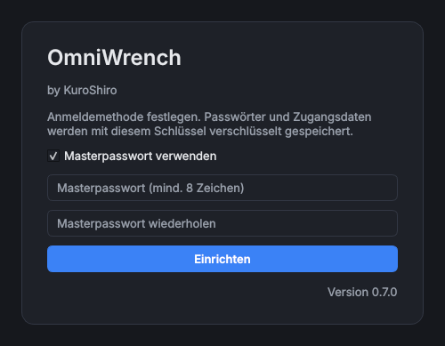

# Erste Schritte

> **Kurz:** Beim ersten Start legt OmniWrench einen verschlüsselten Tresor an (Masterpasswort und/oder
> Smartcard). Danach im **Store** ein Tool installieren und per Doppelklick öffnen.

**Gilt für:** Hauptprogramm ab Version 0.7.0 · Windows und Linux

## 1. Tresor einrichten

Beim allerersten Start erscheint das Fenster **Einrichtung**. Hier wird festgelegt, womit OmniWrench künftig
geöffnet wird. Mit diesem Schlüssel werden alle Passwörter, Tokens und Zugangsdaten verschlüsselt.

- **Masterpasswort verwenden:** mindestens 8 Zeichen, zweimal eingeben.
- **Benutzerzertifikat verwenden (z. B. Smartcard)** (nur Windows): ein Zertifikat mit privatem Schlüssel aus
  dem persönlichen Zertifikatspeicher wählen. Reine Signaturzertifikate (z. B. Intune-Gerätezertifikate) werden
  nicht angeboten, weil sie nicht entschlüsseln können.
- Sind **beide** Methoden aktiviert, öffnet jede von beiden den Tresor. Das ist die empfohlene Kombination für
  Smartcard-Nutzer: Geht die Karte verloren, hilft das Passwort.

Mit **Einrichten** wird der Tresor erstellt. Details zur Verschlüsselung: [Tresor und Anmeldung](Tresor-und-Anmeldung).

> **Wichtig:** Das Masterpasswort lässt sich nicht wiederherstellen. Bei Verlust kann der Tresor zurückgesetzt
> werden; dabei gehen alle gespeicherten Passwörter verloren, die Einträge selbst bleiben erhalten
> (siehe [Passwort vergessen](Tresor-und-Anmeldung#passwort-vergessen)).

## 2. Das Hauptfenster

Nach der Anmeldung öffnet sich das Hauptfenster mit dem Tab **Home**. Solange noch kein Tool installiert ist,
steht dort „Noch keine Tools installiert“ mit dem Knopf **Store öffnen**.

Aufbau des Fensters: [Bedienung](Bedienung).

## 3. Erstes Tool installieren

1. **Store öffnen** (Knopf auf Home oder `Strg+Umschalt+S`).
2. Ein Tool wählen, z. B. den [Subnetzrechner](Tool-Subnetzrechner). Die Karte zeigt Beschreibung,
   Version, Tags und Voraussetzungen.
3. **Installieren** klicken. Braucht das Tool Voraussetzungen (z. B. RSAT), listet OmniWrench sie vorher auf
   und installiert sie nach Bestätigung mit. Für Windows-Funktionen erscheint eine UAC-Abfrage.
4. Ein Fenster zeigt den Fortschritt. Mit dem Haken „Dieses Fenster nach Abschluss schließen“ verschwindet es
   künftig von selbst.

Das Tool erscheint danach als Kachel auf Home und in der Seitenleiste.

## 4. Tool öffnen und einstellen

- **Doppelklick** auf die Kachel öffnet das Tool in einem eigenen Tab.
- **Einfacher Klick** zeigt rechts die Details (Version, Kategorie, Tags, Voraussetzungen, Link zur Wiki-Seite).
- **Rechtsklick › Einstellungen …** öffnet die Einstellungen des Tools, z. B. Server, Zugangsdaten,
  Export-Ordner oder die Sprache des Tools.

## 5. Zugangsdaten hinterlegen

Viele Tools brauchen Anmeldedaten (AD, DHCP-Server, Passwortmanager). Diese einmal im
[Passwortmanager](Passwortmanager) anlegen (*Extras › Passwortmanager*, `Strg+Umschalt+P`) und dann in jedem
Tool über den Schlüssel-Knopf 🔑 auswählen.

## 6. Sperren und Beenden

- `Strg+L` sperrt OmniWrench sofort. Optional sperrt es sich nach einer einstellbaren Zeit selbst
  (*Einstellungen › Allgemein › Automatisch sperren nach*).
- Beim Beenden werden die geöffneten Tabs und ihre Anordnung gespeichert und beim nächsten Start wiederhergestellt.

## Wie geht es weiter?
- [Bedienung](Bedienung): alles über Home, Seitenleiste und Tabs
- [Einstellungen](Einstellungen): Sprache, Farbschema, Skalierung, Updates
- [Tools](Tools): alle verfügbaren Tools im Überblick
