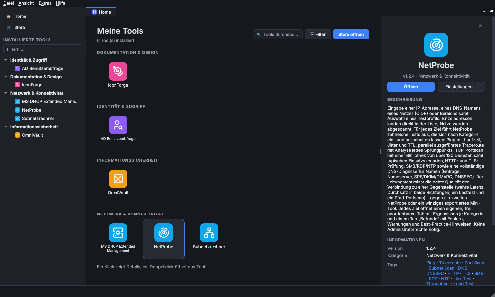

# OmniWrench

**Das Universalwerkzeug für Administratoren, von KuroShiro.**

OmniWrench bündelt die kleinen und großen Werkzeuge, die im IT-Alltag gebraucht werden, in einem einzigen
Programm. Statt für jede Aufgabe ein eigenes Skript, eine eigene Konsole und eigene Zugangsdaten zu pflegen,
installiert man die benötigten **Tools wie aus einem App-Store**: OmniWrench lädt sie aus GitHub-Repositories,
richtet ihre Voraussetzungen (RSAT, PowerShell-Module, winget- und Python-Pakete) selbst ein und hält sie aktuell.

Jedes Tool öffnet sich in einem eigenen Tab. Tabs lassen sich nebeneinander anordnen, stapeln oder als eigenes
Fenster ausklinken, und das Layout bleibt beim nächsten Start erhalten. Zugangsdaten liegen verschlüsselt in
einem Tresor, der mit Masterpasswort oder Smartcard geöffnet wird. Jedes Tool kann sie nutzen, ohne dass ein
Passwort je im Klartext gespeichert wird.

Seit Version 0.9.0 helfen **KI-Assistenten** mit: ChatGPT, Claude, Gemini, Copilot, lokale Modelle oder ein
Firmen-Bot beantworten Fragen zu OmniWrench und zu den Daten der Tools – nur so viel, wie man ihnen erlaubt, und
mit verfremdeten Adressen und Namen.

OmniWrench läuft unter **Windows 10/11** und **Linux** und spricht 23 Sprachen und Dialekte.

## Schnellstart

1. [Installation](Installation): Installationsprogramm oder portable Version herunterladen.
2. [Erste Schritte](Erste-Schritte): Tresor einrichten, erstes Tool aus dem Store installieren.
3. Tools über die [Startseite und Seitenleiste](Bedienung) öffnen.

## Das Hauptprogramm

| Seite | Inhalt |
|---|---|
| [Installation](Installation) | Windows (Setup, stille Installation, portabel), Linux (.deb, tar.gz), Updates, Deinstallation |
| [Erste Schritte](Erste-Schritte) | Erster Start, Tresor einrichten, erstes Tool installieren |
| [Bedienung](Bedienung) | Startseite, Seitenleiste, Tabs, Menüs, Tastenkürzel |
| [Store und Tools](Store-und-Tools) | Tools installieren, aktualisieren, reparieren, deinstallieren; Voraussetzungen; Repositories |
| [Einstellungen](Einstellungen) | Alle Programmeinstellungen und die Einstellungen je Tool |
| [Tresor und Anmeldung](Tresor-und-Anmeldung) | Masterpasswort, Zertifikat/Smartcard, automatisches Sperren, Passwort vergessen |
| [Passwortmanager](Passwortmanager) | Eingebauter Passwortmanager, Zugangsdaten in Tools, externe Manager |
| [KI-Assistenten](KI-Assistenten) | Assistenten verbinden, Chatleiste, Projekte, „Assistent fragen …“, KI-Datenablage |
| [KI-Zugriff und Verfremdung](KI-Zugriff-und-Verfremdung) | Was Assistenten sehen und ändern dürfen, Verfremdung von Adressen und Namen |
| [Sprachen](Sprachen) | Programmsprache, Dialekte, Sprache je Tool |
| [Datenablage und Datenschutz](Datenablage-und-Datenschutz) | Wo welche Daten liegen, portable Daten, Netzwerkzugriffe |
| [Fehlerbehebung](Fehlerbehebung) | Protokolle, häufige Probleme, Hilfe holen |

## Tools

Eine Übersicht aller Tools mit Plattformen und Voraussetzungen steht auf der Seite [Tools](Tools).

| Tool | Zweck |
|---|---|
| [Subnetzrechner](Tool-Subnetzrechner) | IPv4/IPv6-Netze berechnen und in Subnetze aufteilen |
| [AD Benutzerabfrage](Tool-AD-Benutzerabfrage) | Benutzer im Active Directory suchen, Status und Gruppen anzeigen |
| [OmniVault](Tool-OmniVault) | Passwortmanager-Konnektoren: KeePass, Bitwarden, 1Password, HashiCorp Vault u. a. |
| [IconForge](Tool-IconForge) | Über 100.000 freie Symbole suchen, anpassen und exportieren |
| [NetProbe](Tool-NetProbe) | Netzwerk-Testtool: Ping, Traceroute, Portscan, TLS, DNS, Leitungstest |
| [MS DHCP Extended Management](Tool-MS-DHCP-Extended-Management) | Microsoft-DHCP-Server verwalten und prüfen |
| [MS DNS Extended Management](Tool-MS-DNS-Extended-Management) | Microsoft-DNS-Server verwalten und prüfen |
| [Clank – KI-Studio](Tool-Clank-KI-Studio) | KI-Arbeitsplatz: Chat mit Arbeitsbereich, Bilder, Musik, Video, Gruppenchat, MCP, Mitschrift, Sprachassistent |

## Eigene Tools entwickeln

Der [Entwicklerbereich](Entwicklung) erklärt, wie eigene Tools entstehen, wie ein eigenes Tool-Repository
aufgebaut wird (mit fertiger [Vorlage](Entwicklung-Vorlagen-Repository)) und wie es in OmniWrench eingebunden wird.

## Über dieses Wiki

Die Seiten werden im Repository unter [`wiki/`](https://github.com/KuroShiroMe/OmniWrench/tree/main/wiki)
gepflegt und automatisch hierher übertragen. Änderungen bitte dort per Pull Request, nicht im Wiki-Editor:
Er würde beim nächsten Abgleich überschrieben. Aufbau und Vorlagen: [Wiki-Seiten schreiben](Entwicklung-Wiki-Seiten).
