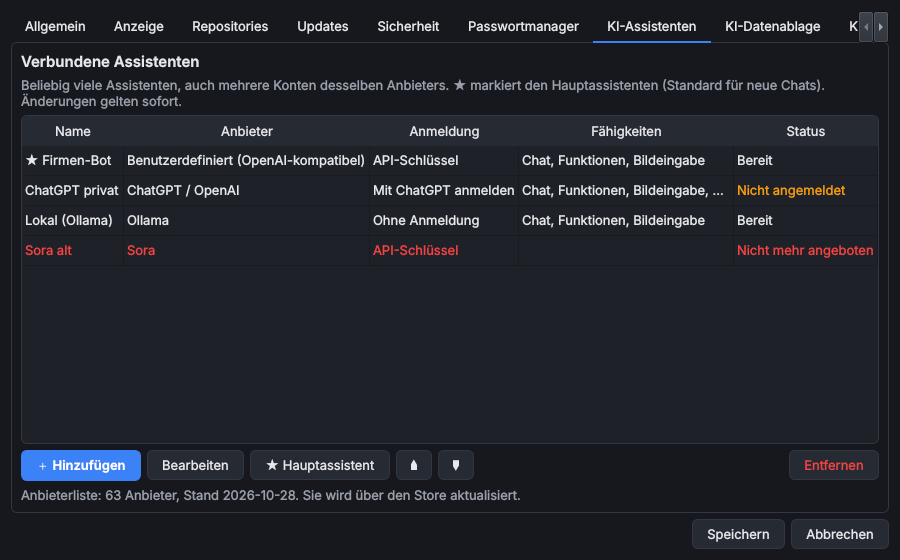
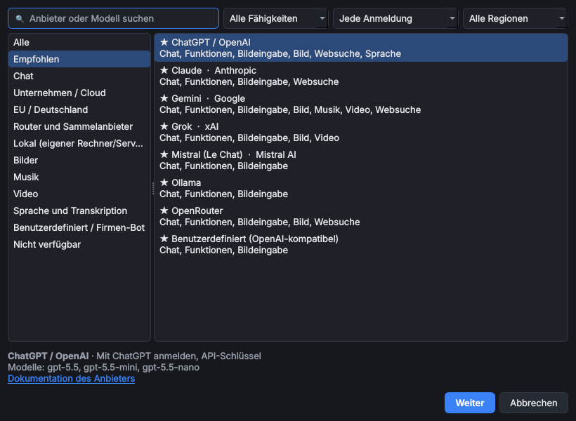
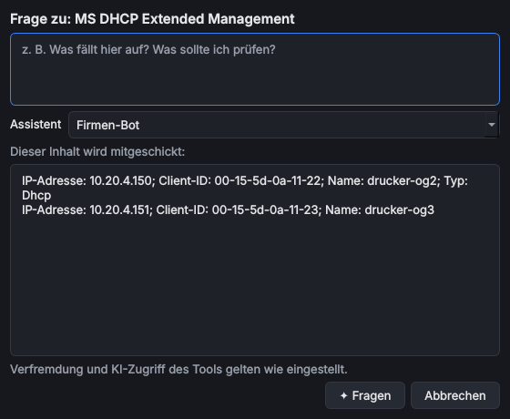

# KI-Assistenten

> **Kurz:** OmniWrench verbindet sich mit beliebig vielen KI-Assistenten – ChatGPT, Claude, Gemini, Copilot,
> lokale Modelle oder ein Firmen-Bot. Gefragt wird über die Chatleiste am rechten Rand oder direkt aus den Tools
> („Assistent fragen …“). Was ein Assistent sehen darf, regelt der [KI-Zugriff](KI-Zugriff-und-Verfremdung).

**Gilt für:** Hauptprogramm ab Version 0.9.0

## Inhalt
- [Überblick](#überblick)
- [Assistenten verbinden](#assistenten-verbinden)
- [Anmeldearten](#anmeldearten)
- [Die Chatleiste](#die-chatleiste)
- [Projekte](#projekte)
- [Assistent fragen …](#assistent-fragen-)
- [Was Assistenten können](#was-assistenten-können)
- [KI-Datenablage](#ki-datenablage)
- [Anbieterliste und entfernte Anbieter](#anbieterliste-und-entfernte-anbieter)
- [Kosten](#kosten)
- [Fehlerbehebung](#fehlerbehebung)
- [Siehe auch](#siehe-auch)

## Überblick

| Teil | Wo | Wofür |
|---|---|---|
| **Verbindungen** | *Extras › Einstellungen › KI-Assistenten* | Assistenten hinzufügen, anmelden, Hauptassistent festlegen |
| **Chatleiste** | Knopf **✦ Assistent** oben rechts, *Ansicht*-Menü oder **Strg+Umschalt+A** | Fragen stellen, Chats und Projekte |
| **Assistent fragen …** | Rechtsklick in Tabellen der Tools | Ausgewählte Zeilen erklären oder prüfen lassen |
| **KI-Zugriff** | *Einstellungen › KI-Zugriff* und Einstellungen jedes Tools | Was Assistenten sehen und ändern dürfen, Verfremdung |
| **KI-Datenablage** | *Einstellungen › KI-Datenablage* | Wo Chats, Projekte, Bilder, Musik, Videos und Mitschriften liegen |
| **[Clank – KI-Studio](Tool-Clank-KI-Studio)** | Tool aus dem Store | Großer Arbeitsplatz: Arbeitsbereich mit Ordnern und Repositories, Bilder, Musik, Video, Gruppenchat, MCP, Mitschrift, Sprachassistent |

Ohne verbundenen Assistenten zeigt die Chatleiste einen Hinweis mit dem Knopf **Einstellungen öffnen**. Alles
andere im Programm funktioniert unverändert – die KI-Funktionen sind ein Angebot, keine Voraussetzung.

## Assistenten verbinden

1. *Extras › Einstellungen › KI-Assistenten* öffnen und **Hinzufügen** wählen.
2. Anbieter auswählen. Links stehen Kategorien (Empfohlen, Chat, Unternehmen / Cloud, EU / Deutschland, Router und
   Sammelanbieter, Lokal, Bilder, Musik, Video, Sprache und Transkription, Benutzerdefiniert). Oben lässt sich nach
   Anbieter oder Modell suchen und nach Fähigkeit, Anmeldeart und Region filtern.
3. **Weiter**: Name vergeben, anmelden (siehe [Anmeldearten](#anmeldearten)), Modell wählen (**Modelle laden**
   fragt die Liste beim Anbieter ab) und **Verbindung testen**.

Welcher Anbieter wofür taugt, was er kostet und welche Modelle es gibt, steht auf der Seite
[KI-Anbieter](KI-Anbieter). Bei Anbietern mit Platzhalter in der Adresse (z. B. `<ACCOUNT_ID>` bei Cloudflare)
muss dieser vor dem Speichern ersetzt werden.

Bei Anbietern, die Inhalte für Erwachsene erzeugen können (z. B. Grok, Venice, lokale Modelle), gibt es in der
Verbindung den Schalter **NSFW-Inhalte erlauben (ab 18)**; standardmäßig aus. Details:
[Inhalte für Erwachsene](KI-Anbieter#inhalte-für-erwachsene-nsfw).

| Spalte | Bedeutung |
|---|---|
| **Name** | Frei wählbar, z. B. „ChatGPT privat“ und „ChatGPT Firma“ – mehrere Konten desselben Anbieters sind möglich |
| **Anbieter**, **Anmeldung** | Dienst und Anmeldeart |
| **Fähigkeiten** | Chat, Funktionen (Tool-Aufrufe), Bildeingabe, Bild, Musik, Video, Sprache, Websuche |
| **Status** | Bereit, Nicht angemeldet (gelb), Nicht mehr angeboten (rot) |

- **★ Hauptassistent**: Standard für neue Chats und für „Assistent fragen …“. Über den gleichnamigen Knopf festlegen.
- Mit ▲/▼ wird die Reihenfolge in der Auswahl der Chatleiste festgelegt.
- **Entfernen** löscht die Verbindung und ihre Anmeldung; Chats bleiben erhalten.
- Änderungen auf dieser Seite gelten sofort (auch ohne **Speichern**).

## Anmeldearten

| Anmeldeart | So geht es | Wo liegt das Geheimnis |
|---|---|---|
| **API-Schlüssel** | Schlüssel beim Anbieter erstellen (Link **Schlüssel beim Anbieter erstellen**) und einfügen – oder **Aus Passwortmanager …** verknüpfen | Tresor bzw. externer Passwortmanager |
| **Mit ChatGPT anmelden** | **Im Browser anmelden**, mit dem ChatGPT-Konto bestätigen. Nutzt das Kontingent des ChatGPT-Abos | Tresor (Token, wird automatisch erneuert) |
| **Mit OpenRouter anmelden** | Anmeldung im Browser, OpenRouter stellt dabei einen Schlüssel aus | Tresor |
| **Microsoft-Konto (Entra ID)** | Für Microsoft 365 Copilot. Leere Felder nutzen Vorgaben (beliebiges Arbeitskonto, App „Microsoft Graph Command Line Tools“). Eventuell muss die IT die App einmalig freigeben | Tresor |
| **Eigenes OAuth** | Für Firmen-Bots: Client-ID, Autorisierungs-URL, Token-URL, Scopes, optional Client-Secret. Beim Identitätsanbieter die Weiterleitungs-URI `http://127.0.0.1/callback` (beliebiger Port) eintragen | Tresor |
| **Ohne Anmeldung** | Lokale Modelle (Ollama, LM Studio, llama.cpp, vLLM …): nur Adresse angeben | – |

Die Anmeldung im Browser läuft über eine kurzlebige Adresse auf `127.0.0.1` (PKCE); OmniWrench sieht dabei nie
das Kennwort.

> **Claude-Abos (Pro/Max)** dürfen laut Anthropic nicht in anderen Programmen genutzt werden. Für Claude bitte
> einen API-Schlüssel aus der Claude Console verwenden.

**Firmen-Bot / eigener Server:** „Benutzerdefiniert (OpenAI-kompatibel)“ oder „Benutzerdefiniert
(Anthropic-Format)“ wählen und die Adresse des Endpunkts (z. B. `https://bot.firma.example/v1`) angeben.

## Die Chatleiste

Die Chatleiste ist ein normales Dock-Fenster: Sie lässt sich verschieben, neben ein Tool legen oder als eigenes
Fenster ausklinken. **Strg+Umschalt+A** blendet sie ein und aus.

| Element | Funktion |
|---|---|
| Auswahl oben | Assistent für die nächste Nachricht. Lässt sich jederzeit wechseln, auch mitten im Chat |
| Modell (Knopf daneben) | Modell des Assistenten wählen: Liste direkt vom Anbieter, ★ empfohlen, Kurzbeschreibung je Modell. ⚠ in Rot: Modell gibt es beim Anbieter nicht (mehr). 🔞: NSFW erlaubt. Siehe [Modelle auswählen](KI-Anbieter#modelle-auswählen) |
| **＋** | Neuer Chat |
| **🕘** | Chatverlauf: suchen, öffnen, umbenennen, löschen, Ordner öffnen |
| **⋯** | Projekt bearbeiten, Ordner öffnen, Einstellungen der Assistenten |
| Projekt | Chats in einem Projekt teilen dessen Anweisungen (siehe [Projekte](#projekte)) |
| Kurz / Normal / Ausführlich | Detailgrad der Antworten |
| 📎 | Datei anhängen: Bilder (für Assistenten mit Bildeingabe) und Textdateien, höchstens 8 MB |
| Eingabe | **Enter** sendet, **Umschalt+Enter** neue Zeile; während der Antwort wird der Knopf zu **Anhalten** |

- Ruft der Assistent eine Funktion auf (z. B. „DHCP-Übersicht lesen“), erscheint ein kleiner Hinweis
  „Funktion …“ in der Antwort.
- Will er etwas **ändern**, fragt OmniWrench vorher nach und zeigt, was genau passieren soll. **Erlauben**,
  **Ablehnen**, auf Wunsch „Antwort für diese Sitzung merken“.
- Der Kopier-Knopf unter einer Antwort kopiert sie als Markdown.

## Projekte

Ein Projekt bündelt Chats zu einem Thema und gibt dem Assistenten **Anweisungen** mit, die in jedem Chat des
Projekts gelten – z. B. „Netzwerkumzug Standort Berlin: Antworten mit PowerShell-Beispielen.“

- Anlegen: Projektauswahl › **Neues Projekt …**; ändern: **⋯** › **Projekt bearbeiten …**.
- In [Clank](Tool-Clank-KI-Studio) bekommt jedes Projekt zusätzlich einen eigenen Arbeitsbereich (Ordner und
  Repositories).

## Assistent fragen …

In den Tabellen der Tools (z. B. Leases, Einträge, Befunde, Suchergebnisse) steht im Rechtsklickmenü
**Assistent fragen …**. Der Dialog zeigt, welcher Inhalt mitgeschickt wird (die ausgewählten Zeilen als
„Spalte: Wert“), nimmt eine Frage entgegen und startet damit einen neuen Chat. Leer gelassen lautet die Frage
„Bitte erklären Sie das und weisen Sie auf Auffälligkeiten hin.“

Welcher Assistent antwortet, steht unter *Einstellungen › KI-Assistenten*: der Hauptassistent (★), der gerade in der
Chatleiste gewählte oder jedes Mal nachfragen. Verfremdung und KI-Zugriff des Tools gelten auch hier.

## Was Assistenten können

Assistenten kennen OmniWrench: Sie durchsuchen dieses Wiki (es wird mit dem Programm ausgeliefert), sehen,
welche Tools installiert und geöffnet sind, und können – nach Bestätigung – Tools öffnen oder aus dem Store
installieren. Tools bieten eigene Funktionen an, z. B.:

| Tool | Lesend | Ändernd (immer mit Bestätigung) |
|---|---|---|
| [MS DHCP Extended Management](Tool-MS-DHCP-Extended-Management) | Status, Übersicht, Befunde, Scope mit Leases und Reservierungen, Client suchen, Failover, Server-Optionen | Reservierung anlegen / entfernen |
| [MS DNS Extended Management](Tool-MS-DNS-Extended-Management) | Status, Übersicht, Befunde, Einträge einer Zone, Suche, Server-Einstellungen | Eintrag anlegen / löschen |
| [NetProbe](Tool-NetProbe) | Ergebnisse und Befunde | Test starten (erzeugt Netzwerkverkehr) |
| [IconForge](Tool-IconForge) | Symbolpakete, Suche, Symbol anzeigen | – |
| [AD Benutzerabfrage](Tool-AD-Benutzerabfrage) | Suchergebnisse | – |
| [Clank – KI-Studio](Tool-Clank-KI-Studio) | Arbeitsbereich: Dateien auflisten, lesen, suchen, Git-Status und Änderungen | Datei ändern, Befehl ausführen |

Welche Funktionen ein Assistent tatsächlich bekommt, hängt von der Stufe im
[KI-Zugriff](KI-Zugriff-und-Verfremdung) ab (Standard: nur „Beschreibung“). Ändernde Funktionen verlangen
Stufe 4 und werden **immer** vorher bestätigt.

## KI-Datenablage

Alle KI-Daten liegen **lokal** in lesbaren Formaten. *Einstellungen › KI-Datenablage*:

| Ablage | Ordner |
|---|---|
| **Eigene Dateien** (Standard) | Chats, Projekte, Dokumente, Mitschriften in `Dokumente\OmniWrench\…`, Bilder in `Bilder\OmniWrench`, Musik in `Musik\OmniWrench`, Videos in `Videos\OmniWrench` |
| **Zentraler Speicherort** | Ein Ordner mit Unterordnern `Chats`, `Projects`, `Documents`, `Images`, `Music`, `Videos`, `Transcripts` |
| **Je Datenart ein eigener Ordner** | Jede Datenart einzeln wählbar (z. B. Bilder auf einem Netzlaufwerk) |

| Datenart | Format |
|---|---|
| Chats, Projekte, Mitschriften | JSON + Markdown, oder verschlüsselt (`.owai`) |
| Dokumente | Markdown (Export HTML, PDF, ODT) |
| Bilder, Musik, Videos | PNG/WebP, MP3/WAV, MP4 – jeweils mit einer `.json`-Datei (Beschreibung, Modell, Zeit) |

**Verschlüsseln** (Standard: an) gilt für Chats, Projekte und Mitschriften. Verschlüsselte Daten kann nur
OmniWrench mit diesem Tresor öffnen; andere Programme (Editor, Suche, Backup-Ansicht) können sie nicht mehr lesen,
und beim Zurücksetzen des Tresors gehen sie verloren. Beim Umschalten wandelt OmniWrench vorhandene Daten um.
Mediendateien werden nie verschlüsselt. Beim Wechsel des Ordners bietet OmniWrench an, vorhandene Daten zu
verschieben.

## Anbieterliste und entfernte Anbieter

Die Liste der Anbieter (derzeit 112, beschrieben auf [KI-Anbieter](KI-Anbieter)) wird mit dem Programm ausgeliefert und über den Store aktualisiert – neue
Modelle und Anbieter kommen so ohne Programm-Update. Anbieter, die einen Dienst einstellen, werden **nicht
gelöscht**: Sie bleiben sichtbar und sind **rot** markiert („Nicht mehr angeboten“), mit dem Datum der
Einstellung. Bestehende Verbindungen zu ihnen bleiben bestehen, damit Chats lesbar bleiben.

Einige Dienste haben keine öffentliche Schnittstelle für andere Programme (z. B. Midjourney, Suno, Udio); sie
stehen in der Kategorie „Nicht verfügbar“, damit klar ist, warum sie fehlen.

## Kosten

OmniWrench selbst kostet nichts. Abgerechnet wird beim Anbieter: Mit API-Schlüssel nach Verbrauch, mit
„Mit ChatGPT anmelden“ über das Kontingent des Abos, lokale Modelle kosten nur Rechenzeit. Bilder, Musik und
vor allem Videos sind deutlich teurer als Text; die Reiter in Clank weisen darauf hin.

Was man je Anmeldeart braucht, zeigt der Dialog **Assistent hinzufügen** in der Zeile **Voraussetzung**:

| Voraussetzung | Gilt für |
|---|---|
| ChatGPT Plus oder Pro (Free reicht nicht, Go nennt OpenAI derzeit nicht) | Mit ChatGPT anmelden |
| API-Konto mit Guthaben, nach Verbrauch; Chat-Abos (ChatGPT Plus, Claude Pro …) gelten nicht | API-Schlüssel der meisten Anbieter, z. B. OpenAI, Claude, xAI, DeepSeek, Bild-/Musik-/Videodienste |
| API-Konto mit kostenloser Stufe (Begrenzungen) | Gemini (Google AI Studio), Mistral, Groq, Cerebras, OpenRouter, Hugging Face, Cohere |
| Cloud-Abonnement mit freigeschaltetem Modell | Azure OpenAI, Bedrock, Vertex AI, watsonx und die Firmen-Clouds |
| Microsoft-365-Copilot-Lizenz und Freigabe durch die IT | Microsoft 365 Copilot |
| kostenlos, läuft lokal | Ollama, LM Studio, llama.cpp, vLLM und andere lokale Modelle |

Kostenlose Stufen ändern sich häufig, und bei manchen werden Eingaben zum Training genutzt (z. B. Google
außerhalb der EU, Mistral im „Experiment“-Tarif). Für Firmendaten besser ein bezahltes Konto oder ein lokales Modell
nehmen.

## Fehlerbehebung

| Problem | Ursache / Lösung |
|---|---|
| „Kein API-Schlüssel hinterlegt“ | Schlüssel unter *Einstellungen › KI-Assistenten › Bearbeiten* eintragen |
| „Die Anmeldung ist abgelaufen“ | **Neu anmelden** in der Verbindung |
| „Der Anbieter kennt das gewählte Modell nicht“ (z. B. Gemini: „… is not found for API version …“) | Modell veraltet. Oben im Chat über den Modellknopf ein verfügbares Modell wählen; Vorgaben aus dem Katalog tauscht OmniWrench von selbst aus |
| ChatGPT: Plan reicht nicht | „Mit ChatGPT anmelden“ braucht Plus oder Pro; sonst API-Schlüssel nutzen |
| „Anfragelimit erreicht“ / „Guthaben aufgebraucht“ | Beim Anbieter Kontingent prüfen; kurz warten |
| „Keine Verbindung zum Anbieter“ | Proxy/Firewall prüfen. Lokale Adressen (`localhost`, `127.x`) gehen nie über den Proxy |
| Anmeldung im Browser bleibt hängen | Browser-Fenster schließen, erneut versuchen; bei Entra ID die Freigabe der App durch die IT prüfen |
| Assistent nutzt keine Tool-Daten | KI-Zugriff steht auf „Beschreibung“ (Standard) – Stufe im Tool erhöhen, siehe [KI-Zugriff](KI-Zugriff-und-Verfremdung) |
| „Diese Daten lassen sich nicht öffnen“ | Mit einem anderen Tresor verschlüsselt oder beschädigt |

## Siehe auch
- [KI-Anbieter](KI-Anbieter) – alle Anbieter, Modelle, kostenlos testen, NSFW
- [KI-Zugriff und Verfremdung](KI-Zugriff-und-Verfremdung)
- [Clank – KI-Studio](Tool-Clank-KI-Studio)
- [Datenablage und Datenschutz](Datenablage-und-Datenschutz)
- [Tresor und Anmeldung](Tresor-und-Anmeldung)
