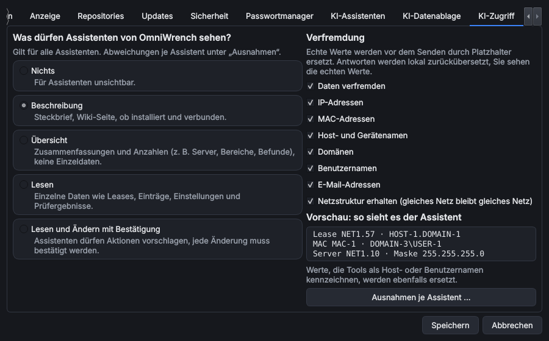

# KI-Zugriff und Verfremdung

> **Kurz:** Fünf Stufen legen fest, was [KI-Assistenten](KI-Assistenten) von OmniWrench und von jedem Tool
> sehen und ändern dürfen – für das Hauptprogramm, je Tool, je Assistent und bei DHCP/DNS sogar je Server.
> Die Verfremdung ersetzt Adressen und Namen vor dem Senden durch Platzhalter. Standard: Stufe „Beschreibung“,
> Verfremdung an.

**Gilt für:** Hauptprogramm ab Version 0.9.0

## Inhalt
- [Die Stufen](#die-stufen)
- [Wo man sie einstellt](#wo-man-sie-einstellt)
- [Vererbung und Ausnahmen](#vererbung-und-ausnahmen)
- [Verfremdung](#verfremdung)
- [Bestätigung von Änderungen](#bestätigung-von-änderungen)
- [Was nie an Assistenten geht](#was-nie-an-assistenten-geht)
- [Beispiele](#beispiele)
- [Siehe auch](#siehe-auch)

## Die Stufen

| Stufe | Name | Assistenten sehen … |
|---|---|---|
| 0 | **Nichts** | gar nichts – das Tool ist für Assistenten unsichtbar |
| 1 | **Beschreibung** (Standard) | Steckbrief und Wiki-Seite, ob das Tool installiert und verbunden ist |
| 2 | **Übersicht** | Zusammenfassungen und Anzahlen (z. B. Server, Bereiche, Befunde), keine Einzeldaten |
| 3 | **Lesen** | einzelne Daten wie Leases, Einträge, Einstellungen und Prüfergebnisse |
| 4 | **Lesen und Ändern mit Bestätigung** | dürfen zusätzlich Aktionen vorschlagen; jede Änderung muss bestätigt werden |

Jede Funktion eines Tools hat eine Mindeststufe. Ein Assistent bekommt nur die Funktionen angeboten, die die
eingestellte Stufe erlaubt – was darüber liegt, „kennt“ er gar nicht.

## Wo man sie einstellt

| Ebene | Ort |
|---|---|
| **Hauptprogramm** | *Extras › Einstellungen › KI-Zugriff* – gilt für alle Tools ohne eigene Einstellung und für die Programmfunktionen (Wiki, Tool-Liste, Tools öffnen/installieren) |
| **Je Tool** | Rechtsklick auf das Tool › *Einstellungen* › Reiter **KI-Zugriff**. Standard: „Wie im Hauptprogramm (…)“ |
| **Je Assistent** | **Ausnahmen je Assistent …** auf beiden Seiten, z. B. mehr für ein lokales Modell, weniger für einen Cloud-Dienst |
| **Je Server** | In [MS DHCP](Tool-MS-DHCP-Extended-Management#favoriten) und [MS DNS Extended Management](Tool-MS-DNS-Extended-Management#favoriten): Zeile **KI-Zugriff** auf der Anmeldeseite, gespeichert mit dem Favoriten |
| **Externe KI-Programme** | Ausnahme für „MCP-Server (externe KI-Programme)“, wenn [Gadgetron](Tool-Gadgetron) OmniWrench als MCP-Server anbietet |

## Vererbung und Ausnahmen

Gilt für ein Tool und einen Assistenten mehreres, gewinnt die genaueste Angabe:

1. Ausnahme für diesen Assistenten **im Tool**
2. Stufe des **Server-Favoriten** (DHCP/DNS, solange man angemeldet ist)
3. Stufe des **Tools**
4. Ausnahme für diesen Assistenten **im Hauptprogramm**
5. Stufe des **Hauptprogramms**

Die Verfremdung wird genauso vererbt: „Wie im Hauptprogramm (An)“ im Tool, „Verfremdung wie im Tool eingestellt“
im Favoriten.

## Verfremdung

Echte Werte werden **vor dem Senden** durch Platzhalter ersetzt und in der Antwort **lokal zurückübersetzt** –
man selbst sieht immer die echten Werte, der Anbieter nie.

| Art | Beispiel echt | Beispiel verfremdet |
|---|---|---|
| IP-Adressen (IPv4, IPv6) | `10.20.4.150`, `2001:db8::5` | `NET1.150`, `IP6-1` |
| MAC-Adressen | `00-15-5d-0a-11-22` | `MAC-1` |
| Host- und Gerätenamen | `dc01.corp.contoso.local` | `HOST-1.DOMAIN-1` |
| Domänen | `corp.contoso.local` | `DOMAIN-1` |
| Benutzernamen | `CONTOSO\j.becker` | `DOMAIN-2\USER-1` |
| E-Mail-Adressen | `j.becker@contoso.example` | `EMAIL-1` |

- **Netzstruktur erhalten** (Standard an): Adressen aus demselben /24-Netz bleiben im selben Platzhalter-Netz
  (`NET1.57`, `NET1.10`), damit Assistenten Netze, Bereiche und Gateways noch sinnvoll beurteilen können.
  Masken (`255.255.255.0`), Loopback, Dateinamen und bekannte öffentliche Domänen (z. B. `microsoft.com`)
  bleiben unverändert.
- Werte, die Tools als Host- oder Benutzernamen kennzeichnen (Felder für Host, Server oder Benutzer),
  werden auch dann ersetzt, wenn sie nicht wie ein Name aussehen.
- Die **Vorschau** auf der Seite zeigt, wie ein Beispiel beim Assistenten ankommt.
- Die Zuordnung Platzhalter ↔ echter Wert gilt je Chat und wird mit ihm gespeichert (verschlüsselt, wenn die
  [KI-Datenablage](KI-Assistenten#ki-datenablage) verschlüsselt ist).

**Ausnahmen:** Beschreibungen für Bilder, Musik und Videos gehen unverfremdet an den Anbieter (Platzhalter
ergeben in Bildern keinen Sinn) – die KI-Tools weisen darauf hin.

## Bestätigung von Änderungen

Funktionen der Stufe 4 laufen nie ohne Rückfrage. Der Dialog zeigt, was der Assistent tun will (bei Dateien
die Änderungen als Diff, bei Befehlen den Befehl mit Erklärung, bei DHCP/DNS die betroffenen Einträge).

- **Erlauben** / **Ablehnen**; „Antwort für diese Sitzung merken“ spart Rückfragen bei gleichartigen Aktionen.
- Geplante Läufe ([Orvus](Tool-Orvus)) führen ändernde Funktionen **nie** aus.
- Änderungen über den MCP-Server werden ebenfalls hier im Programm bestätigt.

## Was nie an Assistenten geht

- Kennwörter, Token und andere Geheimnisse aus dem Tresor oder Passwortmanager.
- Zugriffstoken für Repositories (Clank) – sie gehen nur an den Repository-Dienst.
- Daten von Tools mit Stufe 0 und alles, was über der eingestellten Stufe liegt.

## Beispiele

| Ziel | Einstellung |
|---|---|
| Cloud-Assistent darf DHCP-Befunde zusammenfassen, aber keine Einzeldaten sehen | DHCP-Tool: Stufe 2 (Übersicht) |
| Lokales Modell darf alles lesen und Reservierungen vorschlagen | DHCP-Tool: Ausnahme „Lokal (Ollama)“ = Stufe 4 |
| Testserver offen, Produktionsserver gesperrt | Favorit „Test“: KI-Zugriff 4; Favorit „Produktion“: KI-Zugriff 0 |
| Nur Wiki-Fragen, keine Tool-Daten | Hauptprogramm: Stufe 1 (Standard) |

## Siehe auch
- [KI-Assistenten](KI-Assistenten)
- [Clank – KI-Chat](Tool-Clank)
- [Datenablage und Datenschutz](Datenablage-und-Datenschutz)
