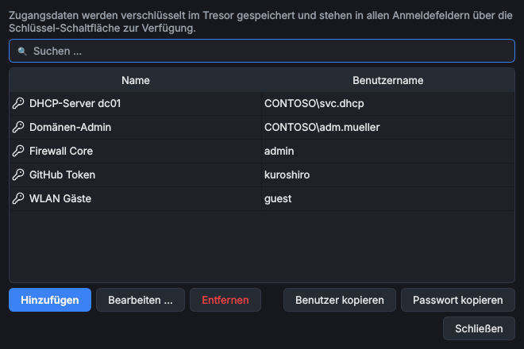

# Passwortmanager

> **Kurz:** Zugangsdaten einmal im eingebauten Passwortmanager anlegen und in jedem Tool per 🔑 auswählen.
> Mit dem Tool [OmniVault](Tool-OmniVault) kommen externe Manager dazu (KeePass, Bitwarden, 1Password …).

**Gilt für:** Hauptprogramm ab Version 0.7.0 · Windows und Linux

## Inhalt
- [Eingebauter Passwortmanager](#eingebauter-passwortmanager)
- [Zugangsdaten in Tools verwenden](#zugangsdaten-in-tools-verwenden)
- [Externe Passwortmanager](#externe-passwortmanager)
- [Grundregeln für Passwörter](#grundregeln-für-passwörter)

## Eingebauter Passwortmanager

*Extras › Passwortmanager* (`Strg+Umschalt+P`) oder *Einstellungen › Passwortmanager*.

| Aktion | Beschreibung |
|---|---|
| Suchen … | Volltextsuche über Name und Benutzername |
| Neu … | Eintrag mit Name (z. B. „Domänen-Admin Contoso“), Benutzername und Passwort anlegen |
| Passwort generieren | erzeugt ein starkes Zufallspasswort im Bearbeitungsdialog |
| Bearbeiten … / Doppelklick | Eintrag ändern |
| Benutzer kopieren / Passwort kopieren | in die Zwischenablage; das Passwort wird nach **30 Sekunden** automatisch gelöscht |
| Entfernen | Eintrag löschen (mit Rückfrage) |

Die Einträge liegen verschlüsselt im [Tresor](Tresor-und-Anmeldung). Einträge mit ❗ haben nach dem Zurücksetzen
des Masterpassworts kein Passwort mehr und müssen neu ergänzt werden.

## Zugangsdaten in Tools verwenden

Felder für Anmeldedaten (in Tool-Einstellungen oder direkt im Tool) bestehen aus einer Auswahlliste und Knöpfen:

| Knopf | Wirkung |
|---|---|
| 🔑 Aus Passwortmanager übernehmen | öffnet die Suche über alle verbundenen Passwortmanager und verknüpft den gewählten Eintrag |
| + Zugangsdaten manuell eingeben | Benutzername und Passwort direkt eingeben, optional „Auch im OmniWrench-Passwortmanager speichern“ |
| ✎ | manuellen Eintrag bearbeiten (z. B. fehlendes Passwort nach dem Zurücksetzen) |
| 🗑 Aus der Liste entfernen | entfernt den Eintrag aus diesem Feld (nicht aus dem Passwortmanager) |

Ein Feld kann **mehrere** Zugangsdaten enthalten, z. B. „Admin Domäne A“ und „Admin Domäne B“; gewählt wird
per Auswahlliste. Verknüpfte Einträge zeigen „Verknüpft mit: ‹Name›“, manuelle „Manuell hinterlegt“.

**Verknüpfen statt kopieren:** Bei Einträgen aus dem Passwortmanager speichert das Tool nur einen Verweis.
Ändert sich das Passwort im Manager, nutzt jedes Tool automatisch das neue.

## Externe Passwortmanager

Das Tool [OmniVault](Tool-OmniVault) bindet externe Manager an:

| Manager | Stand |
|---|---|
| KeePass / KeePassXC (.kdbx) | stabil |
| Microsoft SecretManagement (nur Windows) | stabil |
| Netwrix Password Secure (nur Windows) | Alpha |
| Bitwarden / Vaultwarden | Alpha |
| 1Password | Alpha |
| HashiCorp Vault / OpenBao | Alpha |

Danach durchsucht die Auswahl 🔑 alle verbundenen Manager gleichzeitig; die Spalte „Quelle“ zeigt, woher ein
Eintrag stammt. Braucht ein Manager neue Anmeldedaten (z. B. weil sich ein Passwort geändert hat), erscheint
ein Anmeldefenster statt einer Fehlermeldung.

## Grundregeln für Passwörter

- In Einstellungen werden aus externen Managern **nur Verweise** gespeichert, nie die Passwörter.
- Passwörter werden erst beim Gebrauch abgerufen, **einmal pro Sitzung**, und nur im Arbeitsspeicher gehalten.
  Beim Sperren werden sie verworfen.
- Manuell eingegebene Passwörter liegen verschlüsselt im Tresor.
- Tools übergeben Passwörter nie über die Kommandozeile.

## Siehe auch
- [OmniVault](Tool-OmniVault)
- [Tresor und Anmeldung](Tresor-und-Anmeldung)
- Für Entwickler: [Zugangsdaten im eigenen Tool](Entwicklung-Tool-Klasse-und-SDK#zugangsdaten)
