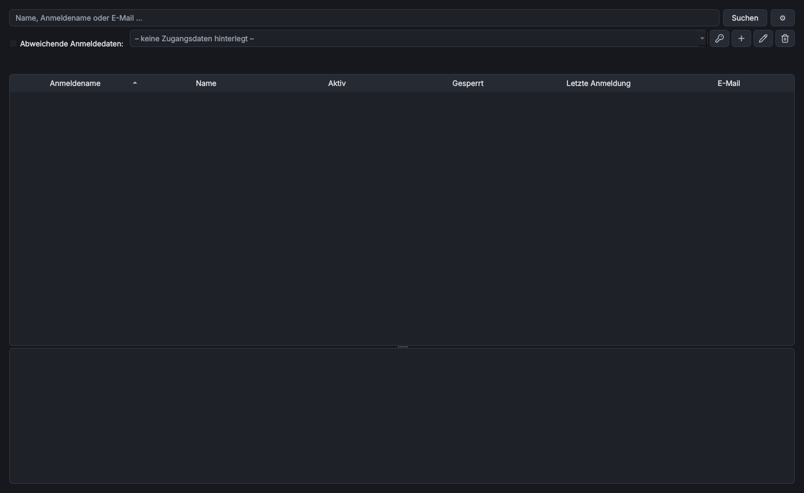

# AD Benutzerabfrage

> **Kurz:** Sucht Benutzerkonten im Active Directory über Name, Anmeldename oder E-Mail und zeigt Status,
> letzte Anmeldung, Sperrstatus und Gruppen. Ideal für den Service Desk.

| | |
|---|---|
| **Tool-ID** | `ms.ad-user-lookup` |
| **Stand der Seite** | Version 1.4.0 |
| **Bereich** | Identität & Zugriff |
| **Tags** | Active Directory, RSAT, User Accounts, Groups, Account Lockout, Service Desk |
| **Plattformen** | Windows |
| **Voraussetzungen** | RSAT: Active Directory-Tools (PowerShell-Modul `ActiveDirectory`), wird automatisch installiert |
| **Adminrechte** | nur für die Installation von RSAT (UAC); die Abfrage selbst braucht normale Domänen-Leserechte |
| **Mindestversion OmniWrench** | 0.5.1 |
| **Quellcode** | [`tools/ad_user_lookup`](https://github.com/KuroShiroMe/OmniWrench/tree/main/tools/ad_user_lookup) |

## Inhalt
- [Wofür](#wofür)
- [Installation und Voraussetzungen](#installation-und-voraussetzungen)
- [Erste Schritte](#erste-schritte)
- [Funktionen im Detail](#funktionen-im-detail)
- [Einstellungen](#einstellungen)
- [Sicherheit und Datenschutz](#sicherheit-und-datenschutz)
- [Grenzen und bekannte Einschränkungen](#grenzen-und-bekannte-einschränkungen)
- [Fehlerbehebung](#fehlerbehebung)
- [Versionen](#versionen)

## Wofür
- am Telefon schnell prüfen, ob ein Konto aktiv oder gesperrt ist
- letzte Anmeldung und letzten Passwortwechsel eines Benutzers nachsehen
- Gruppenmitgliedschaften eines Benutzers auflisten
- Benutzer finden, wenn nur ein Teil des Namens oder der E-Mail-Adresse bekannt ist
- in einer fremden Domäne mit abweichenden Anmeldedaten suchen

## Installation und Voraussetzungen
Das Tool braucht das PowerShell-Modul `ActiveDirectory` aus den RSAT-Tools
(`Rsat.ActiveDirectory.DS-LDS.Tools~~~~0.0.1.0`). Fehlt es, installiert OmniWrench es bei der Installation
des Tools nach Rückfrage mit einer UAC-Abfrage. Sind die RSAT-Tools schon da, entfällt die Abfrage.

In Netzen mit WSUS kann die RSAT-Installation mit `0x800f0954` scheitern, siehe
[Fehlerbehebung](Fehlerbehebung). Bei der Deinstallation des Tools bleiben die RSAT-Tools installiert.

Nur unter Windows verfügbar.

## Erste Schritte
1. Tool öffnen. Ohne Einstellungen sucht es in der Domäne des angemeldeten Benutzers.
2. Im Suchfeld einen Namensteil, Anmeldenamen oder eine E-Mail-Adresse eingeben, z. B. `meier`, und
   **Suchen** (oder Enter). Der Knopf ⚙ daneben öffnet die Einstellungen.
3. Einen Treffer anklicken: unten erscheinen alle Details mit den Gruppen.

## Funktionen im Detail

### Suche
Gesucht wird mit „enthält“ in **Anmeldename** (`sAMAccountName`), **Name** und **E-Mail** (`mail`), z. B. findet
`mei` auch „Meier“ und „Schmeiser“. Die Suche läuft im Hintergrund; die Oberfläche bleibt bedienbar. Die
Statuszeile zeigt „n Benutzer gefunden“ oder den Fehler.

Mit **Abweichende Anmeldedaten** (Haken in der Suchzeile bzw. in den Einstellungen) wird mit den gewählten
Zugangsdaten gesucht, z. B. als Admin einer anderen Domäne. Die Zugangsdaten stammen aus dem
[Passwortmanager](Passwortmanager) oder werden manuell hinterlegt; mehrere Einträge sind möglich.

### Ergebnisliste

| Spalte | Inhalt |
|---|---|
| Anmeldename | `sAMAccountName` |
| Name | Anzeigename |
| Aktiv | Ja/Nein |
| Gesperrt | Ja/Nein (Kontosperrung durch Fehlanmeldungen) |
| Letzte Anmeldung | `LastLogonDate` (repliziert, kann bis zu 14 Tage nachhinken) |
| E-Mail | `mail` |

Die Spalten lassen sich per Klick auf die Überschrift sortieren.

### Details
Ein Klick auf einen Treffer zeigt unter der Liste alle gelesenen Werte: Anmeldename, Name, Aktiv, Gesperrt,
letzte Anmeldung, E-Mail, Abteilung, Position, Distinguished Name, Erstellungsdatum, letzter Passwortwechsel
und die **Gruppen** (alphabetisch, nur direkte Mitgliedschaften). Der Text lässt sich markieren und kopieren.

### KI-Assistenten
Ab OmniWrench 0.9.0 können [KI-Assistenten](KI-Assistenten) die aktuellen Suchergebnisse lesen (Stufe 3 –
Lesen im [KI-Zugriff](KI-Zugriff-und-Verfremdung); Standard: nur Beschreibung). Benutzernamen, E-Mail-Adressen
und Domänen werden dabei verfremdet. Im Rechtsklickmenü der Ergebnisliste steht **Assistent fragen …** für die
markierten Benutzer.

## Einstellungen

| Einstellung | Standard | Bedeutung |
|---|---|---|
| Verbindung › Domänencontroller / Domäne | leer = Domäne des angemeldeten Benutzers | Server oder Domäne für die Abfrage (`-Server`) |
| Verbindung › Suchbasis (OU) | leer = ganze Domäne | Distinguished Name einer OU, z. B. `OU=Benutzer,DC=contoso,DC=local` |
| Anmeldung › Abweichende Anmeldedaten verwenden | aus | sucht mit den Zugangsdaten unten statt mit dem angemeldeten Benutzer |
| Anmeldung › Anmeldedaten | – | Zugangsdaten (verschlüsselt im Tresor oder als Verweis auf den Passwortmanager) |
| Max. Ergebnisse | 200 | Obergrenze der Treffer je Suche |

## Sicherheit und Datenschutz
- Das Tool **liest nur**; es ändert nichts im Active Directory.
- Verbindung zum Domänencontroller über die AD-Webdienste (TCP 9389), wie `Get-ADUser`.
- Passwörter werden über die Standardeingabe an PowerShell übergeben, nie über die Kommandozeile.
- Suchergebnisse werden nicht gespeichert.

## Grenzen und bekannte Einschränkungen
- Nur Benutzerkonten (keine Computer, Gruppen oder Kontakte).
- Nur direkte Gruppenmitgliedschaften, keine verschachtelten.
- Keine Aktionen wie Entsperren oder Passwort zurücksetzen.
- Nur Windows (RSAT).

## Fehlerbehebung

| Problem | Ursache / Lösung |
|---|---|
| „Unable to find a default server with Active Directory Web Services running“ | Rechner nicht in der Domäne oder DC nicht erreichbar: Domänencontroller in den Einstellungen eintragen |
| „The term 'Get-ADUser' is not recognized“ / Modul fehlt | RSAT fehlt: Rechtsklick › *Voraussetzungen prüfen*, dann *Reparieren* |
| „Abweichende Anmeldedaten aktiviert, aber keine ausgewählt …“ | in den Einstellungen Zugangsdaten wählen oder den Haken entfernen |
| Keine Treffer trotz vorhandenem Benutzer | Suchbasis (OU) zu eng? Feld leeren |
| Letzte Anmeldung wirkt veraltet | `LastLogonDate` wird nur alle 9–14 Tage repliziert |

## Versionen

| Version | Änderungen |
|---|---|
| 1.4.0 | **KI-Assistenten**: Suchergebnisse für Assistenten, „Assistent fragen …“ |
| 1.3.3 | Bereich und Tags neu |
| 1.3.1 | Zugangsdaten werden im Hintergrund abgerufen |
| 1.3.0 | Auswahl der Zugangsdaten direkt in der Suchzeile |
| 1.0.0 | erste Version |

## Siehe auch
- [Passwortmanager](Passwortmanager)
- [Store und Tools › Voraussetzungen](Store-und-Tools#voraussetzungen)
