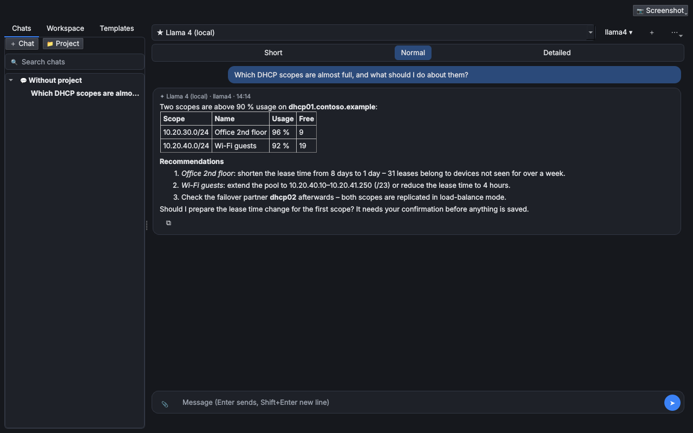
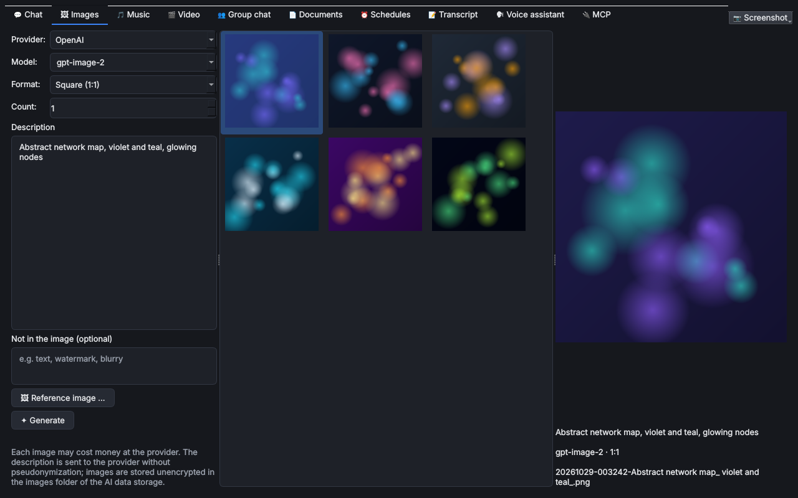
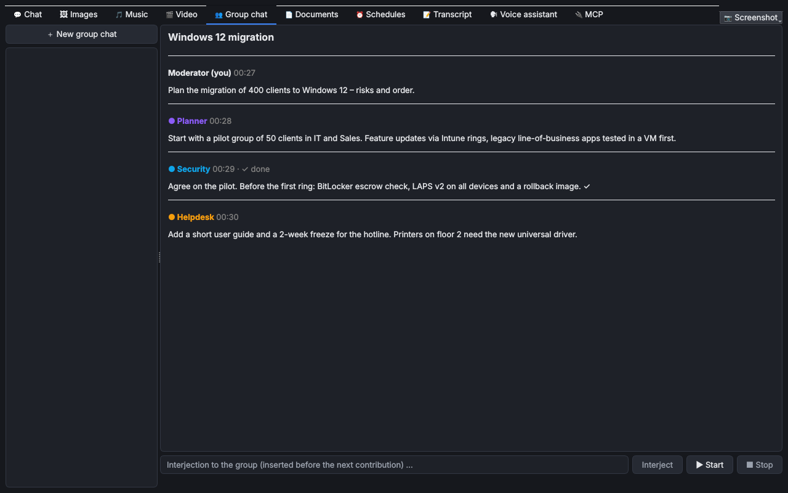
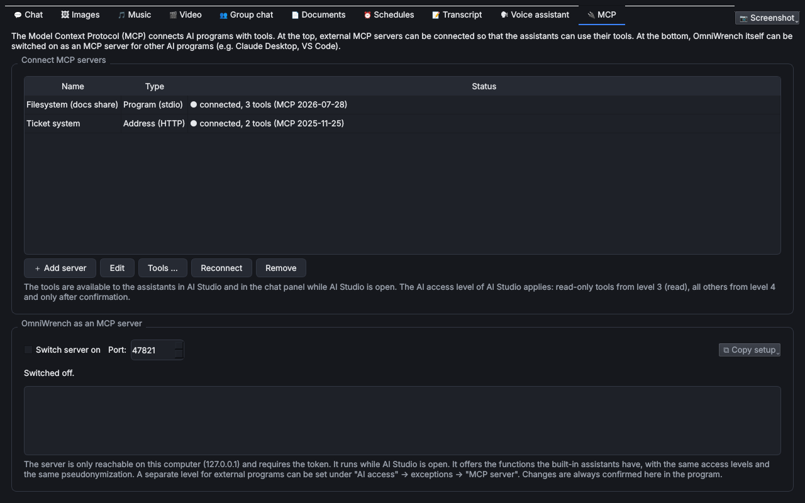

# Clank – KI-Studio

> **Kurz:** Der große Arbeitsplatz für die [KI-Assistenten](KI-Assistenten): Chats mit Projekten, Vorlagen und
> einem Arbeitsbereich aus Ordnern und Repositories, dazu Bilder, Musik, Video, Gruppenchat, Dokumente,
> Zeitpläne, MCP, Live-Mitschrift von Besprechungen und ein Sprachassistent mit Weckwort.

| | |
|---|---|
| **Tool-ID** | `ai.clank` |
| **Stand der Seite** | Version 1.0.2 |
| **Bereich** | Automatisierung & Entwicklung |
| **Tags** | KI, Chat, ChatGPT, Claude, Copilot, Ollama, Git, GitHub, GitLab, Azure DevOps, MCP, Bilder, Musik, Video, Transkription, Sprachassistent |
| **Plattformen** | Windows, Linux |
| **Voraussetzungen** | mindestens ein verbundener Assistent; optional Git, ffmpeg, Python-Pakete für Ton (werden bei Bedarf angeboten) |
| **Adminrechte** | nicht nötig |
| **Mindestversion OmniWrench** | 0.9.0 |
| **Quellcode** | [`tools/clank`](https://github.com/KuroShiroMe/OmniWrench/tree/main/tools/clank) |

## Inhalt
- [Wofür](#wofür)
- [Installation und Voraussetzungen](#installation-und-voraussetzungen)
- [Erste Schritte](#erste-schritte)
- [Funktionen im Detail](#funktionen-im-detail)
  - [Chat, Projekte und Arbeitsbereich](#chat-projekte-und-arbeitsbereich)
  - [Vorlagen](#vorlagen)
  - [Bildschirmfoto](#bildschirmfoto)
  - [Bilder](#bilder)
  - [Musik und Video](#musik-und-video)
  - [Gruppenchat](#gruppenchat)
  - [Dokumente](#dokumente)
  - [Planung](#planung)
  - [Mitschrift](#mitschrift)
  - [Sprachassistent](#sprachassistent)
  - [MCP](#mcp)
  - [KI-Übersicht](#ki-übersicht)
- [Einstellungen](#einstellungen)
- [Sicherheit und Datenschutz](#sicherheit-und-datenschutz)
- [Grenzen und bekannte Einschränkungen](#grenzen-und-bekannte-einschränkungen)
- [Fehlerbehebung](#fehlerbehebung)
- [Versionen](#versionen)
- [Siehe auch](#siehe-auch)

## Wofür
- Mit einem Assistenten an Skripten und Konfigurationen arbeiten: Ordner oder Git-Repository freigeben, Dateien
  lesen und durchsuchen lassen, Änderungen als Diff vorschlagen lassen und nach Bestätigung speichern.
- Wiederkehrende Fragen mit Vorlagen stellen („Skript prüfen“, „Fehlermeldung erklären“, „Runbook schreiben“).
- Anleitungen, Berichte und E-Mails an Anwender schreiben lassen und als PDF/ODT exportieren.
- Mehrere Assistenten ein Thema besprechen lassen (z. B. Planer, Sicherheit, Helpdesk).
- Regelmäßige Berichte planen („Fasse jeden Montag die DHCP-Befunde zusammen“).
- Besprechungen live mitschreiben und zusammenfassen lassen.
- Bilder, Musik und kurze Videos erzeugen (Präsentationen, Wartemusik, Schulungsclips).
- Fremde MCP-Server anbinden oder OmniWrench selbst Claude Desktop, VS Code & Co. als MCP-Server anbieten.

## Installation und Voraussetzungen
Clank wird über den [Store](Store-und-Tools) installiert und braucht keine zusätzlichen Pakete. Assistenten werden
im Hauptprogramm verbunden (*Einstellungen › KI-Assistenten*, siehe [KI-Assistenten](KI-Assistenten)) und gelten
in Clank und in der Chatleiste gleichermaßen.

Optional, jeweils erst bei Bedarf:

| Für | Was | Wie |
|---|---|---|
| Lokale Repositories, Klonen | Git | [git-scm.com](https://git-scm.com) bzw. Paketverwaltung. Ordner und Online-Repositories gehen ohne Git |
| Musik, Video | ffmpeg | Windows: Download im Reiter (BtbN-Build, ca. 100 MB, in den Datenordner von Clank). Linux: Paketverwaltung (`sudo apt install ffmpeg`) |
| Mitschrift, Sprachassistent | Python-Pakete `numpy`, `soundcard` (ca. 20 MB) | Knopf **Pakete installieren** im Reiter, landen im Ordner des Tools |
| Weckwort des Sprachassistenten | Paket `vosk` + kleines Sprachmodell (40–50 MB) | **Weckwort einrichten …** im Reiter |

Unter Linux braucht der Systemton (Loopback) PulseAudio oder PipeWire mit Pulse-Schnittstelle.

## Erste Schritte
1. Im Hauptprogramm mindestens einen Assistenten verbinden (*Einstellungen › KI-Assistenten*).
2. Clank öffnen. Im Reiter **Chat** steht links die Liste der Chats, in der Mitte der Chat.
3. Frage eingeben und mit **Enter** senden.
4. Damit der Assistent Dateien sehen darf: Seitenleiste **Arbeitsbereich** › **Hinzufügen** › Ordner oder
   Repository, dann im KI-Zugriff von Clank mindestens Stufe 3 (Lesen) einstellen – der Hinweisbalken im
   Arbeitsbereich führt direkt dorthin.

## Funktionen im Detail

### Chat, Projekte und Arbeitsbereich
Der Reiter **Chat** besteht aus drei Teilen:

| Teil | Inhalt |
|---|---|
| Seitenleiste **Chats** | Chats nach Projekt gruppiert, Suche, **＋ Chat**, **＋ Projekt**; Rechtsklick: öffnen, umbenennen, Ordner öffnen, löschen, Projekt bearbeiten/löschen |
| Seitenleiste **Arbeitsbereich** | Freigegebene Ordner und Repositories des aktuellen Projekts (oder ohne Projekt) |
| Seitenleiste **Vorlagen** | siehe [Vorlagen](#vorlagen) |
| Mitte | Der Chat – wie die [Chatleiste](KI-Assistenten#die-chatleiste), mit denselben Chats und Projekten |
| Rechts | Dateiansicht mit Hervorhebung, **Änderungen zeigen (Git)**, **An den Chat anhängen** |

**Arbeitsbereich hinzufügen** (**Hinzufügen**):
- **Ordner oder Git-Repository …** – lokaler Ordner; erkennt Git automatisch. Rechtsklick › **Nur lesen** sperrt
  Änderungen.
- **Online-Repository (GitHub, GitLab, Azure DevOps) …** – Adresse, optional Zugriffstoken (nur für private
  Repositories, im Tresor) und Zweig. Online-Repositories sind nur lesbar; **Lokal klonen** legt eine lokale Kopie
  an (das Token wird dabei nur als Header übergeben, nie in `.git/config` gespeichert).

**Was der Assistent im Arbeitsbereich darf** (Stufe im KI-Zugriff von Clank):

| Funktion | Stufe |
|---|---|
| Arbeitsbereich beschreiben (Namen, Art, Zweig) | 2 – Übersicht |
| Dateien auflisten, lesen, durchsuchen; Git-Status, Verlauf, Diff | 3 – Lesen |
| Datei ändern (Bestätigung zeigt das Diff) | 4 – Ändern mit Bestätigung |
| Befehl ausführen (Bestätigung zeigt Befehl und Erklärung; Shell und Zeitlimit siehe [Einstellungen](#einstellungen)) | 4 – Ändern mit Bestätigung |

Pfade außerhalb der freigegebenen Ordner werden abgelehnt.

### Vorlagen
Seitenleiste **Vorlagen**: mitgelieferte (📌) und eigene (✎) Vorlagen für wiederkehrende Fragen. Doppelklick
setzt die Vorlage in das Eingabefeld. Platzhalter in doppelten geschweiften Klammern (`{{Skript}}`,
`{{Servername}}`) werden beim Verwenden abgefragt. Mitgeliefert: Skript erklären, Skript prüfen, PowerShell-Skript
schreiben, Protokoll analysieren, Fehlermeldung erklären, E-Mail an Anwender, Änderungseintrag, Runbook.
Mitgelieferte Vorlagen lassen sich als eigene kopieren und anpassen.

### Bildschirmfoto
Knopf **Bildschirmfoto** oben rechts: **Bereich auswählen …** (mit der Maus aufziehen, Esc bricht ab) oder
**Ganzer Bildschirm**. Das Fenster von OmniWrench wird dafür kurz ausgeblendet; das Bild landet im Bilder-Ordner
und hängt am Chat. Unter Wayland liefern manche Desktops ein leeres Bild – dann das Werkzeug des Desktops
nutzen und das Bild über 📎 anhängen.

### Bilder

Erzeugt Bilder mit den verbundenen Bild-Anbietern (OpenAI, Gemini, xAI, Black Forest Labs, fal.ai, Replicate,
Stability AI, Ideogram, Recraft, MiniMax). Einstellbar: Anbieter, Modell, Format (1:1, 16:9, 9:16, 4:3, 3:4),
Anzahl, Beschreibung, „Nicht im Bild“, **Vorlagebild …** (bei Anbietern, die das können). Die Galerie zeigt alle
Bilder der KI-Datenablage; Rechtsklick: öffnen, im Ordner zeigen, kopieren, **Einstellungen übernehmen**,
**Als Vorlagebild verwenden**, **An den Chat anhängen**, löschen.

Ist kein passender Anbieter verbunden, zeigt der Reiter einen Hinweis mit Knopf zu den Einstellungen.

### Musik und Video
Erzeugen Musikstücke und kurze Videos – u. a. Google Gemini (Lyria, Omni Flash), ElevenLabs, MiniMax, Stability,
Mureka, xAI, Runway, Luma, Seedance, fal.ai, Replicate. Musik: Beschreibung, Liedtext, „Nur instrumental“, Länge.
Video: Beschreibung, Startbild, Länge, Auflösung.

Bearbeiten mit ffmpeg (Ergebnis immer als neue Datei):

| Musik | Video |
|---|---|
| **Kürzen …**, **Als MP3** | **Kürzen …**, **Musik unterlegen …**, **Als GIF**, **Ton entfernen**, **Standbild speichern** |

Videos sind meist die teuerste Art (Abrechnung je Sekunde) und können einige Minuten dauern.

### Gruppenchat

Mehrere Assistenten besprechen ein Thema der Reihe nach (bis zu sechs Teilnehmer, auch derselbe Assistent mehrfach
mit verschiedenen Rollen).

| Abschnitt | Einstellungen |
|---|---|
| **Teilnehmer** | Name, Assistent, Rolle (optional, z. B. „Sicherheit“, „Pro“, „Contra“) |
| **Thema** | Worum es geht |
| **Ablauf** | Art (Diskussion, Ideensammlung, Debatte, Prüfung), Reihenfolge (fest / zufällig je Runde), Detailgrad, Zusammenfassung am Ende |
| **Bremsen** | Runden, Beiträge insgesamt, Zeichen je Beitrag, Zeitlimit, Token-Budget, nach jeder Runde anhalten, Ende bei Einigkeit, Ende bei Wiederholung |

**Minutenlimits:** Kostenlose Stufen erlauben oft nur wenige Anfragen pro Minute (Gemini z. B. 5). Meldet ein
Anbieter, dass das Minutenlimit erreicht ist, wartet der Gruppenchat die genannte Zeit (höchstens 90 Sekunden) und
macht dann weiter; im Verlauf steht ein Hinweis. Danach hält er für diesen Anbieter automatisch genug Abstand
zwischen den Anfragen. Tageslimits, leeres Guthaben oder „nicht im Tarif“ beenden den Lauf mit einer Meldung.
Tipp: Für mehrere Teilnehmer verschiedene Anbieter mischen.

Während des Laufs: **Einwerfen** (kommt vor dem nächsten Beitrag), **Anhalten**, **Weiter**. Im Gruppenchat
gibt es keine Funktionsaufrufe; die Verfremdung folgt dem KI-Zugriff von Clank. Gruppenchats werden wie Chats
gespeichert (verschlüsselt, falls eingestellt).

### Dokumente
Markdown-Editor mit Vorschau. **Schreiben lassen …** (Art: Anleitung/Runbook, Bericht, Konzept, Protokoll,
E-Mail, freier Text; auf Wunsch mit dem bisherigen Text als Entwurf), **Überarbeiten …** (gilt für die
Markierung, sonst den ganzen Text, z. B. „kürzer und mit nummerierten Schritten“), **Speichern**,
**Exportieren** (HTML, PDF, ODT), **An den Chat anhängen**. Dokumente liegen unverschlüsselt im Ordner
„Documents“ der KI-Datenablage, damit sie mit anderen Programmen bearbeitet werden können. Der Text wird
verfremdet gesendet.

### Planung
Zeitpläne stellen dem Assistenten zu festen Zeiten eine Frage – einmalig, täglich, wöchentlich (Wochentage) oder
alle N Stunden. Jeder Lauf wird ein neuer Chat („⏰ Name · Datum“), auf Wunsch in einem Projekt. Sie laufen,
solange OmniWrench mit Clank geöffnet ist; verpasste Läufe werden auf Wunsch beim nächsten Öffnen nachgeholt.
**Funktionen, die etwas ändern, werden bei geplanten Läufen nie ausgeführt.** Bei mehreren Clank-Tabs führt nur
einer die Zeitpläne aus.

### Mitschrift
Schreibt Besprechungen von **Mikrofon** und/oder **Systemton** (Teams, Zoom, Webex …) live mit, erkennt die
Sprecher und fasst am Ende zusammen. Spracherkennung über OpenAI, Google Gemini, Groq (Whisper), Mistral (Voxtral),
ElevenLabs, Deepgram, AssemblyAI oder **Whisper lokal** (offline und kostenlos, siehe
[Sprachassistent](#sprachassistent); ohne Sprecherkennung des Anbieters, die Sprecher trennt dann Clank selbst).

1. Quellen, Spracherkennung, Sprachen (z. B. `de, en`) und den eigenen Namen für das Mikrofon wählen.
2. **Aufnahme starten** – vor **jeder** Aufnahme fragt Clank die Einwilligung ab (siehe unten). Ein roter
   Balken zeigt, solange aufgenommen wird. **Pause** unterbricht.
3. Im Reiter **Sprecher**: **Umbenennen …**, **Zusammenlegen …** (wenn eine Person doppelt erkannt wurde),
   **Als Sprecherprofil speichern …**.
4. **Aufnahme beenden** – die Zusammenfassung entsteht automatisch (abschaltbar) oder über **Zusammenfassen**.
   **In den Chat**, **Exportieren …** (Markdown).

**Einwilligung:** Gespräche dürfen nur mit Zustimmung aller Beteiligten aufgenommen werden (in Deutschland
§ 201 StGB, DSGVO). Der Dialog verlangt die Bestätigung, dass alle informiert und einverstanden sind, und bietet
einen **Hinweistext für Teilnehmende** zum Kopieren an. Die Bestätigung wird mit Zeitpunkt in der Mitschrift
vermerkt.

**Was gespeichert wird:** nur der Text (verschlüsselt, falls eingestellt). Audio und Stimmmerkmale bleiben im
Arbeitsspeicher. **Sprecherprofile** (Stimmmerkmale mit Namen, damit bekannte Stimmen automatisch benannt werden)
sind biometrische Daten (Art. 9 DSGVO): nur nach Erlaubnis im Einwilligungsdialog und Zustimmung der Person. Beim
Start mit Profilen erscheint ein eigener, deutlicher Hinweis; die Verantwortung liegt beim Anwender. Profile sind **immer
verschlüsselt**, verwaltbar und löschbar über **Sprecherprofile**. Die **Stimmen-Ähnlichkeit** legt fest, wie
streng Stimmen zugeordnet werden.

### Sprachassistent
Ein Sprachassistent wie Alexa, nur für OmniWrench: **Sprachassistent einschalten**, „Hey Clank“ sagen (Weckwort
einstellbar, weitere Schreibweisen möglich), Frage sprechen, die Antwort wird vorgelesen und erscheint im Chat.
**Sprechen** stellt eine Frage ohne Weckwort, **Vorlesen stoppen** unterbricht.

| Einstellung | Bedeutung |
|---|---|
| Weckwort | Offline erkannt mit Vosk (kleines Sprachmodell je Sprache, **Weckwort einrichten …**) |
| Sprache | Programmsprache oder eine andere Sprache; danach richten sich Weckwort-Modell, Erkennung und Stimmenliste |
| Spracherkennung | Anbieter, **Whisper lokal** oder „Offline (Vosk, ungenauer)“ (siehe Tabelle unten) |
| Antwort vorlesen mit | Systemstimme, **Piper** oder ein Anbieter mit Stimme (OpenAI, Google Gemini, ElevenLabs) |
| Stimme | Liste passend zur gewählten Sprache (Systemstimmen, Piper) bzw. die Stimmen des Anbieters (Gemini 30, OpenAI 11; ElevenLabs: Stimm-ID eintragen). Die Wahl wird je Ausgabe gemerkt. **Probehören** spielt einen Beispielsatz |
| Folgefragen ohne Weckwort | 8 Sekunden nach der Antwort wieder zuhören |
| Vorlesen bis etwa | Längere Antworten werden gekürzt vorgelesen; Code wird nur erwähnt |

Das Weckwort wird **immer offline** erkannt; erst danach geht der gesprochene Satz an die gewählte
Spracherkennung.

**Welche Erkennung und Stimme passt?**

| Möglichkeit | Kosten | Qualität | Hinweise |
|---|---|---|---|
| Whisper lokal (faster-whisper) | kostenlos, offline | sehr gut (Modell *small* empfohlen, *large-v3-turbo* am besten) | Einmalig **Offline-Sprache einrichten**: Paket (~100 MB) und Modell (145 MB bis 1,6 GB) werden geladen. Braucht etwas Rechenzeit |
| Vosk | kostenlos, offline | einfach | Dasselbe kleine Modell wie das Weckwort |
| Groq (Whisper) | kostenlose Stufe | sehr gut, sehr schnell | Groq-Assistent verbinden |
| Google Gemini | kostenlose Stufe mit Minutenlimit | sehr gut, erkennt Sprecher | Erkennung und Vorlesen (30 Stimmen) |
| Mistral (Voxtral) | günstig | sehr gut | EU-Anbieter |
| OpenAI, ElevenLabs, Deepgram, AssemblyAI | kostenpflichtig | sehr gut | |
| Systemstimme | kostenlos, offline | je nach System | Alle installierten Stimmen der Sprache. Unter Windows zusätzliche Stimmen über *Einstellungen › Zeit und Sprache › Sprache* installieren. Die neuen „natürlichen“ Sprachausgabe-Stimmen gibt Windows bisher nur teilweise für andere Programme frei |
| Piper | kostenlos, offline | natürlich klingend | Stimmen je Sprache (z. B. Thorsten, Kerstin, Eva), je Stimme 20–110 MB, Download auf Wunsch |

Pakete und Modelle landen im Tool-Ordner bzw. im Datenordner von Clank; heruntergeladen wird nur nach Rückfrage.

### MCP

Das Model Context Protocol (MCP) verbindet KI-Programme mit Werkzeugen. Clank unterstützt die aktuelle Fassung
(2026-07-28) und ältere Server (2025-03-26 bis 2025-11-25) automatisch.

**MCP-Server anbinden** (oben): **Server hinzufügen** – als Programm (stdio: Befehl, Argumente, Arbeitsordner,
Umgebungsvariablen) oder Adresse (HTTP: URL, Token im Tresor, weitere Header). **Werkzeuge …** zeigt die
Werkzeuge und lässt einzelne abwählen. Die Werkzeuge stehen den Assistenten in Clank und in der Chatleiste zur
Verfügung, solange Clank geöffnet ist:
- Ohne **Server vertrauen** gilt jedes Werkzeug als ändernd: Stufe 4 und Bestätigung mit den Aufrufdaten.
- Mit Vertrauen gelten Werkzeuge, die der Server als „nur lesend“ kennzeichnet, ab Stufe 3.
- Programme (stdio) laufen mit den Rechten des angemeldeten Benutzers – nur Server aus vertrauenswürdiger Quelle
  eintragen.

**OmniWrench als MCP-Server** (unten): **Server einschalten** bietet die Funktionen der eingebauten Assistenten
(Wiki, Tools, DHCP, DNS …) anderen KI-Programmen an – mit denselben Stufen und derselben Verfremdung. Eine eigene
Stufe für externe Programme: *KI-Zugriff › Ausnahmen › MCP-Server (externe KI-Programme)*. **Einrichtung
kopieren** liefert die Konfiguration für Claude Desktop & Co. (stdio, startet `OmniWrench.exe --mcp-stdio`), VS Code
(HTTP) oder allgemein (HTTP mit Token).
- Nur auf diesem Rechner erreichbar (`127.0.0.1`, Standard-Port 47821) und nur mit Token.
- Änderungen werden **immer hier im Programm** bestätigt.
- **Neues Token erzeugen …** macht bisherige HTTP-Einrichtungen ungültig.

### KI-Übersicht
Legt fest, welcher Assistent für welche Funktion standardmäßig verwendet wird (Chat, Bilder, Musik, Video,
Dokumente, Mitschrift, Zusammenfassung, Spracherkennung und Vorlesen des Sprachassistenten). Die Reiter übernehmen
die Auswahl sofort. Zu jeder Zeile zeigt die Tabelle:

| Spalte | Inhalt |
|---|---|
| Erlaubt? | Ergebnis der letzten Prüfung: verfügbar, nicht verfügbar, unklar |
| Volumen | Guthaben oder verbleibende Anfragen, soweit der Anbieter sie meldet, mit Zeitpunkt der Prüfung |
| Voraussetzung | z. B. „API-Konto mit Abrechnung“ |

**Ausgewählten prüfen** und **Alle prüfen** fragen die Anbieter neu ab; **Details …** zeigt den ganzen Bericht
(Modelle je Funktion, Limits, Link zur Verbrauchsseite). Mehr dazu unter
[KI-Assistenten › Fähigkeiten prüfen](KI-Assistenten#fähigkeiten-prüfen).

## Einstellungen
Rechtsklick auf Clank › *Einstellungen*:

| Einstellung | Standard | Bedeutung |
|---|---|---|
| Shell für Befehle | Automatisch | PowerShell unter Windows, bash unter Linux; oder fest PowerShell, cmd, bash |
| Zeitlimit je Befehl | 120 s | Befehle des Assistenten werden danach abgebrochen (10–900 s) |
| Ordner für geklonte Repositories | leer | Leer = `OmniWrench-Repos` im Benutzerordner |
| ffmpeg-Programm | leer | Leer = automatisch (heruntergeladene Kopie oder ffmpeg im PATH) |

Der Reiter **KI-Zugriff** in den Einstellungen legt Stufe und Verfremdung für Clank fest (siehe
[KI-Zugriff](KI-Zugriff-und-Verfremdung)). Die Einstellungen der Reiter (Mitschrift, Sprachassistent, MCP-Server,
Vorlagen, Zeitpläne) werden in den Reitern selbst gesetzt und gespeichert.

## Sicherheit und Datenschutz
- **Verbindungen:** zu den verbundenen KI-Anbietern (HTTPS), zu GitHub/GitLab/Azure DevOps für
  Online-Repositories, zu den eingetragenen MCP-Servern, für Downloads zu GitHub (ffmpeg), alphacephei.com (Vosk)
  und PyPI (Python-Pakete). Der eigene MCP-Server lauscht nur auf `127.0.0.1`.
- **Verfremdung:** Chat, Gruppenchat, Dokumente und Zusammenfassungen werden verfremdet gesendet; Beschreibungen
  für Bilder, Musik und Video nicht (Hinweis im Reiter). Audio der Mitschrift geht an die gewählte Spracherkennung.
- **Änderungen:** Dateien schreiben, Befehle ausführen, ändernde MCP-Werkzeuge – nur nach Bestätigung, nie in
  geplanten Läufen.
- **Gespeichert:** Chats, Projekte, Gruppenchats, Mitschriften in der KI-Datenablage (verschlüsselt, falls
  eingestellt); Sprecherprofile immer verschlüsselt; Medien und Dokumente unverschlüsselt; Token (Repositories,
  MCP) im Tresor; Einstellungen ohne Geheimnisse in den Tool-Einstellungen.
- **Nie gespeichert:** Tonaufnahmen und Stimmmerkmale der Mitschrift (außer ausdrücklich angelegte Profile).

## Grenzen und bekannte Einschränkungen
- Zeitpläne, MCP-Werkzeuge und der MCP-Server laufen nur, solange Clank geöffnet ist.
- Kling direkt und ComfyUI werden für Video nicht unterstützt (über fal.ai/Replicate möglich).
- Microsoft 365 Copilot kann keine Programmfunktionen aufrufen (nur Text).
- Bildschirmfotos unter Wayland können leer sein.
- Die Sprechererkennung ohne Anbieter-Diarisierung arbeitet mit einfachen Stimmmerkmalen; bei ähnlichen Stimmen
  hilft **Zusammenlegen …** oder ein Sprecherprofil.
- Online-Repositories sind nur lesbar.

## Fehlerbehebung

| Problem | Ursache / Lösung |
|---|---|
| „Clank braucht OmniWrench 0.9.0 oder neuer“ | OmniWrench aktualisieren |
| Assistent sieht den Arbeitsbereich nicht | KI-Zugriff von Clank auf Stufe 3 oder 4 stellen |
| Reiter Bilder/Musik/Video ausgegraut | Kein Anbieter mit dieser Fähigkeit verbunden – in *Einstellungen › KI-Assistenten* hinzufügen |
| Musik/Video: „braucht ffmpeg“ | Unter Windows **ffmpeg herunterladen**, unter Linux per Paketverwaltung installieren, dann **Erneut prüfen** |
| Mitschrift: Quelle kann nicht aufgenommen werden | Gerät belegt oder fehlt; unter Linux PulseAudio/PipeWire prüfen; unter Windows Mikrofonzugriff in den Datenschutzeinstellungen erlauben |
| Gruppenchat: „Limit des Anbieters erreicht“ | Kostenlose Stufe mit Minutenlimit – Clank wartet automatisch; bei Tageslimit später weitermachen oder Anbieter mischen |
| „Offline-Sprache ist noch nicht eingerichtet“ | Im Sprachassistenten **Offline-Sprache einrichten** drücken (lädt faster-whisper bzw. Piper und das Modell) |
| Weckwort reagiert nicht | Weckwort deutlich sprechen, weitere Schreibweisen eintragen (z. B. „hey klang“) oder **Sprechen** benutzen |
| MCP-Server „Fehler: Server process ended“ | Befehl/Argumente prüfen (z. B. `npx` installiert?), Server einzeln in der Konsole starten |
| Externes Programm erreicht den MCP-Server nicht | Server in Clank eingeschaltet? Port frei? Bei HTTP das aktuelle Token verwenden |

## Versionen

| Version | Änderungen |
|---|---|
| 1.0.2 | Reiter **KI-Übersicht** (Standard-Assistent je Funktion, Prüfung, Volumen); Sprachassistent: Sprache frei wählbar, Whisper lokal, Piper, Systemstimmen zur Auswahl, Stimmen von Gemini und OpenAI, Probehören; Spracherkennung auch mit Gemini, Groq Whisper und Mistral Voxtral (auch in der Mitschrift); Gruppenchat wartet bei Minutenlimits und hält Abstand |
| 1.0.1 | Mitschrift: deutlicher Hinweis (Art. 9 DSGVO) vor dem Verwenden von Sprecherprofilen |
| 1.0.0 | Erste Version: Chat mit Projekten, Vorlagen und Arbeitsbereich (Ordner, Git, GitHub/GitLab/Azure DevOps), Bilder, Musik, Video, Gruppenchat, Dokumente, Bildschirmfoto, Planung, MCP-Client und -Server, Mitschrift mit Sprechererkennung, Sprachassistent mit Weckwort |

## Siehe auch
- [KI-Assistenten](KI-Assistenten)
- [KI-Zugriff und Verfremdung](KI-Zugriff-und-Verfremdung)
- [Datenablage und Datenschutz](Datenablage-und-Datenschutz)
