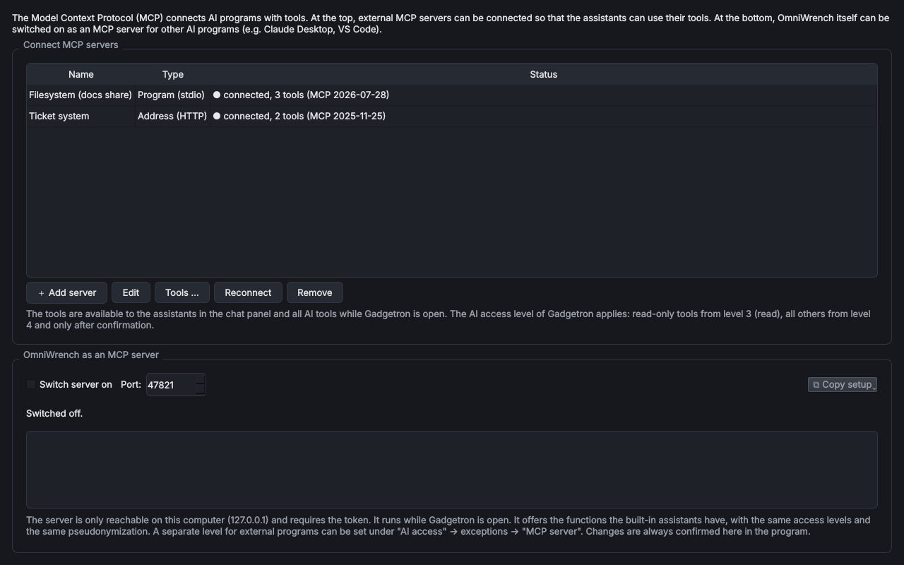

# Gadgetron – MCP

> **Kurz:** Bindet fremde MCP-Server (Model Context Protocol) an, damit die Assistenten deren Werkzeuge nutzen,
> und bietet OmniWrench selbst als MCP-Server für Claude Desktop, VS Code & Co. an.

| | |
|---|---|
| **Tool-ID** | `ai.gadgetron` |
| **Stand der Seite** | Version 1.0.0 |
| **Bereich** | KI-Tools |
| **Tags** | KI, MCP, Model Context Protocol, Server |
| **Plattformen** | Windows, Linux |
| **Voraussetzungen** | keine; für stdio-Server deren Laufzeit (z. B. Node.js für `npx`) |
| **Adminrechte** | nicht nötig |
| **Mindestversion OmniWrench** | 0.9.0 |
| **Quellcode** | [`tools/gadgetron`](https://github.com/KuroShiroMe/OmniWrench/tree/main/tools/gadgetron) |

## Inhalt
- [Wofür](#wofür)
- [Installation und Voraussetzungen](#installation-und-voraussetzungen)
- [Erste Schritte](#erste-schritte)
- [Funktionen im Detail](#funktionen-im-detail)
  - [MCP-Server anbinden](#mcp-server-anbinden)
  - [OmniWrench als MCP-Server](#omniwrench-als-mcp-server)
- [Einstellungen](#einstellungen)
- [Sicherheit und Datenschutz](#sicherheit-und-datenschutz)
- [Grenzen und bekannte Einschränkungen](#grenzen-und-bekannte-einschränkungen)
- [Fehlerbehebung](#fehlerbehebung)
- [Versionen](#versionen)
- [Siehe auch](#siehe-auch)

## Wofür
- Assistenten um Werkzeuge erweitern (z. B. Ticketsystem, Monitoring, Dateisysteme), die einen MCP-Server haben.
- Die Funktionen von OmniWrench (Wiki, Tools, DHCP, DNS …) in Claude Desktop, VS Code oder anderen KI-Programmen
  nutzen – mit denselben Stufen und derselben Verfremdung.

## Installation und Voraussetzungen
Installation über den [Store](Store-und-Tools), ohne zusätzliche Pakete. Eingetragene Server und das Token des
eigenen Servers aus Clank 1.0.x werden beim ersten Öffnen übernommen.

## Erste Schritte
1. Gadgetron öffnen, oben **Server hinzufügen**.
2. Art wählen: **Programm (stdio)** mit Befehl und Argumenten oder **Adresse (HTTP)** mit URL und optional Token.
3. Der Status zeigt „verbunden, N Werkzeuge“. Die Werkzeuge stehen jetzt in [Clank](Tool-Clank) und der
   Chatleiste zur Verfügung.

## Funktionen im Detail
Gadgetron unterstützt die aktuelle MCP-Fassung (2026-07-28) und ältere Server (2025-03-26 bis 2025-11-25)
automatisch.

### MCP-Server anbinden

| Feld | Bedeutung |
|---|---|
| Art | Programm (stdio): Befehl, Argumente, Arbeitsordner, Umgebungsvariablen · Adresse (HTTP): URL, Token (im Tresor), weitere Header |
| Server vertrauen | Werkzeuge, die der Server als „nur lesend“ kennzeichnet, gelten dann ab Stufe 3; ohne Vertrauen gilt jedes Werkzeug als ändernd (Stufe 4 und Bestätigung) |
| Beim Öffnen von Gadgetron verbinden | Server automatisch verbinden |

**Werkzeuge …** zeigt die Werkzeuge mit Beschreibung und lässt einzelne abwählen. **Neu verbinden**,
**Bearbeiten**, **Entfernen**.

### OmniWrench als MCP-Server
**Server einschalten** bietet die Funktionen der eingebauten Assistenten anderen KI-Programmen an. Eine eigene
Stufe für externe Programme: *KI-Zugriff › Ausnahmen › MCP-Server (externe KI-Programme)*.

**Einrichtung kopieren** liefert die Konfiguration für:
- Claude Desktop und andere (stdio, startet `OmniWrench.exe --mcp-stdio`),
- VS Code (HTTP),
- allgemein (HTTP mit Token) oder nur das Token.

Der Server ist nur auf diesem Rechner erreichbar (`127.0.0.1`, Standard-Port 47821) und nur mit Token.
Änderungen werden **immer hier im Programm** bestätigt. **Neues Token erzeugen …** macht bisherige
HTTP-Einrichtungen ungültig.

## Einstellungen
Keine Einstellungen im Rechtsklick-Menü; Server, Port und Token werden im Tool verwaltet.

## Sicherheit und Datenschutz
- **Verbindungen:** zu den eingetragenen HTTP-Servern; stdio-Server laufen als Programm **mit den Rechten des
  angemeldeten Benutzers** – nur Server aus vertrauenswürdiger Quelle eintragen.
- **Eigener Server:** lauscht nur auf `127.0.0.1`, verlangt ein Token; ändernde Funktionen brauchen immer eine
  Bestätigung im Programm.
- **Gespeichert:** Servereinträge ohne Geheimnisse in den Tool-Einstellungen; Token im Tresor.

## Grenzen und bekannte Einschränkungen
- Werkzeuge der angebundenen Server und der eigene MCP-Server sind nur verfügbar, solange Gadgetron geöffnet ist.
- Microsoft 365 Copilot kann keine Werkzeuge aufrufen.

## Fehlerbehebung

| Problem | Ursache / Lösung |
|---|---|
| „Fehler: Server process ended“ | Befehl/Argumente prüfen (z. B. `npx` installiert?), Server einzeln in der Konsole starten |
| Externes Programm erreicht den Server nicht | Server in Gadgetron eingeschaltet? Port frei? Bei HTTP das aktuelle Token verwenden |

## Versionen

| Version | Änderungen |
|---|---|
| 1.0.0 | Erste Version als eigenes Tool (vorher Reiter „MCP“ in Clank 1.0.x; Server und Token werden übernommen) |

## Siehe auch
- [Clank – KI-Chat](Tool-Clank)
- [KI-Zugriff und Verfremdung](KI-Zugriff-und-Verfremdung)
