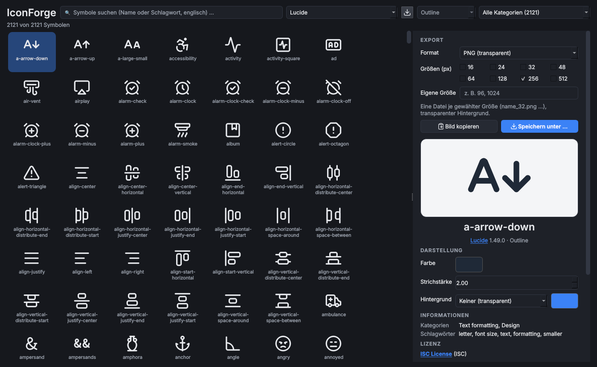

# IconForge

> **Kurz:** Durchsuchbares Raster mit über 100.000 Symbolen aus 26 freien Bibliotheken. Farbe, Strichstärke und
> Hintergrund anpassen, Lizenz prüfen und als SVG, PNG, ICO, PDF oder JPG exportieren, z. B. für Visio.

| | |
|---|---|
| **Tool-ID** | `gfx.iconforge` |
| **Stand der Seite** | Version 1.2.0 |
| **Bereich** | Dokumentation & Design |
| **Tags** | Icons, SVG, PNG, ICO, Visio, Lucide, Tabler, Material, Fluent, Font Awesome |
| **Plattformen** | Windows, Linux |
| **Voraussetzungen** | keine; weitere Bibliotheken werden bei Bedarf aus dem Internet geladen |
| **Adminrechte** | nicht nötig |
| **Mindestversion OmniWrench** | 0.5.0 |
| **Quellcode** | [`tools/iconforge`](https://github.com/KuroShiroMe/OmniWrench/tree/main/tools/iconforge) |

## Inhalt
- [Wofür](#wofür)
- [Installation und Voraussetzungen](#installation-und-voraussetzungen)
- [Erste Schritte](#erste-schritte)
- [Funktionen im Detail](#funktionen-im-detail)
- [Bibliotheken](#bibliotheken)
- [Einstellungen](#einstellungen)
- [Sicherheit und Datenschutz](#sicherheit-und-datenschutz)
- [Grenzen und bekannte Einschränkungen](#grenzen-und-bekannte-einschränkungen)
- [Fehlerbehebung](#fehlerbehebung)
- [Versionen](#versionen)

## Wofür
- Symbole für Visio-Netzwerkpläne, PowerPoint-Folien und Dokumentationen finden
- einheitliche Symbole in Firmenfarbe erzeugen
- Programmsymbole (ICO) oder Symbole in mehreren Größen auf einmal exportieren
- vor der Verwendung prüfen, ob die Lizenz die geplante Nutzung erlaubt
- den Symbolnamen für das `icon`-Feld eines eigenen OmniWrench-Tools nachschlagen

## Installation und Voraussetzungen
Keine Voraussetzungen. Die Bibliothek **Lucide** (rund 2.100 Symbole) ist eingebaut und offline verfügbar.
Alle weiteren Bibliotheken werden über den Download-Assistenten geladen und danach offline genutzt.

## Erste Schritte
1. IconForge öffnen. Das Raster zeigt die Lucide-Symbole.
2. Im Suchfeld einen englischen Begriff eingeben, z. B. `server`, `firewall`, `user`.
3. Ein Symbol anklicken: rechts erscheinen Export, Vorschau, Darstellung, Informationen und Lizenz.
4. Farbe und Größen wählen, dann **Speichern unter …** oder **Bild kopieren** und mit `Strg+V` in Visio einfügen.

## Funktionen im Detail

### Obere Leiste
| Element | Funktion |
|---|---|
| Bibliothek | geladene Bibliotheken oder „Alle geladenen Bibliotheken“ |
| Download-Knopf daneben | öffnet den [Download-Assistenten](#download-assistent) für weitere Bibliotheken |
| Stil | Varianten einer Bibliothek (z. B. outline/filled) oder „Alle Stile“ |
| Kategorie | Kategorien der Bibliothek mit Anzahl („Alle Kategorien (n)“) |
| Suche | Name oder Schlagwort, englisch |

Darunter steht „n von m Symbolen“.

### Symbolraster
Große Vorschau mit Namen; Klick wählt ein Symbol aus. Die Auswahl bleibt beim Wechsel von Filtern erhalten,
solange das Symbol sichtbar ist.

### Export (rechte Leiste, oben)

| Format | Ergebnis |
|---|---|
| SVG (Vektor) | verlustfrei skalierbar; Visio ab 2016: *Einfügen › Bilder* |
| PNG (transparent) | eine Datei je gewählter Größe (`name_32.png` …) |
| ICO (Windows-Symbol) | eine .ico-Datei mit allen gewählten Größen (max. 256 px) |
| PDF (Vektor) | Seitengröße = größte gewählte Größe; für Druck und ältere Visio-Versionen |
| JPG (weißer Hintergrund) | eine Datei je gewählter Größe |

- **Größen (px):** 16, 24, 32, 48, 64, 128, 256, 512, mehrere gleichzeitig; dazu **Eigene Größe** (z. B. `96, 1024`).
- **Bild kopieren:** legt das Symbol als Bild in die Zwischenablage (Größe laut Auswahl) zum Einfügen in Visio,
  Word oder PowerPoint.
- **Speichern unter …:** schreibt alle gewählten Größen; Startordner aus den Einstellungen.

### Darstellung
| Feld | Wirkung |
|---|---|
| Farbe | Vordergrundfarbe (Farbwähler) |
| Strichstärke | nur bei Linien-Symbolen (z. B. Lucide, Tabler) |
| Hintergrund | Keiner (transparent), Abgerundetes Quadrat oder Kreis, mit eigener Hintergrundfarbe; das Symbol wird verkleinert und mittig daraufgesetzt (gut für App- und Kachelsymbole) |

### Informationen
Bibliothek, Stil, Name, Kategorien und Schlagwörter des Symbols. Bei Lucide ist der Name genau der Wert für
`"icon"` in der `tool.json` eines OmniWrench-Tools ([Paketformat](Entwicklung-Paketformat#symbole)).

### Lizenz
Lizenz der Bibliothek und eine Checkliste mit grünem Haken oder rotem Kreuz:

- Kommerzielle Nutzung
- Verändern (Farbe, Form, Größe)
- In Dokumenten, Präsentationen und Diagrammen verwenden
- In Software und Webseiten verwenden
- Nutzung ohne Nennung des Urhebers
- Symbol-Dateien weitergeben
- Weitergabe ohne Lizenzhinweis
- Markenlogos ohne Zustimmung des Inhabers verwenden (nur bei Markenlogos relevant)

Die Übersicht ist vereinfacht und ohne Rechtsgewähr; maßgeblich ist der Lizenztext der Bibliothek.

### Download-Assistent
Auswahl der Bibliothek mit Name, Größe und Herausgeber (✔ = bereits geladen). Ein Banner zeigt Beispielsymbole,
darunter: Herausgeber, Version, Größe (entpackt), Dateien, Veröffentlichungsdatum, Stile, Lizenz, Status,
Quelle und npm-Paket. Knöpfe: **Herunterladen**, **Erneut laden** (neue Version), **Entfernen**.

Geladen wird jeweils die neueste Version, die mindestens 14 Tage alt ist.

## Bibliotheken

| Bibliothek | Lizenz | Herausgeber |
|---|---|---|
| Lucide (eingebaut) | ISC | Lucide Contributors |
| Tabler Icons | MIT | Paweł Kuna |
| Phosphor Icons | MIT | Tobias Fried, Helena Zhang |
| Heroicons | MIT | Tailwind Labs |
| Bootstrap Icons | MIT | Bootstrap Team |
| Material Design Icons (Community) | Apache-2.0 | Pictogrammers |
| Material Symbols (Google) | Apache-2.0 | Google |
| Fluent UI System Icons | MIT | Microsoft |
| Carbon Icons | Apache-2.0 | IBM |
| Font Awesome Free | CC-BY-4.0 | Fonticons, Inc. |
| Remix Icon | Apache-2.0 | Remix Design |
| MingCute | Apache-2.0 | MingCute Design |
| Iconoir | MIT | Luca Burgio |
| Ionicons | MIT | Ionic |
| Octicons | MIT | GitHub |
| Feather | MIT | Cole Bemis |
| Boxicons | MIT | Atisa |
| Eva Icons | MIT | Akveo |
| Majesticons | MIT | Gerrit Halfmann |
| Teenyicons | MIT | Anja van Staden |
| Lineicons Free | MIT | Lineicons |
| Line Awesome | MIT | Icons8 |
| Pixelarticons | MIT | Gerrit Halfmann |
| Pixel Icon Library | MIT | HackerNoon |
| Codicons (VS Code) | CC-BY-4.0 | Microsoft |
| Simple Icons (Markenlogos) | CC0-1.0 | Simple Icons Collaborators |

CC-BY-4.0 verlangt eine Namensnennung des Urhebers. Bei Markenlogos (Simple Icons) gelten zusätzlich die
Markenrechte der Inhaber.

### KI-Assistenten
Ab OmniWrench 0.9.0 können [KI-Assistenten](KI-Assistenten) passende Symbole vorschlagen – so weit der
[KI-Zugriff](KI-Zugriff-und-Verfremdung) es erlaubt (Standard: nur Beschreibung).

| Stufe | Funktionen für Assistenten |
|---|---|
| 2 – Übersicht | Heruntergeladene Symbolpakete |
| 3 – Lesen | Symbole suchen (englische Begriffe funktionieren am besten), ein Symbol im Tool anzeigen |

## Einstellungen

| Einstellung | Standard | Bedeutung |
|---|---|---|
| Standardfarbe der Symbole | `#1f2937` | Farbe beim Öffnen |
| Standardformat | PNG | vorausgewähltes Exportformat |
| Export-Ordner | leer | Startordner für „Speichern unter …“ |

## Sicherheit und Datenschutz
- Netzwerkzugriff nur beim Laden einer Bibliothek: Paketinformationen und Dateien von `registry.npmjs.org`
  (Katalog 24 Stunden zwischengespeichert).
- Geladene Bibliotheken liegen im Datenordner unter `tool_data/gfx.iconforge/packs` und können im Assistenten
  wieder entfernt werden.
- Keine weiteren Daten werden gespeichert oder gesendet.

## Grenzen und bekannte Einschränkungen
- Kein EMF/WMF-Export (Visio: SVG oder PDF verwenden).
- Suche nur mit englischen Begriffen (Namen und Schlagwörter der Bibliotheken).
- Alle 26 Bibliotheken zusammen belegen mehrere hundert MB; nur laden, was gebraucht wird.

## Fehlerbehebung

| Problem | Ursache / Lösung |
|---|---|
| „‹Bibliothek› konnte nicht geladen werden“ | Internet/Proxy prüfen; `registry.npmjs.org` muss erreichbar sein |
| „Angaben aus dem npm-Registry nicht abrufbar“ | wie oben; geladene Bibliotheken funktionieren trotzdem |
| Strichstärke ändert nichts | Symbol ist gefüllt, keine Linien-Grafik |
| Eingefügtes Bild in Visio unscharf | größere Größe wählen oder als SVG einfügen |

## Versionen

| Version | Änderungen |
|---|---|
| 1.2.0 | **KI-Assistenten**: Symbolpakete, Suche und Anzeige für Assistenten |
| 1.1.4 | läuft auch unter Linux |
| 1.1.3 | Bereich und Tags neu |
| 1.1.0 | Download-Assistent; Bibliotheksliste zeigt nur geladene Bibliotheken; Export oben in der rechten Leiste |
| 1.0.0 | erste Version mit 26 Bibliotheken, Lizenz-Checkliste und Export |

## Siehe auch
- [Paketformat › Symbole](Entwicklung-Paketformat#symbole)
- [Bedienung › Menüs](Bedienung#menüs) (eingebaute Symbol-Bibliothek)
