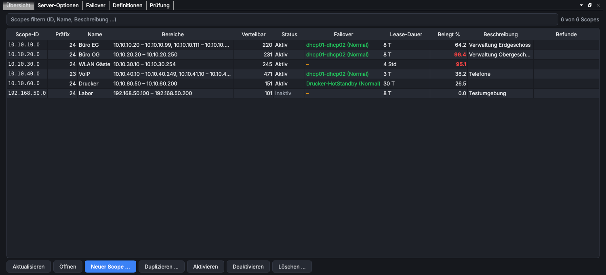
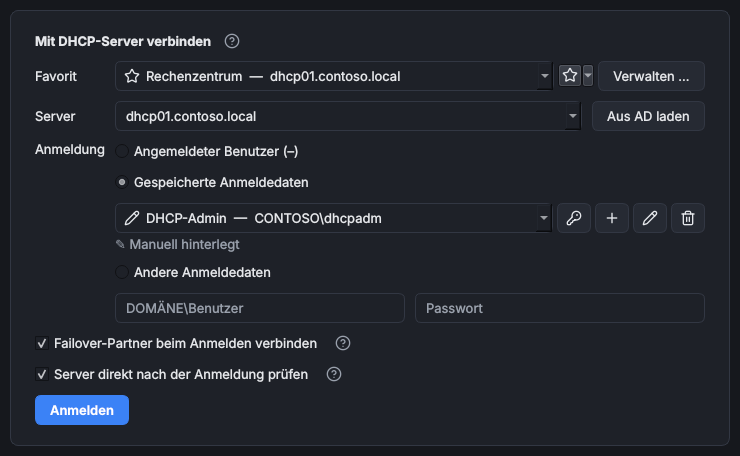
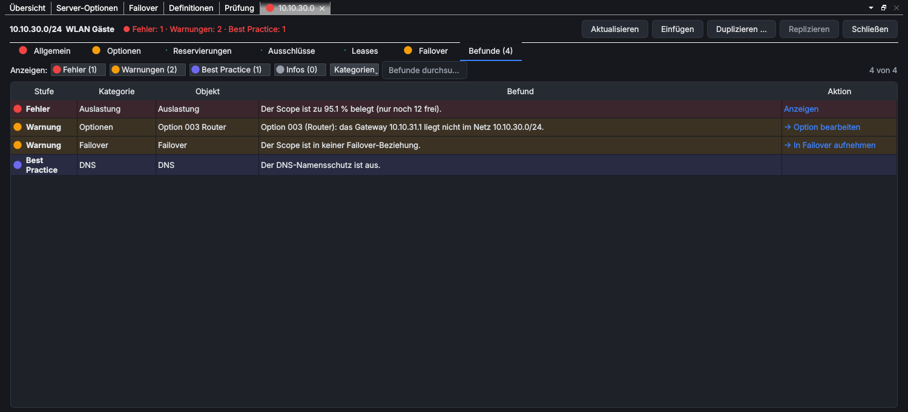
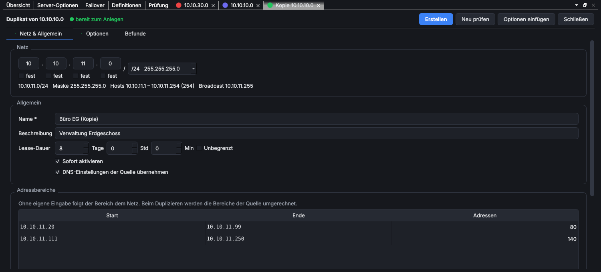
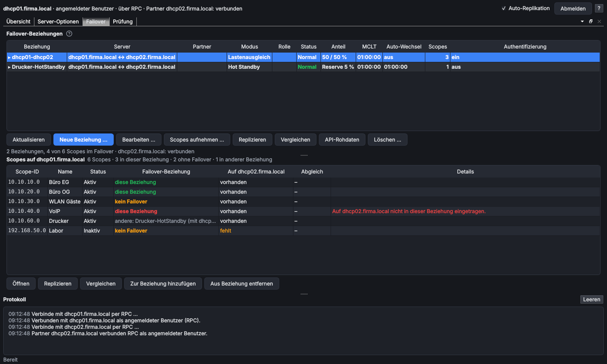
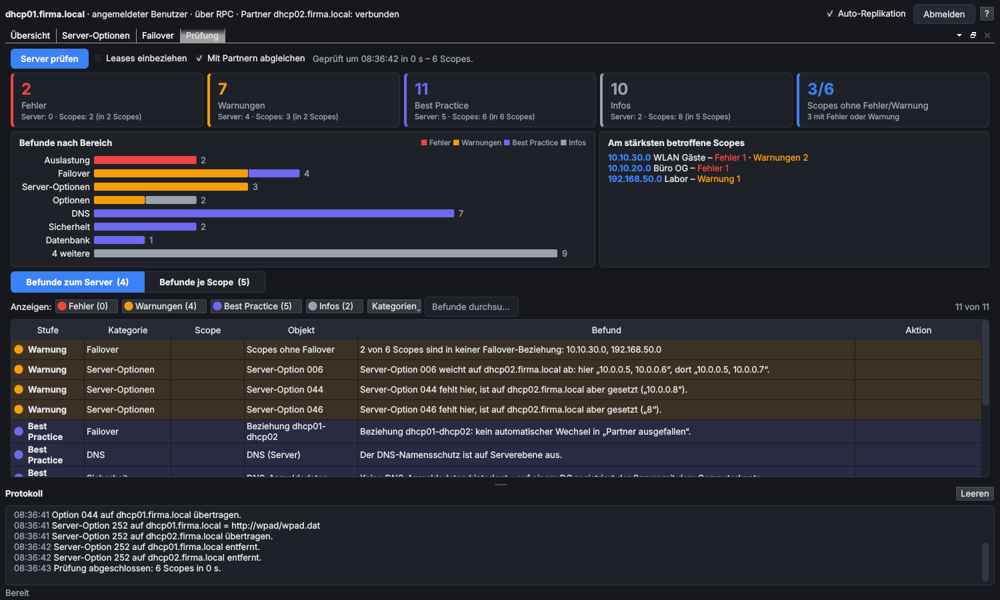

# MS DHCP Extended Management

> **Kurz:** Verwaltet Microsoft-DHCP-Server (IPv4) mit Scopes, Optionen, Reservierungen, Failover und einer
> vollständigen Konfigurationsprüfung. Befunde erscheinen schon beim Tippen, Änderungen an Failover-Scopes
> werden auf den Partner repliziert, neue Scopes entstehen aus Entwürfen oder Duplikaten mit Netzumrechnung.

| | |
|---|---|
| **Tool-ID** | `net.ms-dhcp-extended` |
| **Stand der Seite** | Version 1.3.0 |
| **Bereich** | Netzwerk & Konnektivität |
| **Tags** | DHCP, Scopes, Failover, Reservations, Leases, DHCP Options, RSAT, Microsoft |
| **Plattformen** | Windows |
| **Voraussetzungen** | RSAT: DHCP-Server-Tools (für `netsh dhcp`), wird automatisch installiert |
| **Adminrechte** | lokal nur für die Installation von RSAT; auf dem DHCP-Server Mitglied von „DHCP Administrators“ (Lesen: „DHCP Users“) |
| **Mindestversion OmniWrench** | 0.6.0 |
| **Quellcode** | [`tools/ms_dhcp_extended`](https://github.com/KuroShiroMe/OmniWrench/tree/main/tools/ms_dhcp_extended) |

## Inhalt
- [Wofür](#wofür)
- [Installation und Voraussetzungen](#installation-und-voraussetzungen)
- [Erste Schritte](#erste-schritte)
- [Funktionen im Detail](#funktionen-im-detail)
  - [Anmeldung](#anmeldung)
  - [Aufbau des Hauptfensters](#aufbau-des-hauptfensters)
  - [Übersicht](#übersicht)
  - [Scope-Tab](#scope-tab)
  - [Neuer Scope und Duplikat (Entwurf)](#neuer-scope-und-duplikat-entwurf)
  - [Server-Optionen](#server-optionen)
  - [Failover](#failover)
  - [Replikation auf den Partner](#replikation-auf-den-partner)
  - [Prüfung und Befunde](#prüfung-und-befunde)
  - [Definitionen (Expertenmodus)](#definitionen-expertenmodus)
  - [Zwischenablage](#zwischenablage)
  - [Nur-Lese-Zugriff](#nur-lese-zugriff)
  - [Protokoll](#protokoll)
- [Einstellungen](#einstellungen)
- [Sicherheit und Datenschutz](#sicherheit-und-datenschutz)
- [Grenzen und bekannte Einschränkungen](#grenzen-und-bekannte-einschränkungen)
- [Fehlerbehebung](#fehlerbehebung)
- [Versionen](#versionen)

## Wofür
- alle Scopes eines DHCP-Servers mit Auslastung, Failover und Befunden auf einen Blick sehen
- Scopes anlegen, duplizieren (z. B. für einen neuen Standort) und dabei Adressen automatisch umrechnen lassen
- Optionen, Reservierungen, Ausschlüsse und Leases bearbeiten, mit Prüfung jeder Eingabe
- Failover-Beziehungen anlegen, prüfen und beide Server synchron halten, auch wenn der Partner nur per RPC
  erreichbar ist
- einen ganzen Server auf Fehler, Warnungen und Best-Practice-Abweichungen prüfen
- Optionen und Reservierungen zwischen Scopes kopieren

## Installation und Voraussetzungen
- Der Zugriff auf den Server läuft direkt über die **Windows-DHCP-API** (`dhcpsapi.dll`, RPC), wie die
  DHCP-Konsole. Es wird weder PowerShell noch WinRM benötigt.
- Für die **Replikation zum Partner** nutzt das Tool `netsh dhcp` aus den RSAT-DHCP-Tools
  (`Rsat.DHCP.Tools~~~~0.0.1.0`). OmniWrench installiert sie bei der Installation nach Rückfrage (UAC).
- Auf dem DHCP-Server: Mitgliedschaft in **DHCP Administrators** zum Ändern oder **DHCP Users** zum Lesen.
- Netzwerk: RPC zum DHCP-Server (TCP 135 und dynamische RPC-Ports), wie für die DHCP-Konsole.
- „Aus AD laden“ liest die autorisierten DHCP-Server aus dem Active Directory.

Nur unter Windows verfügbar.

## Erste Schritte
1. Tool öffnen. Es erscheint **Mit DHCP-Server verbinden**.
2. **Server** eintragen oder über **Aus AD laden** wählen.
3. Anmeldung wählen (angemeldeter Benutzer, gespeicherte oder andere Anmeldedaten) und **Anmelden**.
4. Nach dem Laden zeigt die **Übersicht** alle Scopes. Im Hintergrund läuft die Serverprüfung.
5. Doppelklick auf einen Scope öffnet ihn in einem eigenen Tab.

## Funktionen im Detail

### Anmeldung

| Feld | Bedeutung |
|---|---|
| Server | Name oder IP-Adresse; zuletzt verwendete Server zur Auswahl |
| Aus AD laden | listet die im Active Directory autorisierten DHCP-Server |
| Anmeldung | **Angemeldeter Benutzer**, **Gespeicherte Anmeldedaten** (aus den Einstellungen bzw. dem Passwortmanager) oder **Andere Anmeldedaten** (Benutzer `DOMÄNE\Benutzer` + Passwort, nur für diese Sitzung) |
| Failover-Partner beim Anmelden verbinden | prüft sofort den Zugriff auf alle Partner |
| Server direkt nach der Anmeldung prüfen | startet die Serverprüfung im Hintergrund |

Abweichende Anmeldedaten wirken wie `runas /netonly`: Sie gelten nur für die Verbindungen zum Server.
Während der Anmeldung zeigt eine Ladeansicht die Schritte; bei Fehlern geht es zurück zum Formular.

Ist ein **Failover-Partner** mit den Anmeldedaten nicht erreichbar, fragt das Tool:
**Wiederholen**, **Andere Anmeldedaten …**, **Nur Primärserver** oder **Später**.

### Aufbau des Hauptfensters
Das Hauptfenster hat ein eigenes Dock-System: feste Seiten **Übersicht**, **Server-Optionen**, **Failover**,
**Prüfung** (und **Definitionen** im Expertenmodus) sowie ein schließbarer Tab je geöffnetem Scope oder Entwurf.
Alle lassen sich nebeneinander anordnen oder ausklinken.

Oben rechts: Schalter **Auto-Replikation**, **Protokoll**, **Hilfe**, **Abmelden**. Lang laufende Aktionen
zeigen Status, Fortschritt und, wo möglich, **Abbrechen**.

### Übersicht
Tabelle aller Scopes, filterbar über „Scopes filtern (ID, Name, Beschreibung …)“.

| Spalte | Inhalt |
|---|---|
| Scope-ID, Präfix, Name, Beschreibung | Stammdaten |
| Bereiche | Verteilbereiche (Tooltip: Bereiche und Ausschlüsse) |
| Verteilbar / Freie Adressen / Belegt in % | Auslastung |
| Status | aktiv / inaktiv |
| Failover | Beziehung, Partner und Modus |
| Lease-Dauer | z. B. „8 T“ |
| Befunde | höchster Befund des Scopes |

Spalten lassen sich verschieben und ausblenden (*Spalten*; *Standardanordnung wiederherstellen*), die Anordnung
wird gespeichert. Aktionen: **Öffnen**, **Neuer Scope …**, **Duplizieren …**, **Aktivieren**, **Deaktivieren**,
**Löschen …** (Bestätigung durch Eingabe von „LÖSCHEN“; Failover-Scopes werden vorher aus der Beziehung
genommen und auf dem Partner gelöscht).

### Scope-Tab

Jeder Scope öffnet sich in einem eigenen Tab mit diesen Seiten:

| Seite | Inhalt |
|---|---|
| **Allgemein** | Scope-ID, Subnetzmaske, Name, Beschreibung, Lease-Dauer (Tage/Std/Min oder unbegrenzt), Status, Auslastung, dynamisches DNS (immer / auf Anforderung / nie, Einträge bei Ablauf löschen, auch für ältere Clients, Namensschutz) und der **Adresspool** |
| **Optionen** | Scope-Optionen mit Hersteller- und Benutzerklasse; Optionen ohne eigenen Wert erben die Server-Optionen |
| **Reservierungen** | IP, MAC/Client-ID, Name, Beschreibung, Typ (DHCP, BOOTP, beide) |
| **Ausschlüsse** | Start, Ende, Anzahl |
| **Leases** | IP, MAC/Client-ID, Hostname, Status, Ablauf; **In Reservierung umwandeln**, **Als Reservierungen kopieren**, **Lease löschen** |
| **Failover** | Beziehung, Partner, Modus, Status, MCLT, Authentifizierung; Aktionen siehe [Failover](#failover) |
| **Befunde** | alle Befunde des Scopes; Doppelklick wendet eine vorgeschlagene Korrektur an |

**Adresspool:** wie in der DHCP-Konsole eine **Startadresse** und eine **Endadresse**; **Ganzes Netz** setzt
alle nutzbaren Adressen des Netzes. Adressen, die nicht vergeben werden sollen, stehen als **Ausschlüsse** auf
der Seite „Ausschlüsse“ und werden dort einzeln angelegt oder entfernt. Beim Speichern wird der Pool auf dem
Server direkt angepasst (auch bei Failover-Scopes); Ausschlüsse, die danach außerhalb des Pools lägen, nennt
die Rückfrage und entfernt sie. Bei einem Failover-Scope folgt anschließend die Replikation auf den Partner.

**Optionen bearbeiten:** Werte je Zeile oder durch Komma getrennt, Binärwerte als Hex (`0A0B0C`). Jede Eingabe
wird gegen die Definition geprüft (Typ, Anzahl, Adressen im Netz …). Ist eine Option nicht definiert, bietet das
Tool an, eine Definition anzulegen. Die Lease-Dauer (Option 51) steht auf „Allgemein“. Bekannte Hersteller-
Optionen werden erkannt und erklärt, z. B. Option 43 mit Cisco-WLC- oder UniFi-Controller-Adressen, PXE (66/67), WPAD (252).

**Prüfen beim Tippen:** Jede Änderung wird sofort neu bewertet. Betroffene Felder bekommen ein „?“ mit der
Erklärung, Zeilen werden eingefärbt, Seiten mit Befunden tragen ein Symbol. **Speichern** ist gesperrt, solange
Fehler offen sind; Warnungen und Hinweise sperren nicht. Ungespeicherte Änderungen werden beim Schließen erfragt.

### Neuer Scope und Duplikat (Entwurf)

**Neuer Scope …** oder **Duplizieren …** öffnet einen Entwurf als eigenen Tab:

- **Netz & Allgemein:** Netz oktettweise eingeben; ein Schloss („fest“) sperrt Oktette gegen versehentliches
  Ändern. Darunter Maske, Hostbereich, Broadcast. Name (beim Duplikat „‹Name› (Kopie)“), Beschreibung,
  Lease-Dauer, **Sofort aktivieren**, **DNS-Einstellungen der Quelle übernehmen**.
- **Adresspool:** folgt ohne eigene Eingabe dem Netz; beim Duplizieren werden Pool und Ausschlüsse der Quelle umgerechnet.
- **Optionen, Reservierungen, Ausschlüsse:** beim Duplizieren mit Spalten **Übernehmen**, **Wert (Quelle)**,
  **Wert (neu)** und **IP anpassen**. „IP anpassen“ rechnet Adressen aus dem Quellnetz auf das neue Netz um
  (z. B. Gateway `10.1.5.1` → `10.1.9.1`). Doppelklick auf „Wert (neu)“ setzt einen eigenen Wert.
- **Failover:** **In Failover-Beziehung aufnehmen** (bestehende oder **Neue Beziehung …**) und
  **Nach dem Anlegen replizieren**.
- **Erstellen** zeigt eine Zusammenfassung (Netz, Bereich, Ausschlüsse, Optionen, Lease, Status, Failover) und
  legt alles in einem Schritt an. Fehler im Entwurf verhindern das Anlegen.

### Server-Optionen
Oben die Server der Failover-Gruppe (verbundener Server und Partner) mit Rolle, Verbindung, Anzahl Optionen und
Abweichungen. Unten die Optionen des gewählten Servers mit Spalte **Abgleich**:
„Mit Partner synchronisiert“, „Abweichend auf ‹Server›“, „Fehlt auf ‹Server›“.

Aktionen: **Option hinzufügen …**, **Bearbeiten …**, **Entfernen** (optional auch auf den Partnern),
**Auf Partner übertragen** (je Option). Server-Optionen werden **nie automatisch** repliziert, nur auf Knopfdruck.
Ein Befund „Option fehlt“ springt mit **Anzeigen** zu dem Server, der sie hat.

### Failover

Oben die **Failover-Beziehungen** als aufklappbare Zeilen (▸/▾, Doppelklick oder Pfeiltasten). Aufgeklappt
erscheint je Server eine Zeile mit seiner Sicht: Modus, Rolle, Status, Lastenausgleich %, Reserve %, MCLT,
Auto-Wechsel, Anzahl Scopes, Authentifizierung und Abgleich. Abweichungen zwischen beiden Servern werden
markiert (z. B. „Lastverteilung ergibt nicht 100 %“, „beide Server sind aktiv“, „Scopes unterschiedlich“).

Unten **alle Scopes des gewählten Servers** mit ihrer Mitgliedschaft (diese Beziehung, andere Beziehung, kein
Failover) und ob sie auf dem anderen Server vorhanden sind. So fallen getrennte oder halb eingerichtete
Failover-Scopes sofort auf.

| Aktion | Wirkung |
|---|---|
| Neue Beziehung … | Name, Partner, Modus (**Lastenausgleich** mit Anteil in % oder **Hot Standby** mit Rolle und Reserve %), MCLT, automatischer Wechsel in „Partner ausgefallen“ mit Wartezeit, gemeinsamer geheimer Schlüssel, Scopes |
| Bearbeiten … | Modus-Werte, MCLT, Schlüssel (leer = unverändert); Name und Partner sind fest |
| Scopes aufnehmen … / Zur Beziehung hinzufügen | kopiert die Scopes auf den Partner und nimmt sie auf |
| Aus Beziehung entfernen | nimmt Scopes heraus und löscht sie auf dem Partner (beim letzten Scope wird die Beziehung gelöscht) |
| Replizieren | gleicht alle oder gewählte Scopes mit dem Partner ab |
| Vergleichen | zeigt je Element (Name, Maske, Bereich, Status, Lease, Ausschlüsse, Optionen, Reservierungen) lokal / Partner / Ergebnis |
| API-Rohdaten / Partner-Rohdaten | zeigt die Rohdaten zur Fehlersuche |
| Partnersicht neu laden | liest die Sicht des Partners erneut |
| Löschen … | löscht die Beziehung auf beiden Servern und die Scopes auf dem Partner; lokal bleiben sie erhalten |

### Replikation auf den Partner
- Mit **Auto-Replikation** (Schalter oben, Standard an) wird ein Failover-Scope nach jedem Speichern mit dem
  Partner abgeglichen. Sonst trägt der Scope „(nicht repliziert)“, bis **Replizieren** gedrückt wird.
- Die Replikation liest den Partner per `netsh dhcp server \\partner dump`, berechnet die Unterschiede und
  schreibt nur diese per `netsh`. Das funktioniert auch, wenn der Partner nur per RPC erreichbar ist (ohne WinRM).
- Eigene Optionsdefinitionen und Herstellerklassen werden vorher auf dem Partner angelegt.
- Server-Optionen werden nicht automatisch repliziert (siehe [Server-Optionen](#server-optionen)).

### Prüfung und Befunde

Die Seite **Prüfung** bewertet den ganzen Server: Servereinstellungen und jeden Scope, parallel (bis zu 8
gleichzeitig), mit Fortschritt; die Bedienung bleibt frei und die Prüfung lässt sich abbrechen.
**Leases einbeziehen** liest zusätzlich alle Leases (langsam bei großen Servern), **Mit Partnern abgleichen**
vergleicht alles, was auf beiden Failover-Servern gleich sein sollte (siehe [Abgleich mit dem Partner](#abgleich-mit-dem-partner)).

Darstellung: Verteilungsbalken je Kategorie, die Scopes mit den meisten Befunden, Umschalter zwischen
**Befunde zum Server** und **Befunde je Scope** (mit Spalte „Höchster Befund“).

Stufen: **Fehler** (verhindert Speichern), **Warnung**, **Best Practice**, **Info**.
Kategorien: Netz, Adresspool, Allgemein, Lease-Dauer, Auslastung, Ausschlüsse, Optionen, Reservierungen, Leases,
Failover, DNS, Server, Server-Optionen, Definitionen, Sicherheit, Datenbank, Bindungen, Superscopes,
Richtlinien, Filter, Abgleich mit Partner.

Beispiele für Befunde:
- Adresspool außerhalb des Netzes, Netz-/Broadcastadresse im Pool, Ausschluss außerhalb des Pools
- Gateway (Option 3) nicht im Netz, keine DNS-Server (Option 6), kein Domänenname (Option 15)
- ungültige Werte (Adressen, Hostnamen, Domänennamen, Leerzeichen, Text länger als 255 Byte)
- Scope-Option identisch mit der Server-Option (überflüssig), Option auf dem Server nicht definiert
- T1/T2 passen nicht zur Lease-Dauer, PXE ohne Option 66 und 67, WPAD-URL ohne `http://`
- Reservierung außerhalb des Scopes oder im Verteilbereich, hohe Auslastung
- Scope ohne Failover, Abweichungen zum Partner

Viele Befunde bieten eine **Korrektur** an: Doppelklick im Reiter „Befunde“ wendet sie an.

#### Abgleich mit dem Partner
Mit **Mit Partnern abgleichen** liest die Prüfung jeden Failover-Partner (per `netsh`-Dump bzw. DHCP-API) und
meldet jede Abweichung einzeln, Kategorie **Abgleich mit Partner**:

| Ebene | Geprüft |
|---|---|
| Scope | fehlt auf dem Partner, Subnetzmaske, Name, Beschreibung, Status, **Adresspool**, Lease-Dauer, **Ausschlüsse nur hier / nur auf dem Partner**, Optionen (alle Klassen; fehlt, nur auf dem Partner, anderer Wert), Reservierungen (fehlen, nur auf dem Partner, andere MAC oder anderer Name) |
| Beziehung | fehlt auf dem Partner, Modus, Lastverteilung (Summe 100 %), Reserve, MCLT, Authentifizierung, Scopes nur auf einer Seite in der Beziehung |
| Server | Server-Optionen, Optionsdefinitionen (fehlt, anderer Datentyp), Benutzer- und Herstellerklassen |

Die Scope-Abweichungen erscheinen auch im Scope-Tab (Seite „Befunde“ und am betroffenen Feld) mit der Korrektur
**Jetzt replizieren**; die Replikation überträgt den Stand dieses Servers auf den Partner.

### Definitionen (Expertenmodus)
Nur sichtbar, wenn in den Einstellungen **Expertenmodus** eingeschaltet ist, und auch dann zuerst **gesperrt**.
**Entsperren …** fragt nach einer Bestätigung, weil falsche Definitionen auf alle Scopes und Clients wirken.

Tabelle: Option, Name, Typ, Mehrwertig, Herstellerklasse, Beschreibung, Standardwert. Aktionen: **Neue
Definition …**, **Bearbeiten …**, **Löschen** (gesetzte Werte gehen auf allen Scopes verloren), **Auf Partner
übertragen**. Standardoptionen (1–77, 81, 121, 249) sind auf jedem Server vorhanden.

### Zwischenablage
Optionen, Reservierungen und Ausschlüsse lassen sich in einem Scope kopieren und in einem anderen (auch auf
einem anderen Server oder in einem Entwurf) einfügen. Stammen die Daten aus einem anderen Netz, fragt das Tool,
ob Adressen umgerechnet werden sollen. Vorhandene Einträge werden nach Rückfrage überschrieben, Einträge
außerhalb des Scopes übersprungen.

### Nur-Lese-Zugriff
Beim Anmelden prüft das Tool ohne Änderung, ob das Konto schreiben darf. Bei reinem Lesezugriff (DHCP Users)
werden alle Bearbeitungsfunktionen ausgeblendet und Felder schreibgeschützt.

### Protokoll
**Protokoll** zeigt alle ausgeführten Aktionen und Befehle der Sitzung (z. B. die `netsh`-Befehle der
Replikation); **Leeren** löscht die Anzeige.

## Einstellungen

| Einstellung | Standard | Bedeutung |
|---|---|---|
| Verbindung › Letzter Server | leer | wird beim Öffnen vorgeschlagen |
| Verbindung › Failover-Partner beim Anmelden verbinden | an | prüft direkt nach der Anmeldung den Zugriff auf alle Partner; sonst erst bei Bedarf |
| Verbindung › Server nach der Anmeldung prüfen | an | startet die Serverprüfung im Hintergrund |
| Verbindung › Änderungen automatisch replizieren | an | gleicht Failover-Scopes nach jeder Änderung mit dem Partner ab |
| Erweitert › Expertenmodus | aus | zeigt die Seite „Definitionen“ |
| Anmeldung › Gespeicherte Anmeldedaten | – | für „Gespeicherte Anmeldedaten“ bei der Anmeldung; verschlüsselt im Tresor |

## Sicherheit und Datenschutz
- Verbindungen nur zu den angegebenen DHCP-Servern und ihren Failover-Partnern (RPC über die DHCP-API und
  `netsh`), für „Aus AD laden“ zum Active Directory.
- Das Tool **ändert die DHCP-Konfiguration** – jede schreibende Aktion wird angezeigt, kritische Aktionen
  (Löschen, Definitionen) brauchen eine ausdrückliche Bestätigung.
- Abweichende Anmeldedaten gelten nur für die Sitzung und nur für die Serververbindungen; Passwörter werden nicht
  auf der Kommandozeile übergeben.
- Gespeichert werden nur die Einstellungen, die Spaltenanordnung und, falls gewünscht, die Zugangsdaten im Tresor.

## Grenzen und bekannte Einschränkungen
- Nur IPv4; DHCPv6 wird nicht verwaltet.
- Richtlinien (Policies), Filter und Superscopes werden geprüft, aber nicht bearbeitet.
- Server-Optionen werden nur auf Knopfdruck auf Partner übertragen.
- Nur unter Windows (DHCP-API und RSAT).

## Fehlerbehebung

| Problem | Ursache / Lösung |
|---|---|
| Zugriff verweigert (Fehler 5) | Konto ist nicht in „DHCP Administrators“/„DHCP Users“ auf dem Server |
| RPC-Server nicht verfügbar (1722) | Server nicht erreichbar oder Firewall blockiert RPC (TCP 135 + dynamische Ports) |
| „Failover-Partner nicht erreichbar“ | andere Anmeldedaten wählen oder „Nur Primärserver“; ohne Partner keine Replikation |
| Replikation scheitert, `netsh` fehlt | RSAT-DHCP-Tools fehlen: *Voraussetzungen prüfen* und *Reparieren* |
| „Speichern nicht möglich, solange Fehler offen sind“ | Fehler auf der Seite „Befunde“ beheben (Doppelklick wendet Korrekturen an) |
| Seite „Definitionen“ fehlt | Expertenmodus in den Einstellungen einschalten |
| Bearbeiten-Knöpfe fehlen | Konto hat nur Lesezugriff |
| „Der Adressbereich eines Failover-Scopes kann nicht gelöscht werden“ (0x4EA4) | trat bis 1.2.2 beim Ändern des Pools eines Failover-Scopes auf; ab 1.3.0 wird der Pool direkt angepasst |
| „Eine Richtlinie im Scope nutzt einen Adressbereich außerhalb des neuen Bereichs“ (0x4E90) | zuerst den Bereich der Richtlinie (Policy) in der DHCP-Konsole anpassen, dann den Pool |

## Versionen

| Version | Änderungen |
|---|---|
| 1.3.0 | Adresspool wie in der DHCP-Konsole (Start/Ende + Ausschlüsse statt Bereichsliste); Pool von Failover-Scopes änderbar (Fehler 0x4EA4 behoben, Pool wird direkt angepasst, Ausschlüsse bleiben bei Fehlern erhalten); Prüfung gleicht alles mit dem Failover-Partner ab (Scopes, Ausschlüsse, Optionen, Reservierungen, Beziehung, Klassen, Definitionen); verständliche Texte für weitere DHCP-Fehlercodes |
| 1.2.1 | Bereich und Tags neu |
| 1.2.0 | Prüfung mit Spalte „Höchster Befund“, Failover-Beziehungen aufklappbar mit beiden Servern, Server-Optionen je Server; Alpha-Kennzeichnung entfernt |
| 1.1.0 | Spalten verschiebbar, Failover-Ansicht je Server, Prüfseite mit Verteilung, Server-Optionen mit Abgleich, Definitionen im Expertenmodus, Erkennung von Nur-Lese-Zugriff |
| 1.0.0 | Neuaufbau als OmniWrench-Tool: Zugriff über die DHCP-API statt PowerShell |

## Siehe auch
- [Subnetzrechner](Tool-Subnetzrechner)
- [NetProbe](Tool-NetProbe)
- [Passwortmanager](Passwortmanager)
