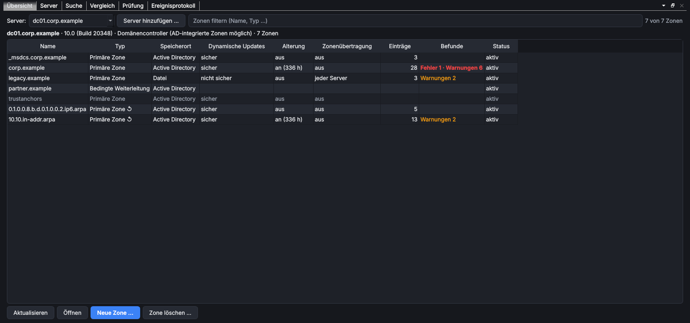
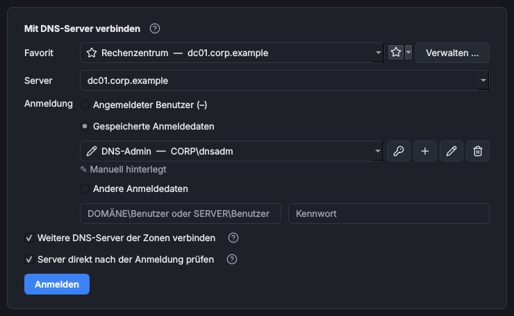
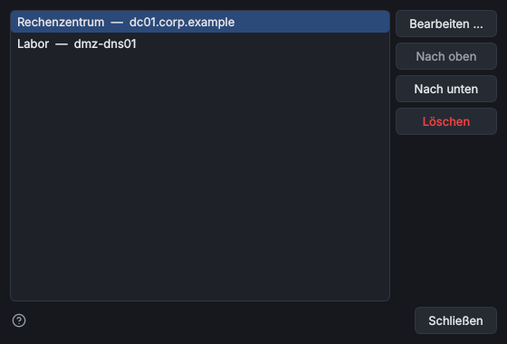
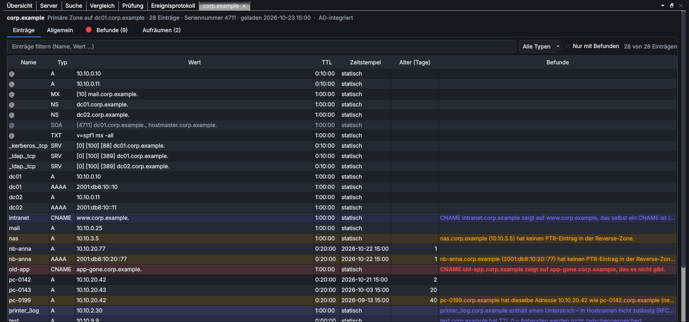
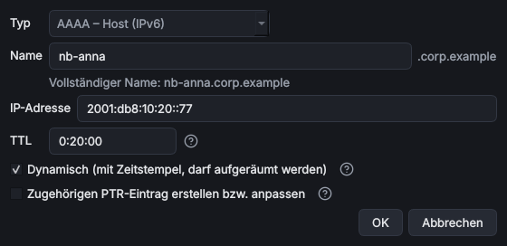
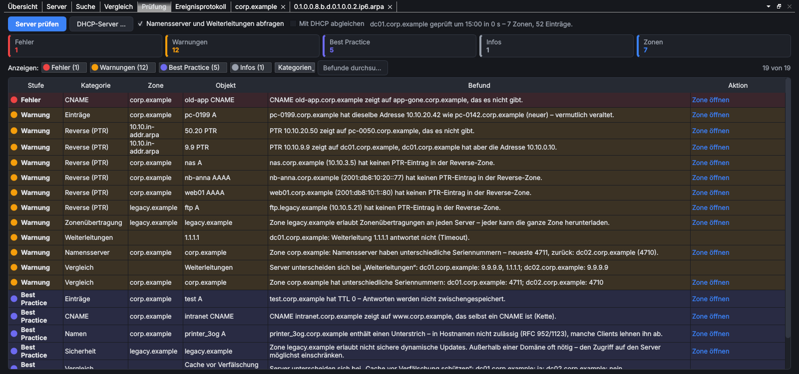

# MS DNS Extended Management

> **Kurz:** Verwaltet Microsoft-DNS-Server – Domänencontroller mit AD-integrierten Zonen ebenso wie eigenständige
> Server außerhalb einer Domäne – mit Zonen, Einträgen (IPv4 und IPv6), Reverse-Auflösung, Alterung/Aufräumen und
> einer vollständigen Konfigurationsprüfung. PTR-Einträge werden beim Anlegen und Ändern mitgeführt, mehrere Server
> lassen sich gleichzeitig verbinden und vergleichen.

| | |
|---|---|
| **Tool-ID** | `net.ms-dns-extended` |
| **Stand der Seite** | Version 1.0.0 |
| **Bereich** | Netzwerk & Konnektivität |
| **Tags** | DNS, Zones, Records, Reverse Lookup, PTR, IPv6, Scavenging, WMI, Microsoft |
| **Plattformen** | Windows |
| **Voraussetzungen** | pywin32 und dnspython (installiert der Store automatisch), kein RSAT |
| **Adminrechte** | lokal nicht nötig; auf dem DNS-Server Mitglied von „DnsAdmins“ oder lokaler Administrator |
| **Mindestversion OmniWrench** | 0.6.0 |
| **Quellcode** | [`tools/ms_dns_extended`](https://github.com/KuroShiroMe/OmniWrench/tree/main/tools/ms_dns_extended) |



## Inhalt
- [Wofür](#wofür)
- [Installation und Voraussetzungen](#installation-und-voraussetzungen)
- [Erste Schritte](#erste-schritte)
- [Funktionen im Detail](#funktionen-im-detail)
  - [Anmeldung](#anmeldung)
  - [Favoriten](#favoriten)
  - [Aufbau des Hauptfensters](#aufbau-des-hauptfensters)
  - [Übersicht](#übersicht)
  - [Zonen-Tab](#zonen-tab)
  - [Eintrag anlegen und ändern](#eintrag-anlegen-und-ändern)
  - [Reverse-Zonen und PTR-Einträge (IPv4 und IPv6)](#reverse-zonen-und-ptr-einträge-ipv4-und-ipv6)
  - [Aufräumen (Scavenging)](#aufräumen-scavenging)
  - [Neue Zone](#neue-zone)
  - [Server](#server)
  - [Suche](#suche)
  - [Vergleich mehrerer Server](#vergleich-mehrerer-server)
  - [Prüfung und Befunde](#prüfung-und-befunde)
  - [Abgleich mit DHCP](#abgleich-mit-dhcp)
  - [Replikation zwischen Servern](#replikation-zwischen-servern)
  - [Änderungen anderer erkennen](#änderungen-anderer-erkennen)
  - [Ereignisprotokoll](#ereignisprotokoll)
  - [Ereignisprotokoll einrichten](#ereignisprotokoll-einrichten)
  - [Protokoll](#protokoll)
- [Einstellungen](#einstellungen)
- [Sicherheit und Datenschutz](#sicherheit-und-datenschutz)
- [Grenzen und bekannte Einschränkungen](#grenzen-und-bekannte-einschränkungen)
- [Fehlerbehebung](#fehlerbehebung)
- [Versionen](#versionen)

## Wofür
- alle Zonen eines oder mehrerer DNS-Server mit Typ, Speicherort, Updates, Alterung, Zonenübertragung und Befunden
  auf einen Blick sehen
- Einträge (A, AAAA, CNAME, PTR, MX, TXT, SRV, NS) anlegen, ändern und löschen – der passende PTR-Eintrag in der
  Reverse-Zone wird dabei mitgeführt, auch für IPv6 (`ip6.arpa`)
- fehlende oder verwaiste PTR-Einträge, CNAME-Konflikte, Ziele ohne Adresse und doppelte Adressen finden und per
  Doppelklick korrigieren
- vor dem Aufräumen sehen, welche dynamischen Einträge gelöscht würden und ob die Geräte noch antworten
- Domänencontroller oder DNS-Server untereinander vergleichen (Einstellungen, Zonen, SOA-Seriennummern)
- DNS mit den Leases und Reservierungen eines Microsoft-DHCP-Servers abgleichen
- eigenständige DNS-Server außerhalb der Domäne (z. B. in der DMZ) mit eigener Anmeldung verwalten

## Installation und Voraussetzungen
- Der Zugriff läuft über **WMI** (Namespace `root\MicrosoftDNS`, DCOM), wie bei der DNS-Konsole. Es wird weder
  PowerShell noch RSAT benötigt.
- Der Store installiert die Python-Pakete **pywin32** (WMI) und **dnspython** (Abfragen an Namensserver und
  Weiterleitungen) in den privaten Ordner des Tools. Keine UAC-Abfrage.
- Auf dem DNS-Server: Mitgliedschaft in **DnsAdmins** oder lokale **Administratorrechte**. Auf einem
  Domänencontroller zählen die Domänengruppen; auf einem eigenständigen Server ein lokales Konto
  (`SERVER\Benutzer`).
- Netzwerk: WMI/DCOM zum Server – TCP 135 und dynamische RPC-Ports, Firewall-Regelgruppe
  **Windows-Verwaltungsinstrumentation (WMI)**. Für die Abfragen an Namensserver und Weiterleitungen zusätzlich
  DNS (UDP/TCP 53).
- Optional für die Seite „Ereignisprotokoll“: Leserecht auf das Protokoll *Microsoft-Windows-DNSServer/Audit* –
  siehe [Ereignisprotokoll einrichten](#ereignisprotokoll-einrichten).
- Optional für den DHCP-Abgleich: Leserecht auf einem Microsoft-DHCP-Server („DHCP-Benutzer“ genügt).

Nur unter Windows verfügbar. Das Tool läuft unabhängig von [MS DHCP Extended Management](Tool-MS-DHCP-Extended-Management);
beide können gemeinsam oder einzeln verwendet werden.

## Erste Schritte
1. Tool öffnen. Es erscheint **Mit DNS-Server verbinden**.
2. **Server** eintragen (Name oder IP-Adresse; leer oder `.` = dieser Computer).
3. Anmeldung wählen (angemeldeter Benutzer, gespeicherte oder andere Anmeldedaten) und **Anmelden**.
4. Nach dem Laden zeigt die **Übersicht** alle Zonen. Im Hintergrund werden weitere DNS-Server der Zonen verbunden
   und die Prüfung läuft.
5. Doppelklick auf eine Zone öffnet sie in einem eigenen Tab.

## Funktionen im Detail

### Anmeldung


| Feld | Bedeutung |
|---|---|
| **Favorit** | gespeicherter Server mit Anmeldeart und Verbindungseinstellungen, siehe [Favoriten](#favoriten) |
| **Server** | Name oder IP-Adresse des DNS-Servers; die zuletzt verwendeten Server stehen in der Liste |
| **Angemeldeter Benutzer** | Windows-Anmeldung des Arbeitsplatzes (Kerberos/NTLM) |
| **Gespeicherte Anmeldedaten** | Zugangsdaten aus dem Tresor oder einem Passwortmanager |
| **Andere Anmeldedaten** | `DOMÄNE\Benutzer` oder für Server außerhalb der Domäne `SERVER\Benutzer` und Kennwort |
| **Weitere DNS-Server der Zonen verbinden** | liest die NS-Einträge und verbindet die gefundenen Microsoft-DNS-Server (bis 12) mit derselben Anmeldung |
| **Server direkt nach der Anmeldung prüfen** | startet die Prüfung im Hintergrund |

Für den **lokalen Computer** verwendet Windows immer das angemeldete Konto; andere Anmeldedaten werden dort
ignoriert (Hinweis im Protokoll).

### Favoriten
Server, die regelmäßig verwaltet werden, lassen sich als **Favorit** speichern (Zeile „Favorit“ oben auf der Anmeldeseite). Zusätzlich kann ein Favorit **weitere Server** (durch Komma getrennt, z. B. ein DNS-Server in der DMZ, der nicht über die NS-Einträge gefunden wird) und den **DHCP-Server für den Abgleich** enthalten. Beide werden nach der Anmeldung mit denselben Anmeldedaten verbunden bzw. eingestellt; nicht erreichbare Server stehen nur im Protokoll.
Eine Auswahl füllt Server, Anmeldeart, Benutzer bzw. gespeicherte Anmeldedaten und die Verbindungseinstellungen
aus. Der zuletzt gewählte Favorit ist beim nächsten Öffnen wieder eingestellt. Wird der Server von Hand geändert,
springt die Auswahl auf „Kein Favorit“.

| Aktion | So geht es |
|---|---|
| Favorit anlegen | Anmeldemaske ausfüllen, ☆ (Als Favorit speichern) › Name und Notiz vergeben |
| Favorit ändern | Favorit wählen, Anmeldemaske anpassen, ☆ › **Favorit „…“ mit den aktuellen Einstellungen überschreiben** |
| Name, Server, Notiz, weitere Server, DHCP-Server | **Verwalten …** › **Bearbeiten …** (oder Doppelklick) |
| Reihenfolge, löschen | **Verwalten …** › **Nach oben**, **Nach unten**, **Löschen** |



Kennwörter werden **nie** im Favoriten gespeichert: Bei „Andere Anmeldedaten“ nur der Benutzer, bei „Gespeicherte
Anmeldedaten“ nur der Verweis auf den Eintrag (das Kennwort bleibt im Tresor bzw. Passwortmanager). Fehlt der
Eintrag später, weist die Anmeldeseite darauf hin. Favoriten sind für weitere Einstellungen je Server vorbereitet
(z. B. die geplanten KI-Einstellungen).

### Aufbau des Hauptfensters
- Oben: verbundener Server (mit Anzahl weiterer Server), **Aktualisieren** (automatische Aktualisierung),
  **Abmelden** und **?** (Kurzhilfe).
- Seiten als Reiter: **Übersicht**, **Server**, **Suche**, **Vergleich**, **Prüfung**, **Ereignisprotokoll** und je
  geöffnete Zone ein Tab. Reiter lassen sich verschieben, nebeneinander anordnen oder abdocken.
- Unten das **Protokoll** und die Statuszeile; lange Aktionen zeigen einen Fortschritt und lassen sich abbrechen.

### Übersicht
Alle Zonen des gewählten Servers. Über **Server** wird zwischen den verbundenen Servern gewechselt,
**Server hinzufügen …** verbindet einen weiteren (mit gleicher oder eigener Anmeldung), **Server entfernen** trennt
ihn wieder.

| Spalte | Inhalt |
|---|---|
| Name | Zonenname; automatisch angelegte Zonen (z. B. `trustanchors`) sind grau |
| Typ | Primär, Sekundär, Stub, Bedingte Weiterleitung; ↺ = Reverse-Zone |
| Speicherort | Active Directory oder Datei |
| Dynamische Updates | keine, nicht sicher, sicher |
| Alterung | an (mit Gesamtdauer) oder aus |
| Zonenübertragung | aus, Namensserver, Liste, jeder Server |
| Einträge | Anzahl, sobald die Zone geladen ist |
| Befunde | Fehler und Warnungen aus der Prüfung |
| Status | aktiv, angehalten, heruntergefahren |

**Öffnen** (oder Doppelklick), **Aktualisieren**, **Neue Zone …** und **Zone löschen …**. Das Löschen einer Zone
muss mit dem Wort „löschen“ bestätigt werden und kann nicht rückgängig gemacht werden; eine AD-integrierte Zone
verschwindet dabei von allen Domänencontrollern ihres Replikationsbereichs.

### Zonen-Tab


Kopfzeile: Typ, Server, Anzahl Einträge, SOA-Seriennummer und Ladezeit. Beim Öffnen werden die zugehörigen
Reverse- und Forward-Zonen mitgeladen, damit PTR-Prüfungen und -Änderungen sofort möglich sind.

**Einträge** – alle Einträge der Zone mit Name, Typ, Wert, TTL, Zeitstempel (oder „statisch“), Alter, **Repliziert**
(nur bei mehreren Servern mit dieser Zone, siehe [Replikation zwischen Servern](#replikation-zwischen-servern)) und
Befunden.
Zeilen mit Befunden sind farbig hinterlegt. Filter nach Text und Typ, **Nur mit Befunden**. Aktionen (Knöpfe und
Rechtsklick):

| Aktion | Wirkung |
|---|---|
| **Neuer Eintrag …** / **Bearbeiten …** | Dialog, siehe [Eintrag anlegen und ändern](#eintrag-anlegen-und-ändern) |
| **Löschen …** | löscht die markierten Einträge; zugehörige PTR-Einträge können gleich mit gelöscht werden |
| **TTL ändern …** | neue TTL für alle markierten Einträge |
| **Statisch machen** | entfernt den Zeitstempel markierter dynamischer Einträge (werden dann nicht mehr aufgeräumt) |
| **PTR-Einträge erstellen** | legt für markierte A-/AAAA-Einträge fehlende PTR-Einträge an |
| **Zeilen kopieren** / **Zelle kopieren** | Zwischenablage (Tab-getrennt) |

Typen ohne eigenen Dialog (z. B. CAA, DNSSEC-Einträge) werden angezeigt, aber nicht geändert. In Sekundär- und
Stubzonen sowie bedingten Weiterleitungen sind die Einträge nur lesbar.

**Allgemein** – Typ, Speicherort, Status, Masterserver, SOA (Seriennummer, primärer Server, Intervalle),
**Dynamische Updates**, **Alterung** (Intervall ohne Aktualisierung, Aktualisierungsintervall, „Aufräumen erlaubt
ab“) und **Zonenübertragung/Benachrichtigung**. **Übernehmen** speichert, **Verwerfen** stellt die geladenen Werte
wieder her. Nicht sichere Updates und Übertragungen an jeden Server müssen ausdrücklich bestätigt werden.
Zonenaktionen: **Anhalten**, **Fortsetzen**, **Neu laden**, **Von Master übertragen** (Sekundär/Stub), **Aus AD
neu laden** (AD-integriert), **In Datei schreiben** (dateibasiert), **Zone löschen …**.

**Befunde** – die Befunde dieser Zone; Doppelklick wendet die vorgeschlagene Korrektur an (z. B. PTR erstellen,
verwaisten Eintrag löschen) oder springt zum Eintrag. Ein „?“-Symbol neben einem Feld auf „Allgemein“ zeigt die
Befunde zu diesem Feld.

**Aufräumen** – siehe [Aufräumen (Scavenging)](#aufräumen-scavenging).

### Eintrag anlegen und ändern


| Feld | Bedeutung |
|---|---|
| Typ | A, AAAA, CNAME, PTR, MX, TXT, SRV, NS (beim Ändern fest) |
| Name | relativ zur Zone, leer = Zone selbst (`@`); darunter der vollständige Name |
| Daten | je Typ: IP-Adresse, Ziel, Priorität/Gewichtung/Port, Text |
| TTL | z. B. `3600`, `1h`, `30m`, `1d` oder `1:00:00` |
| Dynamisch | Eintrag mit Zeitstempel, wird beim Aufräumen gelöscht, wenn er nicht mehr erneuert wird |
| Zugehörigen PTR-Eintrag erstellen bzw. anpassen | nur bei A/AAAA, wenn eine passende Reverse-Zone vorhanden ist |

Jede Eingabe wird geprüft (Adressformat passend zum Typ, Hostnamen, Zahlenbereiche, CNAME nicht an der
Zonenspitze). Ändern bedeutet für Windows „alten Eintrag löschen, neuen anlegen“; beides läuft zusammen mit dem PTR
als eine Transaktion. TXT-Texte über 255 Zeichen (z. B. DKIM) werden automatisch in Teilstücke geteilt,
Zeilenumbrüche entfallen.

### Reverse-Zonen und PTR-Einträge (IPv4 und IPv6)
- IPv4: `in-addr.arpa` mit /8, /16 oder /24; IPv6: `ip6.arpa` mit Nibble-Grenzen (Präfix durch 4 teilbar, z. B. /48
  oder /64).
- In Reverse-Zonen zeigt die Spalte „Name“ die **Adresse** statt der Nibble- bzw. Oktett-Schreibweise; der volle
  Name steht im Tooltip.
- Beim Anlegen oder Ändern eines A/AAAA-Eintrags mit PTR-Option sucht das Tool die genaueste passende primäre
  Reverse-Zone, legt den PTR an und entfernt einen alten PTR auf denselben Namen bzw. die alte Adresse.
- Beim Löschen eines A/AAAA-Eintrags bietet die Rückfrage an, die zugehörigen PTR-Einträge mit zu löschen.

### Aufräumen (Scavenging)
Der Reiter **Aufräumen** im Zonen-Tab zeigt, welche dynamischen Einträge beim nächsten Aufräumen gelöscht würden
oder innerhalb von 7 Tagen veralten: Name, Typ, Wert, Zeitstempel, Alter, **Gelöscht ab**, **Ping** und **DHCP**.

- **Ping** prüft per ICMP (IPv4 und IPv6), ob die Geräte noch antworten. Eine Firewall kann die Antwort
  verhindern – „keine Antwort“ ist ein Hinweis, kein Beweis.
- **DHCP** zeigt nach einem [DHCP-Abgleich](#abgleich-mit-dhcp), ob es eine aktive Lease oder Reservierung gibt.
- **Jetzt löschen …** und **Statisch machen** wirken auf die markierten Zeilen.
- Ist die Alterung der Zone oder das Aufräumen am Server aus, sagt der Hinweis oben, dass nichts automatisch
  gelöscht wird.

### Neue Zone
**Neue Zone …** auf der Übersicht: Zonentyp (Primär, Sekundär, Stub, Bedingte Weiterleitung), Forward- oder
Reverse-Lookupzone, Zonenname bzw. **Netz** (z. B. `192.168.10.0/24` oder `2001:db8:10::/48` – der Name der
Reverse-Zone wird daraus berechnet und angezeigt), **In Active Directory speichern** (nur auf
Domänencontrollern), Zonendatei, Masterserver, verantwortliche Person und dynamische Updates.

### Server
Einstellungen des gewählten Servers: **Weiterleitungen** mit Zeitlimit, **Rekursion**, „Nur Weiterleitungen
verwenden“, **Aufräumen** (Intervall), Alterung für neue Zonen, erweiterte Optionen (Cache-Schutz, Round Robin,
Netzmaskenreihenfolge, BIND-Sekundärserver, automatische Reverse-Zonen, EDNS) und die Adressen, auf denen der
Server lauscht. Knöpfe: **Übernehmen**, **Verwerfen**, **Weiterleitungen testen** (fragt jede Weiterleitung direkt
an und zeigt die Antwortzeit), **Jetzt aufräumen**, **Cache leeren**. Darunter die Befunde zum Server.

### Suche
Sucht in allen geladenen Zonen aller verbundenen Server nach Namen oder Namensteilen, IP-Adressen (IPv4/IPv6) oder
Netzen (z. B. `10.1.2.0/24`), optional nach Typ. **Alle Zonen laden** lädt die noch nicht geöffneten Zonen dazu.
Treffer lassen sich öffnen, löschen und kopieren.

### Vergleich mehrerer Server
Ab zwei verbundenen Servern: Tabelle der Servereinstellungen nebeneinander (Unterschiede farbig), Tabelle der
Zonen je Server und die Befunde dazu (z. B. unterschiedliche Weiterleitungen, AD-Zone fehlt auf einem DC,
unterschiedliche Update-/Alterungseinstellungen, Aufräumen auf mehreren DCs). **SOA-Seriennummern abfragen**
fragt jeden Server nach der Seriennummer jeder Zone und zeigt Replikations- oder Übertragungsverzug.
**Server suchen** findet weitere Microsoft-DNS-Server über die NS-Einträge.

### Prüfung und Befunde


**Server prüfen** lädt alle Zonen und prüft sie; mit **Namensserver und Weiterleitungen abfragen** werden zusätzlich
alle Namensserver jeder Zone (SOA) und die Weiterleitungen per DNS befragt. Die Kacheln zeigen die Verteilung,
Filter nach Stufe, Kategorie und Text. Doppelklick führt die Korrektur aus oder öffnet die Zone.

| Stufe | Beispiele |
|---|---|
| Fehler | CNAME neben anderen Einträgen, CNAME-Ziel fehlt, MX/NS zeigt auf CNAME oder auf einen fehlenden Namen, Zone heruntergefahren, Namensserver nicht autoritativ (fehlerhafte Delegierung), kein SOA/NS |
| Warnung | A/AAAA ohne PTR, PTR zeigt auf fehlenden oder falschen Namen, gleiche Adresse auf mehreren dynamischen Namen, nicht sichere Updates in AD-Zonen, Übertragung an jeden Server, Alterung ohne Aufräumen am Server, Namensserver mit unterschiedlicher Seriennummer oder ohne Antwort, Weiterleitung antwortet nicht |
| Best Practice | Alterung aus bei dynamischen Einträgen, sehr kurze Alterung, TTL 0, CNAME-Ketten, Unterstrich im Hostnamen, nur eine Weiterleitung, keine Reverse-Zonen, Cache-Schutz aus |
| Info | veraltete Einträge (Zusammenfassung), Platzhalter-Einträge, leere Zonen |

### Abgleich mit DHCP
**DHCP-Server …** auf der Prüfseite trägt einen Microsoft-DHCP-Server ein (gleiche oder eigene Anmeldung). Mit
**Mit DHCP abgleichen** liest die Prüfung dessen Leases und Reservierungen (IPv4, nur lesend) und meldet:
- Lease ohne A-Eintrag,
- Lease mit anderer Adresse als im DNS,
- dynamischer A-Eintrag in einem DHCP-Bereich ohne Lease oder Reservierung (vermutlich veraltet, mit Korrektur
  „Eintrag löschen“).

Das DHCP-Tool selbst muss dafür nicht installiert sein. Umgekehrt prüft
[MS DHCP Extended Management](Tool-MS-DHCP-Extended-Management) ab 1.5.0 optional seine Leases gegen DNS.

### Replikation zwischen Servern
Windows repliziert DNS-Änderungen selbst; das Tool zeigt, wie weit sie gekommen sind, und kann nachhelfen. Es
arbeitet mit allen Servern der Sitzung (weitere DCs werden nach der Anmeldung automatisch verbunden, andere über
**Server hinzufügen …**).

| Art der Zone | Wie Windows repliziert | Was „Replikation anstoßen“ macht |
|---|---|---|
| AD-integriert | über die AD-Replikation der Partition (DomainDnsZones, ForestDnsZones oder die Domäne); der DNS-Dienst liest AD etwa alle 3 Minuten neu | AD-Replikation der Partition vom Server dieses Tabs an alle Partner (auch über Standorte, wie `repadmin /syncall /P /e`), danach **Aus AD neu laden** auf den Partnern |
| Dateibasiert (auch ohne Domäne) | Zonenübertragung (AXFR/IXFR) vom primären an die sekundären Server, sofort nach einer Benachrichtigung (NOTIFY) oder nach dem Aktualisierungsintervall aus dem SOA | **Von Master übertragen** auf allen verbundenen sekundären Servern |

- **Spalte „Repliziert“**: `✓ 3/3` = der Eintrag ist auf allen Servern mit dieser Zone, `2/3` (orange) = er fehlt
  auf einem; der Tooltip nennt die Server. `?` = ein Server ließ sich nicht abfragen.
- **Zeile über der Tabelle**: Stand je Server („gleich“, „fehlt dort: n“, „nur dort: n“ – z. B. ein gelöschter
  Eintrag, den der Partner noch hat). Bei dateibasierten Zonen zusätzlich Seriennummer und letzte Übertragung.
  Eingetragene sekundäre Server, die nicht verbunden sind, werden ohne Anmeldung per SOA-Abfrage angezeigt.
- **Replikation prüfen** fragt den Stand neu ab (passiert auch beim Öffnen der Zone).
- **Nach jeder eigenen Änderung** prüft das Tool im Hintergrund nach (nach 15 s, 45 s, 1,5, 3 und 5 Minuten) und
  schreibt ins Protokoll, wann die Änderung überall angekommen ist oder auf welchem Server sie noch fehlt.
- **Rechte**: Das Anstoßen der AD-Replikation braucht das Recht **„Replikation synchronisieren“** auf der Partition.
  Domänen-Admins haben es für DomainDnsZones, für ForestDnsZones standardmäßig nur Organisations-Admins; es lässt
  sich gezielt delegieren. Fehlt es, meldet das Tool das mit Konto und Partition, führt die übrigen Schritte
  trotzdem aus und die Änderung kommt mit der normalen AD-Replikation an. Für **Von Master übertragen** und **Aus
  AD neu laden** reichen DnsAdmins bzw. lokale Administratorrechte auf dem jeweiligen Server.

### Änderungen anderer erkennen
- Vor jedem Speichern vergleicht das Tool die **SOA-Seriennummer** der betroffenen Zonen. Hat sich die Zone seit dem
  Laden geändert (DNS-Konsole, PowerShell, Kollegen, dynamische Updates), lädt es sie neu und meldet, ob betroffene
  Einträge verschwunden, geändert oder schon vorhanden sind – mit „wer“ aus dem Ereignisprotokoll. Auswahl:
  **Neu laden**, **Trotzdem speichern**, **Abbrechen**.
- Die automatische Aktualisierung (oben im Hauptfenster, Standard alle 5 Minuten) lädt Zonenliste und offene Zonen
  neu, wenn sich die Seriennummer geändert hat, und schreibt die Unterschiede ins Protokoll.

### Ereignisprotokoll
Die Seite zeigt das Überwachungsprotokoll des DNS-Servers (*Microsoft-Windows-DNSServer/Audit*): **Zeit**,
**Benutzer**, **Bereich** (Zone, Eintrag, Server, Cache, DNSSEC, Richtlinie), **Aktion** (erstellt, geändert,
gelöscht, aufgeräumt), **Zone**, **Objekt**, Originalmeldung und **ID**. Auswahl von Server, Zeitraum (letzte
Stunde bis 30 Tage) und Zone, Textfilter, **Aktualisieren**. **Zone öffnen** öffnet die betroffene Zone. Kann das
Protokoll nicht gelesen werden, erscheint ein Hinweis mit Link auf die Anleitung unten.

### Ereignisprotokoll einrichten
1. **Protokoll prüfen** – das Überwachungsprotokoll ist ab Windows Server 2012 R2 vorhanden und normalerweise aktiv:
   ```powershell
   wevtutil gl "Microsoft-Windows-DNSServer/Audit"            # enabled: true?
   wevtutil sl "Microsoft-Windows-DNSServer/Audit" /e:true    # einschalten
   ```
2. **Leserecht** – das Konto in die Gruppe **Ereignisprotokollleser** (*Event Log Readers*, SID `S-1-5-32-573`)
   des Servers aufnehmen; auf Domänencontrollern die gleichnamige Gruppe im Container *Builtin* der Domäne.
   Administratoren dürfen ohnehin lesen, „DnsAdmins“ allein reicht **nicht**.
3. **Firewall** – auf dem Server die Regelgruppe **Remote-Ereignisprotokollverwaltung** zulassen:
   ```powershell
   Get-NetFirewallRule -Name "RemoteEventLogSvc*" | Enable-NetFirewallRule
   ```
4. **Testen** vom Arbeitsplatz:
   ```powershell
   Get-WinEvent -ComputerName dc01 -LogName "Microsoft-Windows-DNSServer/Audit" -MaxEvents 5
   ```

### Protokoll
**Protokoll** zeigt alle Aktionen der Sitzung (Verbindungen, angelegte/gelöschte Einträge, Zonen- und
Serveränderungen, Rücknahmen mit „↶“ bzw. „✗“); **Leeren** löscht die Anzeige.

## Einstellungen

| Einstellung | Standard | Bedeutung |
|---|---|---|
| Verbindung › Letzter Server | leer | wird beim Öffnen vorgeschlagen |
| Verbindung › Weitere DNS-Server beim Anmelden verbinden | an | verbindet die DNS-Server aus den NS-Einträgen mit derselben Anmeldung |
| Verbindung › Server nach der Anmeldung prüfen | an | startet die Prüfung im Hintergrund |
| Verbindung › Namensserver und Weiterleitungen bei der Prüfung abfragen | an | DNS-Abfragen (SOA, NS) an alle Namensserver und Weiterleitungen |
| Verbindung › Automatisch aktualisieren | alle 5 Minuten | aus, 1, 2, 5, 10, 15, 30 Minuten; auch oben im Hauptfenster umstellbar |
| DHCP › DHCP-Server für den Abgleich | leer | Microsoft-DHCP-Server, dessen Leases mit DNS verglichen werden |
| Anmeldung › Gespeicherte Anmeldedaten | – | für „Gespeicherte Anmeldedaten“ bei der Anmeldung; verschlüsselt im Tresor |

## Sicherheit und Datenschutz
- Verbindungen nur zu den angegebenen bzw. gefundenen DNS-Servern (WMI/DCOM, verschlüsselt mit
  Paketvertraulichkeit), DNS-Abfragen (Port 53) an deren Namensserver und Weiterleitungen, ICMP nur auf Knopfdruck
  im Reiter „Aufräumen“, optional RPC zum DHCP-Server (nur lesend).
- Das Tool **ändert die DNS-Konfiguration** – kritische Aktionen (Löschen, nicht sichere Updates, Übertragung an
  jeden Server, Rekursion aus, Zone löschen) brauchen eine ausdrückliche Bestätigung.
- **Alles oder nichts:** Jede Aktion läuft als Transaktion. Schlägt ein Schritt fehl oder wird die Aktion
  abgebrochen, nimmt das Tool alle bereits gemachten Änderungen rückwärts zurück (Einträge, Zonen- und
  Servereinstellungen, neu angelegte Zonen). Schritte, die beim Zurücknehmen scheitern, werden einzeln genannt.
- Kennwörter gelten nur für die Sitzung, liegen nur im Arbeitsspeicher und werden nirgends protokolliert.
- Gespeichert werden nur die Einstellungen, die zuletzt verwendeten Server, die Favoriten (ohne Kennwörter), die
  Spaltenanordnung und, falls gewünscht, die Zugangsdaten im Tresor.

## Grenzen und bekannte Einschränkungen
- Nur Windows (WMI über DCOM). Windows Server als Arbeitsplatz wird von OmniWrench nicht unterstützt, als
  DNS-Server aber natürlich schon.
- Bearbeitet werden A, AAAA, CNAME, PTR, MX, TXT, SRV und NS; andere Typen (z. B. CAA, DNSSEC) nur anzeigen.
  DNSSEC-Signierung, DNS-Richtlinien, Zonenbereiche (Scopes) und Stammhinweise werden nicht verwaltet.
- Nur-Lese-Rechte lassen sich über WMI nicht vorab erkennen; fehlende Rechte zeigen sich erst beim Speichern
  („Zugriff verweigert“, die Aktion wird zurückgenommen).
- „Dynamisch“ setzt Windows nur für **alle** Einträge eines Namens gemeinsam (WMI kennt nur „AgeAllRecords“ je
  Name): legt man einen dynamischen Eintrag an, werden andere statische Einträge desselben Namens ebenfalls
  dynamisch.
- Nicht zurücknehmbar und deshalb immer der letzte Schritt: **Zone löschen**, **Jetzt aufräumen**, **Cache leeren**.
- Sehr große Zonen (zehntausende Einträge) brauchen beim Laden und Anzeigen einige Sekunden.
- Der DHCP-Abgleich liest IPv4-Leases; IPv6-Adressen werden nur über die DNS-Einträge geprüft.
- Der Replikationsstand umfasst nur verbundene Server (nicht verbundene sekundäre Server nur über die
  Seriennummer). Die AD-Replikation wird über die Topologie angestoßen; DCs, die nur über andere DCs erreichbar
  sind, bekommen die Änderung im zweiten Schritt.

## Fehlerbehebung

| Problem | Ursache / Lösung |
|---|---|
| Zugriff verweigert (0x80070005 / 0x80041003) | Konto ist nicht in „DnsAdmins“ bzw. nicht lokaler Administrator auf dem Server |
| Anmeldung fehlgeschlagen (0x8007052E) | Benutzername oder Kennwort falsch; außerhalb der Domäne `SERVER\Benutzer` verwenden |
| Server nicht erreichbar (0x800706BA) | Name/Netzwerk prüfen, Firewall-Regelgruppe „Windows-Verwaltungsinstrumentation (WMI)“ und RPC (TCP 135 + dynamische Ports) |
| „Kein Microsoft-DNS-Server“ | Rolle DNS-Server fehlt oder der Dienst läuft nicht |
| „Windows erlaubt für den lokalen Computer keine anderen Anmeldedaten“ | für diesen Computer „Angemeldeter Benutzer“ wählen |
| „pywin32 konnte nicht geladen werden“ | in der Tool-Verwaltung *Reparieren* wählen |
| „Am Server geändert“ beim Speichern | jemand anderes hat die Zone geändert; **Neu laden**, prüfen, erneut speichern |
| PTR-Option ist ausgegraut | es gibt keine primäre Reverse-Zone für die Adresse; Zone über **Neue Zone …** mit dem Netz anlegen |
| Hinweis auf der Seite „Ereignisprotokoll“ | siehe [Ereignisprotokoll einrichten](#ereignisprotokoll-einrichten) |
| Namensserver „antwortet nicht“ in der Prüfung | Port 53 vom Arbeitsplatz zum Namensserver gesperrt oder Name nicht auflösbar; die Option „Namensserver und Weiterleitungen abfragen“ ausschalten, wenn das gewollt ist |
| „… Alle n bereits durchgeführten Änderungen wurden zurückgenommen“ | die Aktion ist an der genannten Ursache gescheitert, der vorherige Stand ist wiederhergestellt |
| „Replikation synchronisieren“ fehlt | siehe [Replikation zwischen Servern](#replikation-zwischen-servern), Abschnitt Rechte |
| Unklare Fehlermeldung, z. B. „Allgemeiner Fehler“ (0x80041001) | im Fehlerfenster **Detailansicht** öffnen: Dort stehen alle Versuche mit den genauen WMI-Meldungen (HRESULT, Quelle, SWbemLastError), ohne Passwörter. Mit **Alles kopieren** lässt sich der Text weitergeben |

## Versionen

| Version | Änderungen |
|---|---|
| 1.2.0 | **Favoriten**: Server mit Anmeldeart, Verbindungseinstellungen, weiteren Servern und DHCP-Server für den Abgleich speichern, auf der Anmeldeseite auswählen und verwalten (ohne Kennwörter) |
| 1.1.2 | Fehlermeldung „Internal C++ object … already deleted“ beim Schließen, wenn noch eine Replikations-Nachprüfung ausstand (behoben) |
| 1.1.1 | „Replikation anstoßen“ scheiterte an AD-Zonen mit „Objekt nicht gefunden“ (0x80041002) beim Ermitteln der Partition (behoben) |
| 1.1.0 | Replikation: Spalte **Repliziert** je Eintrag, Stand je Server, Nachprüfen nach eigenen Änderungen, **Replikation anstoßen** (AD-Replikation der DNS-Partition bzw. Übertragung zu sekundären Servern) mit klarer Meldung bei fehlendem Recht |
| 1.0.4 | Knöpfe unter der Eintragsliste waren bei kleineren Fenstern erst nach dem Scrollen sichtbar (behoben) |
| 1.0.3 | Einträge werden über die Methode der jeweiligen Typklasse angelegt, mit weiteren Wegen bei „Allgemeiner Fehler“; Fehlerfenster mit **Detailansicht** |
| 1.0.2 | Anmeldung scheiterte an jedem Server mit 0x80004005 (behoben) |
| 1.0.0 | Erste Version: Zonen und Einträge (A, AAAA, CNAME, PTR, MX, TXT, SRV, NS) bearbeiten mit PTR-Pflege (IPv4/IPv6), neue Zonen inkl. IPv6-Reverse, Server-Einstellungen, Aufräum-Vorschau mit Ping, Prüfung mit Abfrage der Namensserver und Weiterleitungen, Vergleich mehrerer Server, Suche, DHCP-Abgleich, Ereignisprotokoll, Erkennung von Änderungen anderer, Transaktionen mit Rücknahme |

## Siehe auch
- [MS DHCP Extended Management](Tool-MS-DHCP-Extended-Management)
- [NetProbe](Tool-NetProbe) (DNS-Abfragen von außen)
- [Subnetzrechner](Tool-Subnetzrechner)
- [Passwortmanager](Passwortmanager)
