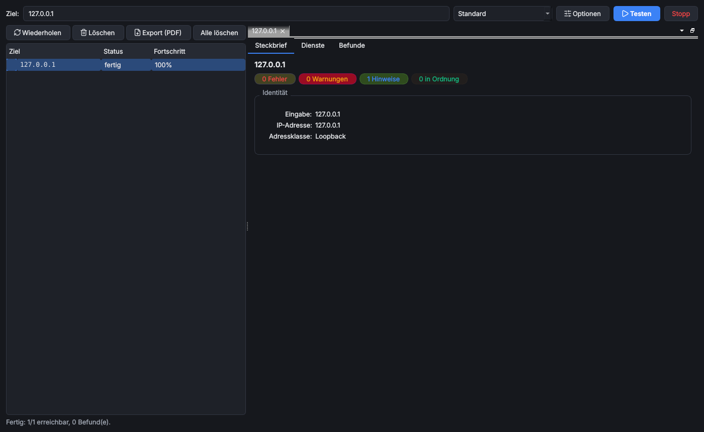

# NetProbe

> **Kurz:** Netzwerk-Testtool für Adressen, Namen und ganze Netze: Ping, Traceroute, Portscan, Web/TLS,
> SMB/RDP/NTP, DNS- und Mail-Diagnose sowie ein Leitungstest zu einer Gegenstelle. Jedes Ziel bekommt einen
> Steckbrief und eine Befundliste mit Fehlern, Warnungen und Best-Practice-Hinweisen.

| | |
|---|---|
| **Tool-ID** | `net.netprobe` |
| **Stand der Seite** | Version 1.3.0 |
| **Bereich** | Netzwerk & Konnektivität |
| **Tags** | Ping, Traceroute, Port Scan, Subnet Scan, DNS, DNSSEC, HTTP, TLS, SMB, RDP, NTP, Link Test, Throughput, Load Test |
| **Plattformen** | Windows, Linux |
| **Voraussetzungen** | Python-Paket `dnspython` (automatisch) |
| **Adminrechte** | nicht nötig |
| **Mindestversion OmniWrench** | 0.6.0 |
| **Quellcode** | [`tools/netprobe`](https://github.com/KuroShiroMe/OmniWrench/tree/main/tools/netprobe) |

## Inhalt
- [Wofür](#wofür)
- [Installation und Voraussetzungen](#installation-und-voraussetzungen)
- [Erste Schritte](#erste-schritte)
- [Funktionen im Detail](#funktionen-im-detail)
- [Leitungstest](#leitungstest)
- [Einstellungen](#einstellungen)
- [Sicherheit und Datenschutz](#sicherheit-und-datenschutz)
- [Grenzen und bekannte Einschränkungen](#grenzen-und-bekannte-einschränkungen)
- [Fehlerbehebung](#fehlerbehebung)
- [Versionen](#versionen)

## Wofür
- prüfen, ob ein Server erreichbar ist und welche Dienste er anbietet
- ein Netz (z. B. `192.168.1.0/24`) nach aktiven Geräten mit Hersteller und offenen Ports durchsuchen
- Paketverlust, Jitter und Laufzeiten einer Verbindung messen, die Route mit Netzbetreibern ansehen
- Zertifikate, TLS-Versionen und Sicherheits-Header einer Webseite prüfen
- eine Domain auf DNS- und Mail-Best-Practice prüfen (SPF, DKIM, DMARC, MTA-STS, DNSSEC, CAA)
- die echte Leitungsqualität zu einem Standort messen: Latenz, Durchsatz, Last, durchgelassene Ports

## Installation und Voraussetzungen
Bei der Installation wird `dnspython` mitinstalliert. Keine Adminrechte nötig: Ping nutzt unter Windows die
Windows-API (`IcmpSendEcho`), unter Linux das Programm `ping`; es werden keine Raw-Sockets geöffnet.

## Erste Schritte
1. NetProbe öffnen.
2. Im Feld **Ziel** eine Adresse, einen Namen, ein Netz oder einen Bereich eingeben.
3. Rechts daneben ein **Testprofil** wählen (z. B. „Standard“) und **Testen** klicken.
4. Das Ziel erscheint links in der Zielliste mit Status und Fortschritt.
5. Ziel anklicken: rechts öffnet sich ein Tab mit Steckbrief und Ergebnissen.

## Funktionen im Detail

### Ziele eingeben
| Eingabe | Beispiel | Ergebnis |
|---|---|---|
| IP-Adresse | `10.0.0.1`, `2001:db8::1` | ein Ziel |
| DNS-Name | `example.com` | ein Ziel, mit vollständiger DNS-Diagnose |
| Netz (CIDR) | `192.168.1.0/24` | alle Hosts des Netzes |
| Bereich | `10.0.0.1-50` oder `10.0.0.1-10.0.0.50` | alle Adressen im Bereich |
| mehrere | durch Komma oder Leerzeichen getrennt | alle zusammen |

Höchstens 4.096 Adressen pro Eingabe. Bei Netzen und Bereichen prüft NetProbe standardmäßig zuerst, welche
Hosts antworten, und testet nur diese ausführlich („Beim Netzscan nur erreichbare Hosts prüfen“).

### Testprofile
| Profil | Inhalt |
|---|---|
| Schnellüberblick | Namensauflösung, PTR, Ping (5), Netzbetreiber, Portscan „Schnell“ mit Bannern, HTTP/TLS |
| Standard | alle Tests außer Leitungstest, Portscan „Standard“ |
| Tiefenanalyse | alle Tests außer Leitungstest, Portscan „Erweitert“, 15 Pings, auch nicht antwortende Hosts |
| Leitungstest (Gegenstelle) | Namensauflösung, Ping und der [Leitungstest](#leitungstest); ❗ daneben erinnert an die Gegenstelle |
| Benutzerdefiniert | die eigene Auswahl aus den **Optionen** |

### Zielliste
- Einzelziele stehen direkt in der Liste, Netze und Bereiche als aufklappbare Gruppe mit „x/y Hosts“.
- Spalten **Ziel**, **Status** (wartet, läuft, fertig, keine Antwort, Fehler, abgebrochen) und **Fortschritt**;
  ⚠n zeigt die Zahl der Befunde.
- Die Liste bleibt erhalten: neue Tests werden angehängt, ein erneuter Test desselben Ziels aktualisiert den
  vorhandenen Eintrag.
- Knöpfe und Rechtsklick: **Wiederholen**, **Löschen**, **Export (PDF)**, **Alle löschen**. **Stopp** bricht
  laufende Tests ab. Mehrere Tests können gleichzeitig laufen.

### Ergebnis-Tabs
Ein Klick auf ein Ziel öffnet rechts einen Tab. Die Tabs lassen sich innerhalb von NetProbe frei anordnen
(nebeneinander, gestapelt, ausgeklinkt), z. B. um zwei Ziele zu vergleichen. Jeder Tab enthält nur die
Kategorien, die gelaufen sind:

| Reiter | Inhalt |
|---|---|
| **Steckbrief** | Identität (Eingabe, IP, Adressklasse, PTR, Netzbetreiber/Land, MAC und Hersteller, NetBIOS-Name/Arbeitsgruppe), Befund-Ampel, offene Ports auf einen Blick |
| **Konnektivität** | Ping: empfangen/gesendet, Paketverlust, Laufzeit min/Ø/max, Median, Standardabweichung, Jitter, TTL mit Schätzung von Sprüngen und Betriebssystem; Pfad-MTU (inkl. stiller Verwerfung); Kurzüberblick der Route |
| **Route** | Traceroute: je Sprungpunkt IP, Name, Laufzeit min/Ø/max, Verlust und Netzbetreiber; alle Sprünge werden parallel nachgemessen |
| **Ports** | offene/geschlossene/gefilterte Ports mit Dienst, Antwortzeit, Banner und Kennzeichen (unverschlüsselt, Verwaltung, veraltet, Datenbank, Windows, Industrie); Erklärung und typische Einsatzszenarien aus einer Bibliothek mit über 130 Diensten |
| **Web & TLS** | je Web-Port: Status, Seitentitel, Server, Antwortzeit, Weiterleitung, fehlende Sicherheits-Header; TLS: ausgehandelte Version, Verschlüsselung, unterstützte Versionen, Zertifikat (Antragsteller, Aussteller, Gültigkeit, alternative Namen, Schlüssel, Vertrauenskette) |
| **Dienste** | SMB (Version, Signierung erforderlich, SMBv1 aktiv, Serverzeit), RDP (Sicherheitsebene, NLA), NTP (Stratum, Referenz, Zeitabweichung), DNS-Server (Rekursion, offene Auflösung) |
| **DNS** | nur bei Namen: A/AAAA/CNAME/MX/NS/TXT/SOA/CAA, Nameserver mit Seriennummern-Vergleich, SPF/DKIM/DMARC, MTA-STS, TLS-RPT, DNSSEC, Wildcard, AD-SRV-Einträge |
| **Leitungstest** | siehe [Leitungstest](#leitungstest) |
| **Befunde** | alle Befunde nach Stufe: Fehler, Warnungen, Hinweise, in Ordnung |

Web und TLS werden auf bekannten Web-Ports **und** auf unbekannten offenen Ports geprüft; so fallen auch
Weboberflächen auf ungewöhnlichen Ports auf.

### Befunde
Rund 60 Regeln bewerten die Ergebnisse, z. B.:
- Erreichbarkeit, hohe Laufzeit, Paketverlust, Jitter
- unverschlüsselte Verwaltungsdienste (Telnet, FTP …), offene Datenbank-Ports, SMBv1, RDP ohne NLA
- abgelaufene oder bald ablaufende Zertifikate, fehlende Vertrauenskette, alte TLS-Versionen,
  fehlende Sicherheits-Header
- Zeitabweichung von NTP, offener DNS-Resolver
- fehlende oder fehlerhafte SPF/DKIM/DMARC-Einträge, kein CAA, kein MTA-STS/TLS-RPT, DNSSEC-Probleme,
  abweichende SOA-Seriennummern

### PDF-Export
**Export (PDF)** erstellt einen Bericht für das gewählte Ziel oder die Auswahl, mit allen Ergebnissen und Befunden.

### Optionen
**Optionen** öffnet die Testauswahl je Kategorie (Haken je Test, „Alle“ je Kategorie) und die Parameter.
Änderungen gelten für das Profil „Benutzerdefiniert“.

| Option | Standard | Bedeutung |
|---|---|---|
| Portumfang | Standard | Schnell (~24 Ports), Standard (~130 Ports aus der Bibliothek), Erweitert (1–1024 + Bibliothek), Vollständig (1–65535, langsam), Eigene Auswahl |
| Eigene Ports | leer | z. B. `22,80,443,8000-8100` |
| Anzahl Pings | 10 | gezählte Pings je Ziel |
| Aufwärm-Pings (nicht gezählt) | 2 | gegen Verluste durch ARP oder Routenaufbau beim ersten Paket |
| Ping-Timeout | 2000 ms | Wartezeit je Ping |
| Ping-Intervall | 300 ms | Abstand der Pings |
| Port-Zeitlimit | 800 ms | Wartezeit je Port |
| Parallele Ziele | 16 | gleichzeitig getestete Hosts |
| Parallele Verbindungen | 300 | gleichzeitige Verbindungen insgesamt |
| Max. Sprungpunkte | 30 | Traceroute-Tiefe |
| DNS-Timeout | 4000 ms | Wartezeit je DNS-Abfrage |
| Beim Netzscan nur erreichbare Hosts prüfen | an | spart Zeit bei großen Netzen |
| Herstellerliste für MAC-Adressen laden | an | IEEE-OUI-Liste für Hersteller zu MAC-Adressen |
| Zurücksetzen | – | Standardwerte wiederherstellen |

## Leitungstest

Misst die echte Qualität der Verbindung zu einer **Gegenstelle**, auf der das NetProbe-Mini-Tool (`linkagent`)
oder ein zweites NetProbe läuft:

| Messung | Ergebnis |
|---|---|
| Wahre Latenz (TCP) | Laufzeit min/Ø/max, Jitter, Verlust auf Anwendungsebene, mit Verlaufskurve |
| Download / Upload | Durchsatz je Richtung |
| Lasttest | mehrere parallele Verbindungen: Gesamtdurchsatz, pro Verbindung, fehlgeschlagene Verbindungen |
| Pfad-Portscan | welche Ports die Strecke (Firewalls, Proxys) durchlässt und welche unterwegs blockiert werden |

**Ablauf:**
1. In den **Optionen › Leitungstest** mit **Neu** ein Token erzeugen (gemeinsames Geheimnis).
2. Die Gegenstelle starten, eine von drei Möglichkeiten:
   - **Mini-Tool (.exe)** exportieren, auf den entfernten Rechner kopieren und starten (kein Python nötig).
     Exportiert wird das Programm für das eigene System (Windows: `linkagent.exe`, Linux: `linkagent`);
     `linkagent.exe` liegt außerdem jedem Release bei
   - **Als Skript (.py)** exportieren und dort mit Python 3.8+ starten:
     `python linkagent.py serve --port 47600 --token <Token>`
   - auf dem anderen Rechner in NetProbe **Als Gegenstelle dienen** klicken
3. Hier das Profil **Leitungstest (Gegenstelle)** wählen, die IP der Gegenstelle eintragen, **Testen**.

| Option | Standard | Bedeutung |
|---|---|---|
| Port der Gegenstelle | 47600 | TCP-Port; in der Firewall der Gegenstelle freigeben |
| Token | – | muss auf beiden Seiten gleich sein |
| Dauer je Richtung | 5 s | Messdauer für Download und Upload |
| Lasttest-Verbindungen | 8 | parallele Verbindungen |
| Pfad-Ports | leer = Standardauswahl | Ports für den Pfad-Portscan, z. B. `22,80,443,8000-8100` |
| Messungen | alle an | Latenz, Download, Upload, Lasttest, Pfad-Portscan einzeln abschaltbar |

Last entsteht nur gegenüber einer Gegenstelle, die bewusst mit demselben Token gestartet wurde. Dauer,
Verbindungszahl und Portanzahl sind begrenzt.

### KI-Assistenten
Ab OmniWrench 0.9.0 können [KI-Assistenten](KI-Assistenten) die Ergebnisse von NetProbe lesen – so weit der
[KI-Zugriff](KI-Zugriff-und-Verfremdung) es erlaubt (Standard: nur Beschreibung).

| Stufe | Funktionen für Assistenten |
|---|---|
| 2 – Übersicht | Geprüfte Ziele mit Zustand, IP und Anzahl Befunde je Schwere |
| 3 – Lesen | Befunde und Rohdaten der Tests eines Ziels |
| 4 – Ändern mit Bestätigung | Test starten (erzeugt Netzwerkverkehr, daher immer mit Bestätigung) |

Im Rechtsklickmenü der Ergebnisse steht **Assistent fragen …**.

## Einstellungen

| Einstellung | Standard | Bedeutung |
|---|---|---|
| Allgemein › Letztes Ziel | leer | wird beim Öffnen ins Zielfeld übernommen |
| Allgemein › Herstellerliste laden (MAC-Suche) | an | lädt die IEEE-OUI-Liste einmalig für Herstellernamen |

Die Testauswahl und Parameter stehen im Tool unter **Optionen**.

## Sicherheit und Datenschutz
- NetProbe sendet Pakete an die eingegebenen Ziele (ICMP, TCP-Verbindungen, HTTP/TLS-Anfragen, SMB/RDP/NTP/DNS-
  Abfragen). **Nur Systeme testen, für die eine Berechtigung besteht.** Portscans können Sicherheitssysteme
  (IDS/IPS) auslösen.
- Weitere Verbindungen: DNS-Abfragen über den eingestellten DNS-Server, Netzbetreiber über den DNS-Dienst von
  Team Cymru (`*.asn.cymru.com`), einmalig die Herstellerliste von `standards-oui.ieee.org`.
- Die Herstellerliste liegt im Datenordner unter `tool_data/net.netprobe`. Testergebnisse werden nicht
  gespeichert, außer als selbst exportierter PDF-Bericht.
- Keine Administratorrechte, keine Raw-Sockets.

## Grenzen und bekannte Einschränkungen
- Kein UDP-Portscan (nur gezielte UDP-Dienste: NTP, DNS, NetBIOS).
- MAC-Adresse und Hersteller nur für Ziele im eigenen Netzsegment.
- Höchstens 4.096 Adressen pro Eingabe.
- Leitungstest braucht eine erreichbare Gegenstelle mit freigegebenem Port.
- Blacklist-Prüfungen (DNSBL) und SMTP-Tests sind noch nicht enthalten.

## Fehlerbehebung

| Problem | Ursache / Lösung |
|---|---|
| Ping meldet Verlust, `ping` in der Konsole nicht | Ping-Timeout oder Aufwärm-Pings in den Optionen erhöhen |
| „Ping nicht verfügbar (ICMP gesperrt?)“ | Ziel oder Firewall blockiert ICMP; Ports und Dienste werden trotzdem getestet |
| „Zu viele Adressen“ | kleineres Netz oder Bereich angeben (max. 4.096) |
| Leitungstest: „Keine Verbindung zur Gegenstelle“ | Mini-Tool läuft? Port in der Firewall der Gegenstelle frei? Gleiches Token? |
| Leitungstest: „Kein Token gesetzt“ | in den Optionen mit **Neu** ein Token erzeugen |
| Mini-Tool (.exe) nicht exportierbar | aus dem Quellcode gestartet: Skript exportieren oder `scripts/build_linkagent.py` bauen |
| Zertifikat „nicht vertrauenswürdig“ obwohl gültig | Zwischenzertifikat fehlt auf dem Server, oder Firmen-CA nicht im Zertifikatspeicher |

## Versionen

| Version | Änderungen |
|---|---|
| 1.3.0 | **KI-Assistenten**: Ergebnisse und Befunde für Assistenten, Test starten mit Bestätigung, „Assistent fragen …“ |
| 1.2.3 | läuft auch unter Linux |
| 1.2.2 | Bereich und Tags neu |
| 1.2.1 | Mini-Tool als eigenständige .exe (ohne Python) |
| 1.2.0 | Leitungstest mit Gegenstelle: Latenz, Durchsatz, Lasttest, Pfad-Portscan |
| 1.1.0 | dauerhafte Zielliste mit Gruppen, Testprofile, Steckbrief und Konnektivität, PDF-Export, Ping-Verbesserungen |
| 1.0.0 | erste Version |

## Siehe auch
- [Subnetzrechner](Tool-Subnetzrechner)
- [MS DHCP Extended Management](Tool-MS-DHCP-Extended-Management)
