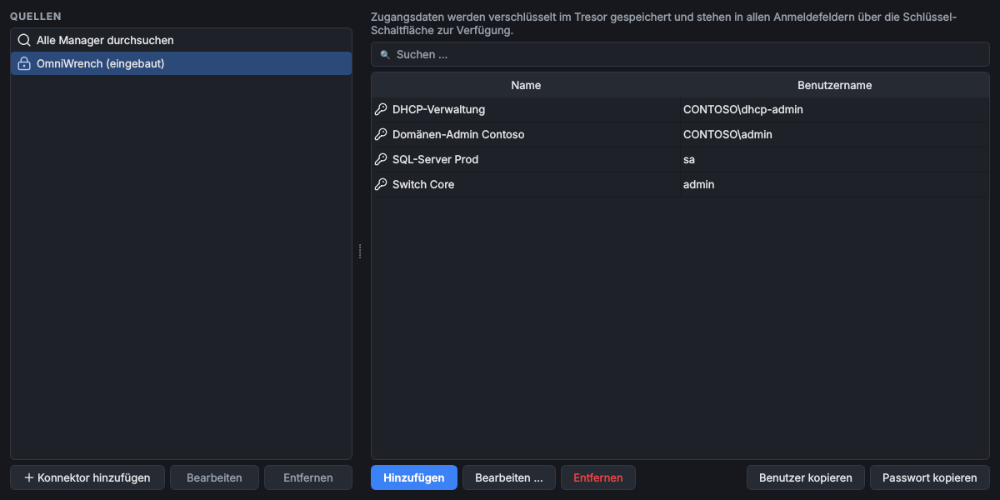

# OmniVault

> **Kurz:** Verwaltet den eingebauten Passwortmanager und bindet externe Passwortmanager an (KeePass,
> SecretManagement, Netwrix, Bitwarden, 1Password, HashiCorp Vault). Danach durchsucht jede
> Zugangsdaten-Auswahl in OmniWrench alle Manager gleichzeitig.

| | |
|---|---|
| **Tool-ID** | `sec.omnivault` |
| **Stand der Seite** | Version 1.1.4 |
| **Bereich** | Informationssicherheit |
| **Tags** | Passwords, Credentials, SecretManagement, KeePass, Netwrix, Bitwarden, Vaultwarden, 1Password, HashiCorp Vault, OpenBao |
| **Plattformen** | Windows, Linux (ohne SecretManagement und Netwrix) |
| **Voraussetzungen** | Python-Paket `pykeepass` (automatisch); je Konnektor ggf. ein Programm oder Modul, siehe unten |
| **Adminrechte** | nicht nötig |
| **Mindestversion OmniWrench** | 0.5.1 |
| **Quellcode** | [`tools/omnivault`](https://github.com/KuroShiroMe/OmniWrench/tree/main/tools/omnivault) |

## Inhalt
- [Wofür](#wofür)
- [Installation und Voraussetzungen](#installation-und-voraussetzungen)
- [Erste Schritte](#erste-schritte)
- [Funktionen im Detail](#funktionen-im-detail)
- [Konnektoren](#konnektoren)
- [Einstellungen](#einstellungen)
- [Sicherheit und Datenschutz](#sicherheit-und-datenschutz)
- [Grenzen und bekannte Einschränkungen](#grenzen-und-bekannte-einschränkungen)
- [Fehlerbehebung](#fehlerbehebung)
- [Versionen](#versionen)

## Wofür
- Zugangsdaten aus dem Firmen-Passwortmanager in OmniWrench-Tools nutzen, ohne sie zu kopieren
- mehrere Passwortmanager (z. B. KeePass-Datei des Teams und persönlicher Bitwarden) gemeinsam durchsuchen
- Benutzername oder Passwort schnell in die Zwischenablage kopieren
- den eingebauten Passwortmanager in einem eigenen Tab verwalten

## Installation und Voraussetzungen
Bei der Installation wird das Python-Paket `pykeepass` mitinstalliert (für KeePass). Weitere Programme braucht
nur der jeweilige Konnektor; der Konnektor-Dialog bietet die Installation an:

| Konnektor | Benötigt |
|---|---|
| KeePass | nichts weiter (liest die .kdbx-Datei direkt) |
| Microsoft SecretManagement | PowerShell-Module `Microsoft.PowerShell.SecretManagement` (+ ggf. `SecretStore`); Installation aus der PowerShell Gallery wird angeboten |
| Netwrix Password Secure | SDK `PsrApi.dll` aus dem Netwrix-Kundenportal |
| Bitwarden / Vaultwarden | Bitwarden-CLI `bw`; Installation per winget (`Bitwarden.CLI`) wird angeboten |
| 1Password | 1Password-CLI `op`; Installation per winget (`AgileBits.1Password.CLI`) wird angeboten |
| HashiCorp Vault / OpenBao | nichts weiter (HTTP-API) |

OmniVault ist eine Einzelinstanz (nur ein Tab gleichzeitig). Die Konnektoren werden nach jeder Anmeldung
automatisch registriert, auch wenn der Tab nicht geöffnet ist.

## Erste Schritte
1. OmniVault öffnen. Links stehen die **Quellen**: „Alle Manager durchsuchen“ und „OmniWrench (eingebaut)“.
2. **Konnektor hinzufügen** klicken, unter **Passwortmanager** den Typ wählen (z. B. KeePass) und die Felder
   ausfüllen.
3. **Verbindung testen**: meldet „Verbindung erfolgreich (n Einträge gefunden)“.
4. Speichern. Ab jetzt findet die 🔑-Auswahl in jedem Tool auch Einträge aus diesem Manager.

## Funktionen im Detail

### Quellen
Die linke Liste zeigt:
- **Alle Manager durchsuchen**: Suche über alle aktiven Quellen gleichzeitig
- **OmniWrench (eingebaut)**: der eingebaute [Passwortmanager](Passwortmanager) mit Anlegen, Bearbeiten,
  Passwort generieren und Löschen
- je Konnektor ein Eintrag; deaktivierte Konnektoren tragen den Zusatz „deaktiviert“, Einträge mit ❗ haben nach
  dem Zurücksetzen des Masterpassworts keine gespeicherten Anmeldedaten mehr

Unter der Liste: **Konnektor hinzufügen**, **Bearbeiten**, **Entfernen**. Entfernen löscht nur die Verbindung,
nicht die Einträge im externen Manager.

### Suche und Ergebnisse
Suchfeld oben, Ergebnisse mit den Spalten **Name**, **Benutzername** und **Quelle**. Externe Manager antworten
oft erst nach 1–3 Sekunden; die Suche läuft im Hintergrund. Pro Manager werden höchstens
„Max. Ergebnisse je Manager“ Treffer angezeigt.

Braucht ein Manager eine Anmeldung, steht unter den Ergebnissen der Link **Bei ‹Name› anmelden**.

**Benutzer kopieren** und **Passwort kopieren** legen den Wert in die Zwischenablage. Das Passwort wird erst
jetzt abgerufen und nach 30 Sekunden aus der Zwischenablage gelöscht.

### Konnektor-Dialog

| Feld | Bedeutung |
|---|---|
| Passwortmanager | Typ des Konnektors; die Felder darunter passen sich an |
| Anzeigename | Name in Quellen und Ergebnissen (Standard: Name des Managers) |
| typabhängige Felder | Datei, Server, Tresor, Anmeldeart …, siehe [Konnektoren](#konnektoren) |
| In der Zugangsdaten-Suche berücksichtigen | aus = Konnektor bleibt eingerichtet, wird aber nicht durchsucht |
| Anmeldedaten speichern | speichert die mit 🔑 markierten Felder verschlüsselt im Tresor; sonst fragt OmniWrench einmal pro Sitzung |
| Verbindung testen | prüft die Einstellungen, ohne zu speichern |
| API-Dokumentation | Link zur Doku des Herstellers |

Konnektoren im Stadium **Alpha** tragen den Zusatz „(Alpha)“ und einen Hinweis: Sie wurden noch nicht mit einer
echten Installation getestet. Rückmeldungen dazu helfen sehr.

### Anmeldung bei Bedarf
Fehlen Anmeldedaten oder sind sie abgelaufen (z. B. geändertes Master-Passwort), erscheint statt einer
Fehlermeldung das Fenster „Anmelden: ‹Name›“ mit den nötigen Feldern und dem Haken
„Anmeldedaten speichern (verschlüsselt)“. Danach wird der Vorgang wiederholt.

## Konnektoren

### KeePass / KeePassXC
Liest eine `.kdbx`-Datei direkt; KeePass muss nicht installiert sein. Läuft unter Windows und Linux.

| Feld | Bedeutung |
|---|---|
| Datenbank (.kdbx) | Pfad zur Datei, auch auf einer Freigabe |
| Schlüsseldatei (optional) | falls die Datenbank eine Schlüsseldatei verwendet |
| Master-Passwort 🔑 | Passwort der Datenbank |

### Microsoft SecretManagement (nur Windows)
Nutzt PowerShell-SecretManagement-Tresore, also alles, wofür es eine Erweiterung gibt (SecretStore, KeePass,
Bitwarden, Azure Key Vault …).

| Feld | Bedeutung |
|---|---|
| Tresor-Name | Name des registrierten Tresors (`Get-SecretVault`) |
| Tresor-Passwort (SecretStore) 🔑 | nur für SecretStore mit Passwort |

### Netwrix Password Secure (nur Windows, Alpha)
Netwrix Password Secure 9 über das offizielle SDK (`PsrApi.dll` aus dem Kundenportal).

| Feld | Bedeutung |
|---|---|
| Endpunkt | Adresse des Servers |
| Datenbank | Name der Datenbank |
| SDK-Ordner (PsrApi.dll) | Ordner mit den SDK-Dateien |
| PowerShell | PowerShell 7 (empfohlen für aktuelle SDKs) oder Windows PowerShell 5.1 |
| Anmeldung | Benutzername und Passwort 🔑 oder API-Schlüssel 🔑 |

### Bitwarden / Vaultwarden (Alpha)
Über die offizielle Bitwarden-CLI (`bw`). OmniVault nutzt ein eigenes Datenverzeichnis je Konnektor und berührt
eine vorhandene `bw`-Anmeldung des Benutzers nicht.

| Feld | Bedeutung |
|---|---|
| Server | leer = bitwarden.com, sonst eigene Instanz (Vaultwarden, EU-Server) |
| Anmeldung | API-Schlüssel (Client-ID und Secret 🔑; empfohlen, funktioniert auch mit Zweistufen-Anmeldung) oder E-Mail und Master-Passwort |
| Master-Passwort 🔑 | entsperrt den Tresor |
| Programmpfad (optional) | falls `bw` nicht im Pfad liegt |
| CA-Zertifikat (optional) | für eigene Server mit interner CA |

### 1Password (Alpha)
Über die offizielle 1Password-CLI (`op`).

| Feld | Bedeutung |
|---|---|
| Anmeldung | Dienstkonto-Token 🔑 oder 1Password-Desktop-App (dort unter *Einstellungen › Entwickler* die CLI-Integration aktivieren) |
| Konto | bei Desktop-App: Konto-Kurzname oder Adresse |
| Tresor | optional, nur diesen Tresor durchsuchen |
| Programmpfad (optional) | falls `op` nicht im Pfad liegt |

### HashiCorp Vault / OpenBao (Alpha)
KV-Secrets-Engine (Version 1 oder 2) über die HTTP-API. Gesucht wird in den Secret-**Pfaden** unterhalb des
Basispfads; die Inhalte werden erst beim Abruf gelesen.

| Feld | Bedeutung |
|---|---|
| Adresse | z. B. `https://vault.contoso.local:8200` |
| Namespace (Enterprise) | optional |
| KV-Mount-Pfad | z. B. `secret` |
| KV-Version | Version 2 (versioniert) oder 1 |
| Basispfad | Startpunkt der Suche |
| Anmeldung | Token 🔑, userpass, LDAP/Active Directory (Benutzer + Passwort 🔑) oder AppRole (Role-ID + Secret-ID 🔑) |
| Auth-Mount-Pfad (optional) | falls die Anmeldemethode nicht am Standardpfad liegt |
| Schlüssel für Benutzername / Passwort | Feldnamen im Secret, z. B. `username` und `password` |

## Einstellungen

| Einstellung | Standard | Bedeutung |
|---|---|---|
| Max. Ergebnisse je Manager | 100 | Obergrenze der Treffer pro Quelle und Suche |

Die Konnektoren selbst werden im Tool verwaltet, nicht im Einstellungsdialog.

## Sicherheit und Datenschutz
- Gespeichert werden nur die Konnektor-Einstellungen (Pfade, Server, Anmeldeart). Anmeldedaten nur, wenn
  „Anmeldedaten speichern“ gesetzt ist, und dann verschlüsselt im Tresor.
- Passwörter aus externen Managern werden **nie auf die Festplatte geschrieben**: Abruf erst beim Gebrauch,
  einmal pro Sitzung, nur im Arbeitsspeicher; beim Sperren verworfen.
- Tools speichern nur Verweise auf Einträge (`Quelle:ID`), keine Passwörter.
- Verbindungen: KeePass liest die Datei, Bitwarden/1Password über ihre CLI zu ihren Servern, HashiCorp Vault per
  HTTPS zur angegebenen Adresse, Netwrix über das SDK zum Endpunkt, SecretManagement lokal über PowerShell.
- Sitzungsschlüssel (Bitwarden `BW_SESSION`, Vault-Token) liegen nur im Arbeitsspeicher.

## Grenzen und bekannte Einschränkungen
- Nur Suche nach Namen, keine Ordnerbäume; nur Lesen, keine Einträge in externen Managern anlegen.
- HashiCorp Vault: Suche über Pfadnamen (höchstens 300 Verzeichnisabfragen pro Suche).
- Netwrix, Bitwarden, 1Password und HashiCorp Vault sind **Alpha**: noch nicht gegen echte Installationen getestet.
- SecretManagement und Netwrix nur unter Windows; unter Linux bietet der Dialog sie nicht an.

## Fehlerbehebung

| Problem | Ursache / Lösung |
|---|---|
| „Datenbank nicht gefunden: …“ | Pfad zur .kdbx prüfen (Laufwerk verbunden?) |
| „Anmeldung fehlgeschlagen. Anmeldedaten prüfen.“ | Passwort/Token falsch; bei KeePass ggf. Schlüsseldatei fehlt |
| „bw/op nicht gefunden“ | CLI installieren (Dialog bietet winget an) oder Programmpfad angeben |
| 1Password: „Anmeldung über die 1Password-App fehlgeschlagen“ | App entsperren und unter *Einstellungen › Entwickler* die CLI-Integration aktivieren |
| „Vault-Fehler 403“ | Token/Rolle hat keine Leserechte auf Mount oder Pfad |
| SecretManagement-Modul fehlt | Angebot zur Installation im Dialog annehmen oder `Install-Module Microsoft.PowerShell.SecretManagement -Scope CurrentUser` |
| Zertifikatsfehler bei eigenem Bitwarden-/Vault-Server | CA-Zertifikat angeben bzw. CA im Windows-Zertifikatspeicher hinterlegen |

## Versionen

| Version | Änderungen |
|---|---|
| 1.1.4 | Linux-Unterstützung (ohne SecretManagement/Netwrix) |
| 1.1.3 | ❗-Markierung nach Zurücksetzen des Masterpassworts; Bereich und Tags neu |
| 1.1.0 | Konnektoren Bitwarden/Vaultwarden, 1Password, HashiCorp Vault/OpenBao; Übersetzungen fr/es und Dialekte |
| 1.0.1 | Netwrix als Alpha gekennzeichnet; Passwort im Hintergrund abrufen |
| 1.0.0 | erste Version mit SecretManagement, KeePass, Netwrix |

## Siehe auch
- [Passwortmanager](Passwortmanager)
- [Tresor und Anmeldung](Tresor-und-Anmeldung)
- Für Entwickler: [Eigene Passwortmanager-Anbieter](Entwicklung-Tool-Klasse-und-SDK#eigene-passwortmanager-anbieter)
