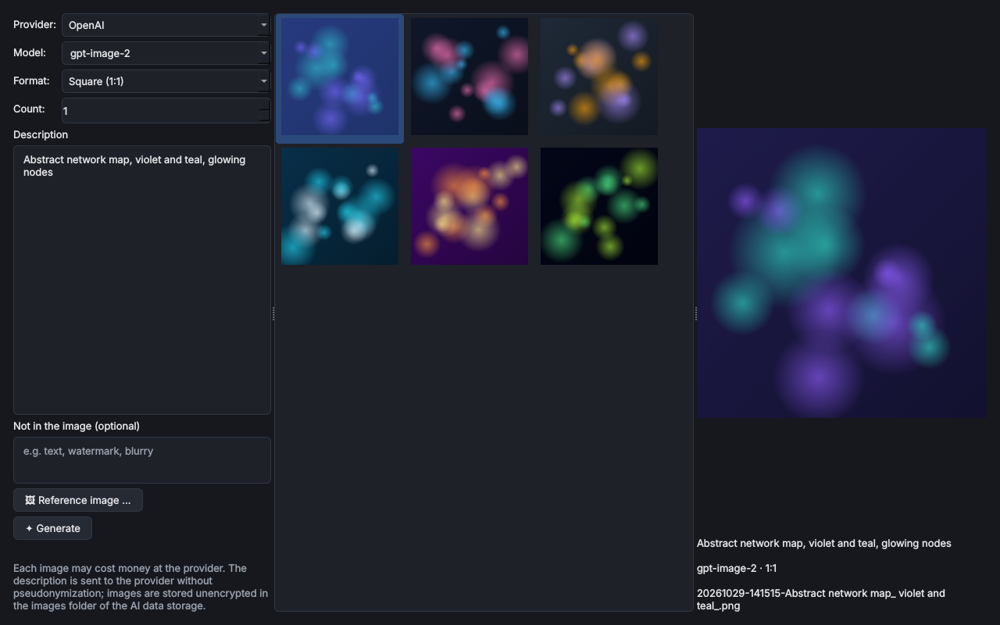

# Pixelizer – Bilder

> **Kurz:** Erzeugt Bilder mit den verbundenen Bild-Anbietern – mit Format, Anzahl, Ausschlüssen, Vorlagebild und
> einer Galerie aller erzeugten Bilder.

| | |
|---|---|
| **Tool-ID** | `ai.pixelizer` |
| **Stand der Seite** | Version 1.0.0 |
| **Bereich** | KI-Tools |
| **Tags** | KI, Bilder, OpenAI, Gemini, Flux, Stability AI |
| **Plattformen** | Windows, Linux |
| **Voraussetzungen** | ein verbundener Assistent mit Bilderzeugung |
| **Adminrechte** | nicht nötig |
| **Mindestversion OmniWrench** | 0.9.0 |
| **Quellcode** | [`tools/pixelizer`](https://github.com/KuroShiroMe/OmniWrench/tree/main/tools/pixelizer) |

## Inhalt
- [Wofür](#wofür)
- [Installation und Voraussetzungen](#installation-und-voraussetzungen)
- [Erste Schritte](#erste-schritte)
- [Funktionen im Detail](#funktionen-im-detail)
- [Einstellungen](#einstellungen)
- [Sicherheit und Datenschutz](#sicherheit-und-datenschutz)
- [Grenzen und bekannte Einschränkungen](#grenzen-und-bekannte-einschränkungen)
- [Fehlerbehebung](#fehlerbehebung)
- [Versionen](#versionen)
- [Siehe auch](#siehe-auch)

## Wofür
- Bilder für Präsentationen, Intranet-Artikel und Schulungsunterlagen erzeugen.
- Symbolbilder und Hintergründe in einem festen Format (z. B. 16:9) erstellen.
- Ein vorhandenes Bild als Vorlage nehmen und abwandeln lassen.

## Installation und Voraussetzungen
Installation über den [Store](Store-und-Tools), ohne zusätzliche Pakete. Gebraucht wird ein verbundener Anbieter,
der Bilder erzeugen kann: OpenAI, Google Gemini, xAI, Black Forest Labs, fal.ai, Replicate, Stability AI,
Ideogram, Recraft oder MiniMax (siehe [KI-Anbieter](KI-Anbieter)).

## Erste Schritte
1. Pixelizer öffnen. Vorbelegt ist der Standard-Assistent für Bilder (*Einstellungen › KI-Funktionen*).
2. Beschreibung eingeben, z. B. „Serverraum im Comic-Stil, blaues Licht“.
3. Format und Anzahl wählen, **Erzeugen** drücken.
4. Das Ergebnis erscheint in der Galerie.

## Funktionen im Detail

### Erzeugen

| Feld | Bedeutung |
|---|---|
| Anbieter, Modell | Verbundene Anbieter mit Bildfähigkeit; die Auswahl wird gemerkt |
| Format | 1:1, 16:9, 9:16, 4:3, 3:4 |
| Anzahl | Mehrere Varianten auf einmal (soweit der Anbieter das kann) |
| Beschreibung | Was das Bild zeigen soll |
| Nicht im Bild | Was vermieden werden soll |
| **Vorlagebild …** | Bild als Ausgangspunkt (bei Anbietern, die das können) |

### Galerie
Zeigt alle Bilder der KI-Datenablage. Rechtsklick: öffnen, im Ordner zeigen, kopieren, **Einstellungen
übernehmen**, **Als Vorlagebild verwenden**, **An den Chat anhängen** (hängt das Bild in [Clank](Tool-Clank) bzw. der
Chatleiste an), löschen.

Ist kein passender Anbieter verbunden, zeigt das Tool einen Hinweis mit Knopf zu den Einstellungen.

## Einstellungen
Keine eigenen Einstellungen. Der Standard-Anbieter steht in *Einstellungen › KI-Funktionen*.

## Sicherheit und Datenschutz
- **Verbindungen:** nur zum gewählten Bild-Anbieter (HTTPS).
- **Verfremdung:** Bildbeschreibungen werden **nicht** verfremdet (Hinweis im Tool) – keine vertraulichen Namen
  oder Adressen eintragen.
- **Gespeichert:** Bilder unverschlüsselt im Ordner „Images“ der KI-Datenablage.

## Grenzen und bekannte Einschränkungen
- Format, Anzahl und Vorlagebild hängen vom Anbieter ab; nicht unterstützte Felder sind ausgegraut.
- Bilderzeugung ist bei den meisten Anbietern kostenpflichtig.

## Fehlerbehebung

| Problem | Ursache / Lösung |
|---|---|
| Hinweis „kein Anbieter für Bilder“ | Anbieter mit Bildfähigkeit verbinden, dann **Erneut prüfen** |
| „nicht im Tarif“ / Abrechnung nötig | Beim Anbieter ein API-Konto mit Abrechnung einrichten; *Funktionen › Prüfen* zeigt die Voraussetzung |

## Versionen

| Version | Änderungen |
|---|---|
| 1.0.0 | Erste Version als eigenes Tool (vorher Reiter „Bilder“ in Clank 1.0.x) |

## Siehe auch
- [Clank – KI-Chat](Tool-Clank)
- [KI-Anbieter](KI-Anbieter)
- [KI-Assistenten](KI-Assistenten)
