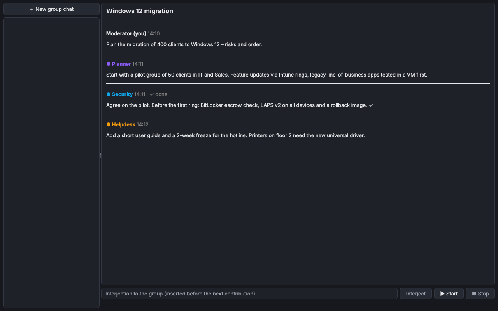

# Q-Force – Gruppenchat

> **Kurz:** Mehrere Assistenten besprechen ein Thema der Reihe nach – mit Rollen, Ablauf, Bremsen gegen
> ausufernde Kosten und einer Zusammenfassung am Ende.

| | |
|---|---|
| **Tool-ID** | `ai.qforce` |
| **Stand der Seite** | Version 1.0.0 |
| **Bereich** | KI-Tools |
| **Tags** | KI, Gruppenchat, Diskussion |
| **Plattformen** | Windows, Linux |
| **Voraussetzungen** | mindestens ein verbundener Assistent |
| **Adminrechte** | nicht nötig |
| **Mindestversion OmniWrench** | 0.9.0 |
| **Quellcode** | [`tools/qforce`](https://github.com/KuroShiroMe/OmniWrench/tree/main/tools/qforce) |

## Inhalt
- [Wofür](#wofür)
- [Installation und Voraussetzungen](#installation-und-voraussetzungen)
- [Erste Schritte](#erste-schritte)
- [Funktionen im Detail](#funktionen-im-detail)
- [Einstellungen](#einstellungen)
- [Sicherheit und Datenschutz](#sicherheit-und-datenschutz)
- [Grenzen und bekannte Einschränkungen](#grenzen-und-bekannte-einschränkungen)
- [Fehlerbehebung](#fehlerbehebung)
- [Versionen](#versionen)
- [Siehe auch](#siehe-auch)

## Wofür
- Ein Konzept aus mehreren Blickwinkeln prüfen lassen (Planer, Sicherheit, Helpdesk).
- Pro und Contra einer Entscheidung sammeln.
- Ideen sammeln und am Ende zusammenfassen lassen.

## Installation und Voraussetzungen
Installation über den [Store](Store-und-Tools), ohne zusätzliche Pakete. Mindestens ein Assistent muss verbunden
sein; derselbe Assistent kann mehrfach mit verschiedenen Rollen teilnehmen.

## Erste Schritte
1. Q-Force öffnen und mit **Teilnehmer** Teilnehmer hinzufügen (vorbelegt ist der Standard-Assistent für
   Gruppenchats).
2. Rollen eintragen (z. B. „Sicherheit“, „Betrieb“), Thema beschreiben.
3. **Starten** drücken. Die Beiträge erscheinen der Reihe nach.

## Funktionen im Detail

| Abschnitt | Einstellungen |
|---|---|
| **Teilnehmer** | Bis zu sechs: Name, Assistent, Rolle (optional, z. B. „Sicherheit“, „Pro“, „Contra“) |
| **Thema** | Worum es geht |
| **Ablauf** | Art (Diskussion, Ideensammlung, Debatte, Prüfung), Reihenfolge (fest / zufällig je Runde), Detailgrad, am Ende fasst der erste Teilnehmer zusammen |
| **Bremsen** | Runden, Beiträge insgesamt, Zeichen je Beitrag, Zeitlimit, Token-Budget, nach jeder Runde anhalten, Ende bei Einigkeit, Ende bei Wiederholung |

Während des Laufs: **Einwerfen** (kommt vor dem nächsten Beitrag), **Anhalten**, **Weiter**. Fertige
Gruppenchats lassen sich in [Clank](Tool-Clank) weiterbesprechen.

**Minutenlimits:** Kostenlose Stufen erlauben oft nur wenige Anfragen pro Minute (Gemini z. B. 5). Meldet ein
Anbieter, dass das Minutenlimit erreicht ist, wartet Q-Force die genannte Zeit (höchstens 90 Sekunden) und macht
dann weiter. Danach hält es für diesen Anbieter automatisch Abstand zwischen den Anfragen. Tageslimits, leeres
Guthaben oder „nicht im Tarif“ beenden den Lauf mit einer Meldung. Tipp: Anbieter mischen.

## Einstellungen
Keine eigenen Einstellungen; alles wird im Tool gesetzt und gemerkt. Die Verfremdung folgt dem Reiter
**KI-Zugriff** in den Einstellungen des Tools.

## Sicherheit und Datenschutz
- **Verbindungen:** zu den Anbietern der Teilnehmer (HTTPS).
- **Funktionsaufrufe:** keine – Teilnehmer können nichts lesen oder ändern.
- **Gespeichert:** Gruppenchats wie Chats in der KI-Datenablage (verschlüsselt, falls eingestellt).

## Grenzen und bekannte Einschränkungen
- Höchstens sechs Teilnehmer.
- Die Kosten wachsen mit Runden und Teilnehmern – die Bremsen begrenzen das.

## Fehlerbehebung

| Problem | Ursache / Lösung |
|---|---|
| „Limit des Anbieters erreicht“ | Kostenlose Stufe mit Minutenlimit – Q-Force wartet automatisch; bei Tageslimit später weitermachen oder Anbieter mischen |
| Teilnehmer wiederholen sich | **Ende bei Wiederholung** einschalten oder Runden verringern |

## Versionen

| Version | Änderungen |
|---|---|
| 1.0.0 | Erste Version als eigenes Tool (vorher Reiter „Gruppenchat“ in Clank 1.0.x; Einstellungen werden übernommen) |

## Siehe auch
- [Clank – KI-Chat](Tool-Clank)
- [KI-Anbieter](KI-Anbieter)
