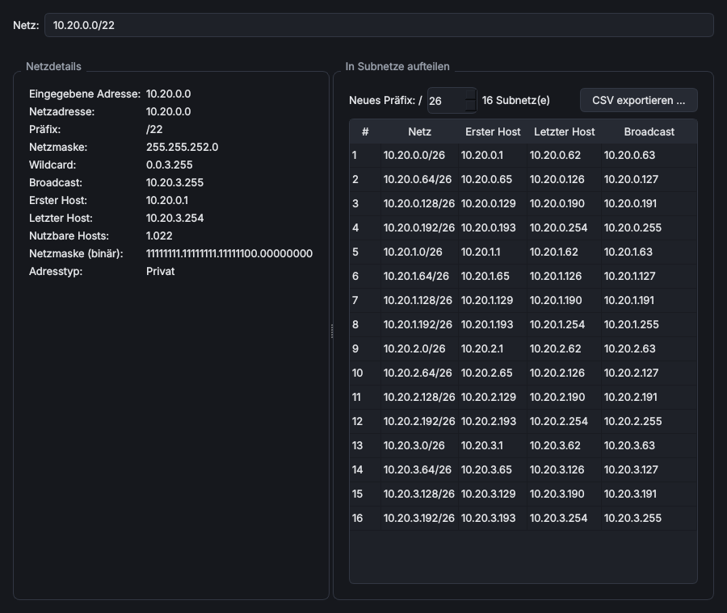

# Subnetzrechner

> **Kurz:** Berechnet zu einer IPv4- oder IPv6-Adresse mit Präfix alle Netzdaten und teilt Netze in gleich große
> Subnetze auf, mit CSV-Export.

| | |
|---|---|
| **Tool-ID** | `net.subnet-calculator` |
| **Stand der Seite** | Version 1.2.4 |
| **Bereich** | Netzwerk & Konnektivität |
| **Tags** | IPv4, IPv6, CIDR, Subnetting, Netmask, CSV |
| **Plattformen** | Windows, Linux |
| **Voraussetzungen** | keine |
| **Adminrechte** | nicht nötig |
| **Mindestversion OmniWrench** | 0.3.0 |
| **Quellcode** | [`tools/subnet_calculator`](https://github.com/KuroShiroMe/OmniWrench/tree/main/tools/subnet_calculator) |

## Inhalt
- [Wofür](#wofür)
- [Installation und Voraussetzungen](#installation-und-voraussetzungen)
- [Erste Schritte](#erste-schritte)
- [Funktionen im Detail](#funktionen-im-detail)
- [Einstellungen](#einstellungen)
- [Sicherheit und Datenschutz](#sicherheit-und-datenschutz)
- [Grenzen und bekannte Einschränkungen](#grenzen-und-bekannte-einschränkungen)
- [Fehlerbehebung](#fehlerbehebung)
- [Versionen](#versionen)

## Wofür
- Netzadresse, Broadcast, Maske und Hostbereich zu einer Adresse schnell nachschlagen
- prüfen, ob zwei Adressen im selben Netz liegen
- einen Adressbereich für Standorte, VLANs oder DHCP-Scopes in gleich große Subnetze aufteilen
- die Aufteilung als CSV an Excel oder ein IPAM-Werkzeug weitergeben

## Installation und Voraussetzungen
Keine Voraussetzungen. Installation aus dem Store ohne Rückfrage und ohne Adminrechte.

## Erste Schritte
1. Subnetzrechner öffnen. Im Feld **Netz** steht das Standard-Netz aus den Einstellungen.
2. Eine Adresse mit Präfix eingeben, z. B. `192.168.10.25/26`. Die Netzdetails erscheinen sofort.
3. Rechts unter **In Subnetze aufteilen** das **neue Präfix** wählen, z. B. `/28`. Die Tabelle zeigt alle Subnetze.
4. **CSV exportieren …** speichert die Liste.

## Funktionen im Detail

### Eingabe
Das Feld **Netz** versteht folgende Schreibweisen:

| Eingabe | Beispiel |
|---|---|
| Adresse mit Präfix (CIDR) | `192.168.10.25/26` |
| Adresse und Netzmaske | `10.0.0.1 255.255.0.0` oder `10.0.0.1/255.255.0.0` |
| IPv6 mit Präfix | `fd00::1/64` |

Die Berechnung läuft bei jeder Eingabe. Bei ungültiger Eingabe erscheint unter dem Feld „Ungültige Eingabe: …“
mit dem Grund.

### Netzdetails (IPv4)

| Feld | Bedeutung |
|---|---|
| Eingegebene Adresse | die eingegebene Adresse |
| Netzadresse, Präfix | Netz, z. B. `192.168.10.0`, `/26` |
| Netzmaske, Wildcard | z. B. `255.255.255.192` und `0.0.0.63` (für ACLs) |
| Broadcast | letzte Adresse des Netzes |
| Erster Host, Letzter Host | nutzbarer Bereich (bei /31 und /32 alle Adressen, RFC 3021) |
| Nutzbare Hosts | Anzahl, mit Tausendertrennzeichen der Sprache |
| Netzmaske (binär) | Maske in Bits, z. B. `11111111.11111111.11111111.11000000` |
| Adresstyp | Privat, Öffentlich, Loopback, Link-Local, Multicast, Reserviert |

### Netzdetails (IPv6)
Netzadresse, Präfix, erste und letzte Adresse, Anzahl der Adressen (ab /64 als Zweierpotenz, z. B. `2^64`),
komprimierte und ausgeschriebene Schreibweise sowie Adresstyp. Alle Werte lassen sich mit der Maus markieren
und kopieren.

### In Subnetze aufteilen
- **Neues Präfix:** Zahlenfeld vom aktuellen Präfix bis /32 (IPv4) bzw. /128 (IPv6).
- Die Zeile darüber nennt die Anzahl der Subnetze; bei sehr feiner Aufteilung zeigt die Tabelle nur die ersten
  „Max. angezeigte Subnetze“ (Einstellung).
- Spalten: Nr., **Netz**, **Erster Host**, **Letzter Host**, **Broadcast** (bei IPv6 „–“).

### CSV-Export
**CSV exportieren …** schreibt die angezeigten Subnetze in eine Datei. Startordner und Trennzeichen kommen aus
den Einstellungen; Semikolon passt zu Excel mit deutschen Ländereinstellungen. Die Statusleiste meldet
„n Subnetze exportiert nach …“.

### Schmale Fenster
Unter etwa 900 Pixel Breite stehen Netzdetails und Subnetz-Tabelle untereinander statt nebeneinander.

## Einstellungen

| Einstellung | Standard | Bedeutung |
|---|---|---|
| Standard-Netz beim Start | `192.168.1.0/24` | Netz, das beim Öffnen im Eingabefeld steht |
| Max. angezeigte Subnetze | 1024 | Begrenzt Tabelle und Export bei sehr feiner Aufteilung |
| Export › Export-Ordner | leer (Benutzerordner) | Startordner des CSV-Exports |
| Export › CSV-Trennzeichen | Semikolon (Excel DE) | Semikolon, Komma oder Tabulator |

## Sicherheit und Datenschutz
Rechnet nur lokal. Keine Netzwerkzugriffe, keine gespeicherten Daten außer den Einstellungen.

## Grenzen und bekannte Einschränkungen
- Teilt nur in gleich große Subnetze (kein VLSM mit unterschiedlichen Größen).
- Tabelle und Export enthalten höchstens „Max. angezeigte Subnetze“ Einträge.

## Fehlerbehebung

| Problem | Ursache / Lösung |
|---|---|
| „Ungültige Eingabe“ | Schreibweise prüfen; Maske muss zusammenhängend sein (z. B. `255.255.255.0`, nicht `255.0.255.0`) |
| Tabelle zeigt nicht alle Subnetze | Einstellung „Max. angezeigte Subnetze“ erhöhen |
| Excel zeigt alles in einer Spalte | Trennzeichen auf Semikolon (deutsch) bzw. Komma (englisch) stellen |

## Versionen

| Version | Änderungen |
|---|---|
| 1.2.4 | läuft auch unter Linux |
| 1.2.3 | Bereich und Tags neu |
| 1.2.1 | schmale Fenster: Bereiche untereinander |
| 1.0.0 | erste Version |

## Siehe auch
- [NetProbe](Tool-NetProbe) zum Scannen eines Netzes
- [MS DHCP Extended Management](Tool-MS-DHCP-Extended-Management) zum Anlegen von Scopes
